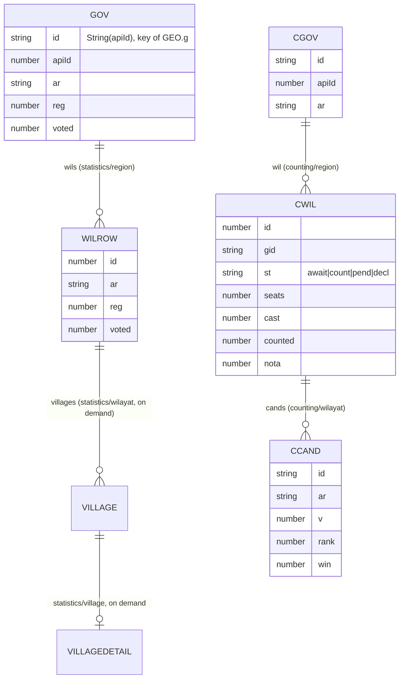

# CLAUDE.md: Municipal Council Live (Angular)

Reflects the end of the "smooth & modern" plan (Phase 7 wrap-up, 2026-11-01; section 23 has the history). Statements marked "⚠️ UNVERIFIED" could not be confirmed from the repo.

---

## 1. Project Overview

**What it is.** A browser-only Angular 22 single-page app that shows the live results of Oman's 2026 municipal council elections ("انتخابات المجالس البلدية 2026"). It was ported from a Claude Design export; the port is complete and the original export, comparison harness and port docs were removed.

**Who uses it.** Viewers of a public dashboard and wall screens (kiosk / TV). The UI is **Arabic only, RTL** (`src/index.html` has `lang="ar" dir="rtl"`; there is no language switch). The data comes from the Ministry's election API (`https://stgapp2.moi.gov.om/eleres26/PublicApi/API/v1634`, see section 8).

**Screens (the whole product):**

| Screen              | Shown when                                                                                                                                                                                                                                                                                | Code                                                                       |
| ------------------- | ------------------------------------------------------------------------------------------------------------------------------------------------------------------------------------------------------------------------------------------------------------------------------------- | -------------------------------------------------------------------------- |
| Countdown           | `ServerClock.phase()` is `before` (voting has not started, gVS in the future)                                                                                                                                                                                                         | `src/app/features/countdown/` (deferred chunk)                             |
| Live Command Center | phase `live` and the first `statistics/overall` answer has arrived; `ScreenState.screen()` is `dashboard`                                                                                                                                                                             | `src/app/features/command-center/`                                         |
| TV mode             | header TV button (`button.tvb`) → `ScreenState.show('tv')`, or `?screen=tv`; intermediate-results tab and clickable map on governorate slides while a window is open; on a phone the story player (`flow/`, RESP 5.3)                                                                 | `src/app/features/tv/` (deferred chunks: the stage's, the phone's)         |
| Detail pages        | on the dashboard: the drawer's «التفاصيل الكاملة», a Wilayat-tab row's ↗, «تفاصيل القرية», or `?gov=&wil=&vil=` in the address                                                                                                                                                        | `src/app/features/command-center/detail/` (deferred chunk)                 |
| Counting TV wall    | second TV button (`button.ctvb`), `?screen=wall`, or automatically from vCS (`ServerClock.counting()`); on a phone the live count to explore (`flow/`, RESP 6.3)                                                                                                                      | `src/app/features/count-wall/` (deferred chunks: the stage's, the phone's) |
| Winners screen      | crown button (`button.wnb`), `?screen=winners[&region=<id>]`, or automatically from the wall once its region is all published (a governorate: on it; Oman: the list); the final winners per governorate from vCS on (`result/get/winner`); on a phone the stories (`flow/`, RESP 7.2) | `src/app/features/winners/` (deferred chunks: the stage's, the phone's)    |
| Candidate accept    | the SMS link of a tie's notification round: path `home/wilayatCandidatAccept?id=&&caid=&&ccid=&&nid=&&sec=` (`main.ts` bootstraps it in place of `App`); phone first                                                                                                                  | `src/app/features/accept/` (own chunk, the whole app on that path)         |
| Draw screen         | «شاهد القرعة» on the wall's race panel (that wilayat, its draw played), `?screen=draw[&wil=<id>]`, or its list of ties; every tie at the last seat and the draw's toss; on a phone cards and a full-screen reveal (`draw/flow/`, RESP 6.4)                                            | `src/app/features/count-wall/draw/` (deferred chunks)                      |

Exactly one screen is on view (`core/screen/screen.state.ts`, Phase 2); they are siblings in one frame (`features/screens/`).

**Scope limits (from the previous CLAUDE.md, still true in code):** the `.cc-pulse` card shows Oman's voters by gender since 2026-11-10 (`pulse/`; the hero's `.bb` slot holds the vote visual since 2026-11-06, `hero/ballot/`); the Oman map is 3D only; live insights has the Gender, Leading-wilayat and Age slides, in that order (`SLIDES` in `insights.component.ts`).

**Domains:** turnout statistics (governorate → wilayat → village), vote counting (governorate → wilayat → candidates, seats), the server clock / election schedule, and presentation (map, TV slides, count wall).

**Status.** The architecture refactor (phases 0–12) and the style restructuring (phases 0–6) are finished (git history). The migration plan "smooth & modern" (written and amended by the audit 2026-10-29, then trimmed to code architecture only) is **finished** (2026-11-01, phases 0–7: test safety net and measurement; Angular 22, zoneless, store tests; one screen on view, screens frame, region choice; data, services, calculations and resilience; rendering, DOM and animation; style architecture (cascade layers, tokens and scales, logical RTL, scoping lint); accessibility and Arabic; endurance (2 h soaks flat on every screen), Screen Wake Lock, perf budgets re-based on mains). Its documents (`docs/refactor/`: PLAN, PROGRESS with the final metrics and what stayed open, AUDIT, BEHAVIOUR) were removed on 2026-11-01 and live in git history at `746c96e`; code comments citing `PLAN x.y`, `Dn` or audit IDs (`X-4`, `S1`…) refer to them. **Plan "detail pages" finished** (2026-11-04; its documents `docs/details/` (PLAN, phases 0–5, PROGRESS with the final metrics and handoff) were removed on 2026-11-12 and live in git history at `ffe9a51`; foundation, chart kit, governorate, wilayat and village pages, transitions, polish and proof): full governorate, wilayat and village pages for the voting dashboard (age by gender, the governorate SVG as a highlighted card, `DetailState` + query-parameter URLs, no router); TV, the wall and counting untouched; its steps are cited `DET x.y`, its decisions `DD-n`. **Current plan: "responsive everywhere"** (`docs/responsive/PLAN.md`, phases 0–9 in `docs/responsive/phases/`, reviewed and brought up to date 2026-11-06, feature checklist `FEATURES.md`, status in `PROGRESS.md`; not started): every screen on every display and input (TV, laptop, tablet, phone, portrait signage) through two forms per screen (`stage`: the scaled 1920 × 1080 composition; `flow`: native layouts) chosen by space, tiers by container queries, tokens with modes, and full feature parity of TV and the wall on phones; its steps are cited `RESP x.y`, its decisions `RD-n`. `npm run check` passes (2026-11-01: 220 vitest + 36 `ng test` tests); `npm run test:e2e` 66 tests, all pass; `npm run perf` 15/15; `npm run test:tv-layout` green against its known list. No CI, no Docker, no deployment config exist in the repo.

---

## 2. Tech Stack

Versions are the ranges in `package.json`; installed versions are in `package-lock.json`.

| Area       | Item                                                                                                                                                       | Version              | Purpose                                                                                                                                     |
| ---------- | ---------------------------------------------------------------------------------------------------------------------------------------------------------- | -------------------- | ------------------------------------------------------------------------------------------------------------------------------------------- |
| Language   | TypeScript                                                                                                                                                 | `~6.0.3`             | strict, `noPropertyAccessFromIndexSignature`, `noUncheckedIndexedAccess`, `exactOptionalPropertyTypes`, `isolatedModules` (`tsconfig.json`) |
| Framework  | `@angular/core`, `common`, `compiler`, `platform-browser`                                                                                                  | `^22.2.4`            | zoneless change detection, signals, `@defer`, `animate.enter/leave`                                                                         |
| Build      | `@angular/build` (`application` builder)                                                                                                                   | `^22.2.5`            | build + dev server (`angular.json`)                                                                                                         |
| CLI        | `@angular/cli`, `@angular/compiler-cli`                                                                                                                    | `^22.2.5`, `^22.2.4` | `ng`                                                                                                                                        |
| Reactive   | `rxjs`                                                                                                                                                     | `~7.8.0`             | only typed event `Subject`s in the stores and `takeUntilDestroyed`                                                                          |
| Runtime    | `tslib`                                                                                                                                                    | `^2.3.0`             | `importHelpers`                                                                                                                             |
| Unit tests | `vitest`                                                                                                                                                   | `^4.1.12`            | `vitest.config.mts` (Node, pure tests); `ng test` (`@angular/build:unit-test`, jsdom `^30.1.3`, TestBed)                                    |
| E2E / perf | `@playwright/test`                                                                                                                                         | `^1.64.1`            | Chromium only                                                                                                                               |
| Lint       | `eslint` `^9.39.5`, `typescript-eslint` `^8.72.0`, `angular-eslint` `~22.6.0`; `stylelint` `^17.16.0` + `stylelint-config-standard-scss` `^17.0.0`         |                      | `eslint.config.js`                                                                                                                          |
| Format     | `prettier`                                                                                                                                                 | `^3.9.10`            | config inside `package.json`                                                                                                                |
| Fonts      | IBM Plex Sans Arabic (weights 400–700; 800 falls back to 700)                                                                                              | self-hosted `woff2`  | `public/fonts` (one per weight, made by `tools/build-fonts.mjs` from the `.ttf` in `tools/fonts`; OFL licence), `src/styles/_fonts.scss`    |
| Styling    | SCSS + CSS custom properties                                                                                                                               |                      | no UI kit, no CSS reset                                                                                                                     |
| Node       | 22.22.3+ or 24.15+ required by Angular 22 (⚠️ UNVERIFIED in repo: no `engines` field, no `.nvmrc`; the machine that produced this file runs Node v24.22.0) |                      |                                                                                                                                             |

Not used (checked): `@angular/router` (removed in phase 11), `@angular/animations`, `HttpClient`, `@angular/forms`, any state library, any UI kit, any backend of its own.

---

## 3. Quick Start Commands

```bash
npm install                    # package-lock.json is the lock file
npm start                      # ng serve, configuration "local" → mock API, http://localhost:4200
npm run start:staging          # ng serve --configuration staging → real staging API
npm run start:local            # ng serve --configuration local → mock API at http://localhost:4300/api
npm run build                  # ng build (local mock API); use -- --configuration production for a production build
npm run watch                  # ng build --watch --configuration development
npm run test:parity            # vitest run: ALL pure tests under tests/ (unit + parity), despite the name
npm run test:angular           # ng test: stores and clock under TestBed in jsdom (tests/angular/*.spec.ts)
npx vitest run tests/unit/poll.test.ts    # one test file
npx vitest run -t "Poll"                  # tests whose name matches
npm run lint                   # eslint .
npm run lint:css               # stylelint src/**/*.scss (standard-scss less layout rules; no !important, no hex, no named colours outside the allowed places; no [dir], no physical sides)
npm run lint:apis              # no browser API newer than Chromium 111 in dist/ (tools/check-browser-apis.mjs; run after ng build)
npm run lint:chunks            # the per-form chunk map: what each form and screen fetches before the first figure and in the 10 s after, with budgets (tools/chunk-map.mjs; after ng build --stats-json)
npm run lint:build             # the kit page (`?kit`, dev only) is absent from the production build (tools/check-build.mjs; after ng build --stats-json)
npm run lint:contrast          # every text/background token pair in both themes ≥ 4.5:1 (text) / 3:1 (large, UI) (tools/styles/contrast.mjs)
npm run lint:lines             # 400-line limit for every .ts/.html/.scss/.mjs/.js (tools/styles/max-lines.mjs; no exceptions left since Phase 4.9)
npm run format:check           # prettier --check .
npx prettier --write <file>    # format a file (not Angular .html templates, see Rules)
npm run check                  # ng build --stats-json && npm run lint:apis && npm run lint:chunks && npm run lint:build && vitest run && ng test && eslint . && npm run lint:css && npm run lint:contrast && npm run lint:lines && prettier --check .   ← run before finishing
http://localhost:4200/?kit     # the small-screen kit's page (RESP 2.9; `local` configuration only: kit-entry.local.ts): every part on flow, the type specimen
npm run test:e2e               # Playwright: smoke, count panels, faults, timeline, behaviour (needs the mock API, see section 15; about 8 min)
npx playwright test tests/e2e/smoke.spec.ts -g "TV mode"   # one e2e test
npm run perf                   # 6 perf scenarios at 1× and 4× CPU with budgets (run on mains power)
npx playwright test -c playwright.perf.config.ts tests/e2e/animations.perf.ts   # animation-count gate only (PLAN 4.12; also part of npm run perf)
npm run perf -- -g "soak-2h dashboard"   # soak run (also tv (pinned on Dhofar), wall); SOAK_MINUTES / SOAK_EVERY shorten it; never part of the default run
MOCK_API_URL=http://localhost:4301 npm run perf -- -g "soak-2h wall" --output=test-results/soak-wall-run   # side by side: each run its own mock copy (PORT=4301 node server.mjs in a copied folder) and output
npm run test:visual            # style parity: replays tests/visual/.data snapshots with baseline vs current CSS (computed styles + pixels; desktop also in forced colours and prefers-contrast: more)
npm run test:visual:capture    # record the snapshots (baseline commit only; see docs/responsive/PLAN.md "How it is proven")
npm run test:tv-layout         # TV layout probe (overlaps, clipped text, overscan)
TIER=smoke npx playwright test -c playwright.devices.config.ts   # device matrix (RESP 0.2): 42 sizes + WebKit, tiers step | smoke | full | webkit | release; own mock on :4301
TIER=step SIZES=phone,tablet STATES=dash,dt- npx playwright test -c playwright.devices.config.ts   # one size class, some states (catalogue names in tests/states)
TIER=release GALLERY=resp-0 npx playwright test -c playwright.devices.config.ts   # every size and state, a PNG each under tests/visual/.data/shots/<name>/ (about 40 min)
TIER=release UPDATE_KNOWN=1 npx playwright test -c playwright.devices.config.ts && node tools/responsive-known.mjs   # re-record the responsive probe's known list
npx playwright test -c playwright.visual.config.ts --project=lists   # RD-21: how much of TV's results list and the wall's ranked rest shows before they scroll
npx playwright test -c playwright.perf.config.ts tests/e2e/phone.perf.ts   # phone at 4x CPU + Slow 4G on the built files (tools/serve-dist.mjs, :4202): vitals, INP, requests, bytes
npx playwright test -c playwright.visual.config.ts --project=census   # class census: tag/classes/ancestors/attributes of every element in the dynamic states → tests/visual/.data/census.json (about 10 min)
git worktree add <dir> HEAD && node tools/styles/layer-eq.mjs <dir> .   # cascade proof for a layer or !important change against HEAD (exit 0: no winner changes on any element the evidence knows)
node tools/styles/layer-eq.mjs <dir> . --fold   # the same for folding rules and logical sides (PLAN 5.3): dead declarations dropped, sides resolved by each element's direction
node tools/styles/token-eq.mjs <dir> .          # token proof (PLAN 5.2): compiled sheets equal once constant tokens are resolved, every theme token unchanged
node tools/styles/snap-edit.mjs <edits.mjs> tests/visual/.data/snaps <out> && BASE_SNAPS=$PWD/tests/visual/.data/snaps SNAPS_DIR=<out> npm run test:visual   # a DOM change (class rename, style → class) proven on the stored snapshots (edits in tools/styles/edits/)
PERF_HEADED=1 npm run perf     # real window, GPU, display refresh rate
node tools/build-geo.mjs <combined.geojson> [--tol 0.3] [--check]   # regenerate src/app/domain/geo/geo.data.ts
node tools/geo-check.mjs [--src <combined.geojson>]   # wilayat point check page → test-results/geo-check/index.html: the map's SVG with every point, the list by governorate (id, name, map units, lat/lon, OpenStreetMap link), ticks, CSV export; --src also checks in the terminal that every stored point is the file's point projected
node tests/visual/mockups/resp-4/run.mjs [filter]   # RESP 4.1's phone mockups (static HTML on the app's tokens; figures from the app's code over the saved mock answers in answers/) → tests/visual/.data/shots/resp-4-design/*.png + index.html
tools/run-plan.sh              # ran the detail-pages plan unattended (its docs are gone since 2026-11-12, so it has nothing left to run): one headless `claude -p` per phase, waits out usage limits (15 min), stops on the guard, a failing check or no progress; logs in test-results/plan-logs/
```

There is no migrate, seed, Docker or Makefile command: no database, no container files, no Makefile exist.

---

## 4. Directory Structure

```
.
├── CLAUDE.md                     this file
├── README.md                     one-line title only
├── package.json / package-lock.json
├── angular.json                  build/serve targets and configurations (production, development, local, staging, perf)
├── tsconfig.json / tsconfig.app.json
├── eslint.config.js              flat config, every rule an error
├── stylelint.config.mjs          SCSS lint: standard-scss (blank-line rules off: Prettier's; :not() notation off: it changes weight; -webkit-mask kept for Chromium 111) + declaration-no-important, color-no-hex, color-named, the RTL bans, kebab-case classes, specificity ≤ 0,4,2 (marked state rules above it), and two local rules in tools/stylelint/: scale-tokens (no literal spacing, font size, radius, z-index or duration) and class-scope (every selector anchored by a class of its feature)
├── playwright.config.ts          e2e: starts mock API + `ng serve --configuration local --port 4200`
├── playwright.perf.config.ts     perf: mock API + `ng serve --configuration perf --port 4201`
├── vitest.config.mts             include tests/**/*.test.ts, environment node (the Angular tests run through `ng test`, tsconfig.spec.json)
├── .editorconfig  .gitignore  .prettierignore
├── .browserslistrc              build targets: Angular 20's default written out (contains D1: wall laptops, public TVs on Chromium ≥ 111; kept below Angular 22's own list on purpose, `ng build` notes it, `lint:apis` guards it); feature rules in docs/responsive/PLAN.md "Browser target"
├── .claude/skills/refactor-phase/SKILL.md   `/refactor-phase`: runs the next phase of the active plan (docs/responsive/; the detail pages plan is finished, its docs in git history at `ffe9a51`)
├── docs/responsive/              PLAN.md (method, rules, definition of done, browser target, proof, decisions RD-n, phases 0–9, out of scope), phases/, FEATURES.md (feature parity checklist per screen and form), PROGRESS.md (status, metrics, handoff)
├── public/                       copied to the site root: favicon.png (the logo mark, 64 px), assets/logos/*.png (4: the election logo and the Ministry of Interior emblem, a night and a day version each), assets/gender/male.png + female.png (the man's and the woman's bust, 256 px, alpha: the only figures for the sexes, painted through a mask by `shared/ui/glyph`), assets/logos/*-h64|h128|h256.png (the logos' sized copies for flow, tools/build-logos.mjs), assets/winners/stage-night.avif (the winners stage's picture, 122 kB), fonts/*.woff2 (IBM Plex Sans Arabic 400–700, 70–74 kB each, and the OFL licence); no candidate portraits (CDN later)
├── src/
│   ├── index.html                lang=ar dir=rtl data-theme=night, preloads one font file (700, 71 kB), <app-root>
│   ├── main.ts                   bootstrapApplication(App, appConfig)
│   ├── styles.scss               the cascade layers (tokens, base, app, motion, states) and the partials of src/styles/* in each
│   ├── assets/i18n/ar.json       131 interface strings; ballot-ar.json: the hero's vote visual's strings (its chunk; `hero/ballot/ballot-strings.ts` `bt`); winners-ar.json: the winners screen's strings (its chunk; `winners/winners-strings.ts` `wt`, `wn-t.pipe.ts`); tv-ar.json: 39 strings only TV and the candidates board use (lazy chunks; `shared/ui/tv-strings.ts`, `tv-t.pipe.ts`); detail-ar.json: the detail pages' strings (their chunk; `detail/detail-strings.ts`, `dt-t.pipe.ts`); flow-ar.json and flow-page-ar.json: the phone feed's and the phone detail pages' strings (their chunks; `flow/flow-strings.ts` `fl`, `flow/page/page-strings.ts` `fp`); winners-flow-ar.json: the phone winners' strings (`winners/flow/wf-strings.ts` `wf`, `wf-t.pipe.ts`, falling back to `wt`); count-flow-ar.json: the phone count's and draw's strings (`count-wall/flow/cf-strings.ts` `cf`, `cf-t.pipe.ts`, falling back to `ct`)
│   ├── styles/                   _tokens (palette, themes, prefers-contrast, TV safe areas), _scales (Sass: spacing, type, radius, z-index, duration; no output), _mixins (no output), _fonts, _base, _controls, _overlays, _reduced-motion, _arabic-fit, _forced-colors,
│   │                             components/ (21 partials), screens/ (_command-center, _drawer, _drawer-night; flow's page scroll lives in `_command-center.scss` on `[data-form='flow']`: html and body `height: auto`, body `overflow: clip visible` so sticky parts stick; the old stack `_fluid.scss` was removed by RESP 4.13)
│   └── app/
│       ├── app.ts                root component: countdown or the screens (app-screens)
│       ├── app.config.ts         provideBrowserGlobalErrorListeners (zoneless: Angular's default, no zone.js)
│       ├── core/                 app-wide services, no UI
│       │   ├── api/              api-client.ts, endpoints.ts, envelope.ts, api-base.ts (staging), api-base.local.ts (mock)
│       │   ├── log/              log.ts (the one logger, `log.once`, `guard`), error-handler.ts (OnceErrorHandler: each uncaught error once)
│       │   ├── poll/             poll-scheduler.ts (Poll, PollScheduler)
│       │   ├── clock/            server-clock.service.ts (ServerClock)
│       │   ├── screen/           screen.state.ts (ScreenState, SCREEN_FRAME), screen-prefs.ts (region, rotation, ?screen= parser with &wil=; pure), nav-history.ts + nav-history.model.ts (NavHistory: the history coordinator; pure model), wake-lock.ts (WakeKeeper; pure),
│       │   │                     layout.model.ts (the layout engine: forms, tiers, dead band; pure), viewport.state.ts (ViewportState: the viewport and input, read once a frame);
│       │   │                     history owners `detail | sheet | screen | level` (`level`: a level inside a screen on flow, RESP 6.3)
│       │   └── i18n/             i18n.ts (t, tParts), count-strings.ts (ct, count wall strings)
│       ├── domain/               pure TypeScript, no Angular, no rxjs
│       │   ├── stats/            stats.ts (API shapes + mappers), turnout.ts, gov-index.ts, diff.ts
│       │   ├── count/            count.ts (model), reduce.ts, steps.ts, diff.ts, count-index.ts
│       │   ├── interim/          interim.ts (intermediate results while voting: API shape, model, who leads, the window phase, countdown text)
│       │   ├── winners/          winners.ts (final winners: API shape of result/get/winner, model, largest photo, announced count)
│       │   ├── conflict/         conflict.ts (a tie at the last seat and its draw: API shape of conflict/get/info, the draw's winners, counting's drawn order, the toss steps)
│       │   ├── geo/              geo.data.ts (GENERATED), projection.ts, label-layout.ts
│       │   ├── validate/         answers.ts (every API answer checked at the boundary), figure.ts (num, wholeId), text.ts (cleanText)
│       │   ├── same.ts           structural sharing helpers (kept, keptList)
│       │   ├── geo/shapes.ts     rings of GEO path data: pathRings, insideRings, randomIn, boundsOf (map + count stage)
│       │   └── format.ts         fmt, pct / pctNum / pctOf / pts / sharePct (2 decimals, cut), clockStr, esc, name
│       ├── data/                 signal stores: turnout.store.ts, count.store.ts, ticker.store.ts, interim.store.ts, winners.store.ts, conflict.store.ts
│       ├── features/
│       │   ├── screens/          screens.component (app-screens: the frame; dashboard, TV and wall side by side), screen-updates.ts (ScreenUpdates),
│       │   │                     screen-chunks.ts (TV / wall chunk + font prefetch), recover.directive.ts (@error → reload into the screen)
│       │   ├── command-center/   screen + state; header/ hero/ kpis/ map/ rail/ drawer/ insights/ podium/ ticker/
│       │   ├── tv/               tv.component, tv-geometry.ts, tv-slide.model.ts, tv.view.ts, tv-memo.ts, tv.scss, tv-slides.scss, slide/ (9 parts),
│       │   │                     flow/ (the phone's story player: tv-flow.component + tvf-player, tvf-* parts, tv-flow.model.ts (pure), tv-flow.scss + styles/)
│       │   ├── count-wall/       count-wall.component (+ .html; playback), count-wall-shell, count-wall-state, count-wall.model (walk timings, reveal),
│       │   │                     flow/ (the count on a phone: count-flow.component (div[countFlow]), count.view.ts, count-flow.model.ts (pure), cf-* parts, cf-walk, count-flow.scss + styles/),
│       │   │                     wall-screens, wall-faces, wall-live, wall-playback, wall-input, event-pacer, count-wall.scss,
│       │   │                     panels/ (banner, national, governorate, wilayat…), stage/ (count-stage + stage-camera, stage-context,
│       │   │                     stage-national, stage-governorate, stage-markup: imperative SVG), draw/ (the draw screen: draw.component (div.cxd-root),
│       │   │                     draw-stage, draw-screen (DrawScreen) and draw-toss (DrawToss): the logic both forms extend, draw-focus (DrawFocus), draw.model.ts (pure),
│       │   │                     draw.scss + styles/; loads the wall's sheets; flow/: the phone's draw-flow (div[drawFlow]) and draw-reveal (section[cfdReveal]))
│       │   ├── accept/           accept.component (app-root on the SMS link's path: the candidate's accept page), accept-avatar, accept-tie,
│       │   │                     accept-steps, accept-glyph, accept-strings + ca-t.pipe (src/assets/i18n/accept-ar.json), accept.scss + styles/ (prefix ca)
│       │   ├── winners/          winners.component (div.wn-root: shell, walk, keys), winners-picker (governorates + map of Oman), winners-region (wilayat rail,
│       │   │                     stage host), winners-stage, winner-card, winners.model.ts (pure), winners.view.ts (WinnersView: the figures both shells show),
│       │   │                     winners.scss + styles/ (its own sheet, in the deferred chunk), flow/ (the phone's stories: winners-flow.component (div[winnersFlow]),
│       │   │                     wf-pick, wf-card, wf-wils, wf-share, winners-flow.model.ts (pure), winners-flow.scss + styles/)
│       │   └── countdown/        countdown.component.ts, countdown.scss (its own sheet, in the deferred chunk)
│       └── shared/
│           ├── motion/           frame-loop.service, update-gate (on view / hold / resume), tween, easing, count-up.directive, odometer, incense, pointer-tracker,
│           │                     pointer.directive, reduced-motion, restart-animation, slide-clock, boot
│           └── ui/               gauge, seg, kpi-tile, icon (+ sprite), band-legend, ambient, horizon, lattice, glyph, confetti,
│                                 toast.service (FxService), format.pipes, t.pipe, tv-prefs, marks, ornament, brand, uid,
│                                 race-board (candidates board: component, model, scss), race-avatar,
│                                 the small-screen kit (RESP 2.7, 2.9; each its own sheet, a pure model, vitest in tests/unit/kit.test.ts): sheet/ (dialog[mjSheet],
│                                 detents: sheet-detent.model, sheet-drag), appbar/ (div[mjAppbar], collapsing header), story/ (section[mjStory]), snaprow/
│                                 (div[mjSnapRow] + [mjSnapItem]), split/ (div[mjSplit]), summary/ (article[mjSummary]); kit/ (the dev-only page, `?kit`)
├── tests/
│   ├── unit/                     41 vitest files (pure logic)
│   ├── parity/                   2 vitest files + legacy-count.ts (frozen reference model)
│   ├── angular/                  `ng test` specs: server-clock, turnout-store (+ TickerStore), count-store; harness.ts (fake ApiClient, fake timers)
│   ├── e2e/                      smoke.spec.ts, count-panels.spec.ts, scenarios.perf.ts, phone.perf.ts, app.ts (selectors), mock-api.ts, touch.ts (tap, swipe, hold, rotate, resizeTo, back, remote)
│   ├── states/                   the state catalogue (RESP 0.1): every screen and state entered from a fresh page, answers in the page (api.ts, voting.ts, count.ts, states.ts: MATRIX)
│   └── devices/                  matrix.spec.ts: the device matrix's walk (probe, focus walk, axe, gallery); config playwright.devices.config.ts
└── tools/                        build-geo.mjs (geo.data.ts generator; its frame/id tables, geometry and topology in geo/); stylelint/ (scale-tokens, class-scope, breakpoints: local stylelint rules); eslint/ (no-layout-in-effect: the measurement rule); chunk-map.mjs (the per-form chunk map); styles/ (style proofs and checks: layer-eq + evidence + templates (cascade-layer proof; `--fold` with fold.mjs for the RTL fold), token-eq (token proof), snap-edit + edits/ (a planned DOM change applied to the visual snapshots), metrics, squash, cascade-eq, dead, max-lines, tv-layout-summary)
```

Local, untracked, generated: `node_modules/`, `.angular/` (build cache), `dist/` (build output from `ng build`), `test-results/` and `playwright-report/` (Playwright). All are git-ignored.

---

## 5. Architecture

**Style.** A client-only, layered SPA. No router (one screen, every path shows it), no backend in this repo. Layering is enforced by ESLint `no-restricted-imports` per folder (`eslint.config.js` `layer()`, since Phase 0.12; also TV may not import the wall or command center, the wall not TV's components or the command center). Before that a grep of imports (2026-10-27) found no `domain/` file importing Angular, rxjs, `core/`, `data/`, `features/` or `shared/`; no `core/` file importing `data/`, `features/` or `shared/`; no `data/` file importing `features/` or `shared/`; no `shared/` file importing `data/` or `features/`.

**Layers (who may import whom):**

| Layer       | Responsibility                                                                                    | May import                                                                                        |
| ----------- | ------------------------------------------------------------------------------------------------- | ------------------------------------------------------------------------------------------------- |
| `domain/`   | API shapes, pure mappers, immutable reducers, diffs into typed events, geo projection, formatting | `domain/` only                                                                                    |
| `core/`     | fetch client, poll scheduler, server clock, i18n                                                  | `domain/` (for endpoint payload types), Angular                                                   |
| `data/`     | signal stores: poll → reduce → publish snapshot → emit events                                     | `core/`, `domain/`, rxjs                                                                          |
| `shared/`   | reusable UI and motion (no screen knowledge)                                                      | `core/i18n`, `domain/`, `shared/`                                                                 |
| `features/` | screens, per-screen state                                                                         | everything below; `screens` imports `command-center`, `tv` and `count-wall` (the `@defer` blocks) |

```mermaid
flowchart LR
  subgraph Browser["Browser (Angular 22 SPA)"]
    App[App root] --> Clock[ServerClock]
    App --> Frame0[Screens frame]
    Frame0 -->|@if built| CC[Command Center]
    Frame0 -->|@defer when screen = tv| TV[TV mode chunk]
    Frame0 -->|@defer when screen = wall| Wall[Count wall chunk]
    Screen[ScreenState] --- Frame0
    Clock --> Poll1[Poll 10 s]
    TStore[TurnoutStore] --> Poll2[Poll 10 s]
    CStore[CountStore] --> Poll3[Poll 10 s]
    TStore --> Dom[domain/ mappers + diff]
    CStore --> Dom
    CC --> TStore
    TV --> TStore
    Wall --> CStore
    Frame[FrameLoop: the only rAF] --- CC
    Frame --- Wall
  end
  API[(Election API v1634, GET only)]
  Mock[(Local mock API :4300)]
  Poll1 --> API
  Poll2 --> API
  Poll3 --> API
  Poll1 -.local build.-> Mock
```

**Flow 1: start-up.**

```mermaid
sequenceDiagram
  participant A as App
  participant SC as ServerClock
  participant API as election/detail
  participant TS as TurnoutStore
  participant CCm as CommandCenter
  A->>SC: constructed (starts Poll, every 10 s)
  SC->>API: GET election/detail
  API-->>SC: gVS, gVF, vCS, sT, iRF, iRT
  SC->>SC: offset = sT + 500 − mid(round trip); phase = before | live
  alt phase before
    A->>A: render app-countdown (tick per second)
  else phase live
    A->>TS: effect → start()
    TS->>API: GET statistics/overall, then statistics/region/{id} per governorate
    TS->>TS: buildGovs, ready = true
    A->>CCm: @if stats.ready() → create the screens frame; the command center once ScreenState shows the dashboard
    A->>A: ScreenState: if clock.counting() → show('wall') once (TV closes)
  end
```

**Flow 2: a statistics poll becomes UI updates.**

```mermaid
sequenceDiagram
  participant P as Poll (timer)
  participant TS as TurnoutStore
  participant D as domain/stats/diff
  participant UI as map, rail, podium, insights, drawer, header
  participant TK as TickerStore
  P->>TS: pull(signal)
  TS->>TS: publish(): buildGovs → _govs.set(new snapshot)
  TS->>D: diffStats(prev, next)
  D-->>TS: change / cross / milestone / pull events
  TS-->>UI: events Subject (signals already updated)
  TS-->>TK: cross / pull / complete → new Tick
  UI->>UI: set signals or write DOM; Angular re-renders OnPush views reading signals
```

**Flow 3: count poll on the wall.** `CountWallComponent` calls `CountStore.start()` when it opens → `counting/overall` → `counting/region/{id}` for each governorate (`regionStep`, events A) → `counting/wilayat/{id}` for changed wilayat, focused governorate first, at most `DETAIL_MAX = 16` per poll, all on the first poll (`detailStep`, events B) → `events.next({type:'poll', events, complete})` → `EventPacer.deliver` spreads the events over the interval (at most 420 ms apart) → panels/banner/stage update.

**Module dependency map:**

```
App ──> ServerClock, TurnoutStore, Screens, Countdown, IconSprite
Screens ──> ScreenState, CommandCenterState and DetailState (provided on the frame), CommandCenter, TvComponent, CountWallComponent
DetailState ──> GEO, detail-url (pure); `move` set by the page (view-move.ts)
DetailPage ──> DetailState, DetailHold (FrameLoop, ScreenUpdates, CommandCenterState, SCREEN_FRAME), TurnoutStore, ScreenState, gov/wil/vil pages, charts/
ScreenState ──> ServerClock, screen-prefs, GEO (governorate ids)
CommandCenter ──> CommandCenterState, ScreenState, TurnoutStore, TickerStore, FxService, header/hero/kpis/rail/map/insights/podium/ticker/drawer
TvComponent ──> ScreenState, TurnoutStore, InterimStore, tv-slide.model, tv-interim.model, tv-geometry, SlideClock, tv-prefs
CountWallComponent ──> ScreenState, CountStore, EventPacer, CountStage, CountWallShell, panels/*, SlideClock, tv-prefs
TurnoutStore ──> ApiClient, ServerClock, PollScheduler, domain/stats/*
CountStore ──> ApiClient, PollScheduler, domain/count/*
TickerStore ──> TurnoutStore
ServerClock ──> ApiClient, PollScheduler
```

---

## 6. Modules / Features

### core/api: `ApiClient`, `endpoints`, `envelope`

- `ApiClient.get<T>(route, { signal?, timeout? })` (`api-client.ts`): `fetch` of `API_BASE + '/' + route.path`, `Accept: application/json`, default timeout 9500 ms (`AbortSignal.timeout`; under the 10 s poll, above a loaded server's 9 s), merged with the caller's signal by `AbortSignal.any` (hand-made fallback `either`). Throws on non-2xx (`path: HTTP status`) and on a failure envelope (`ApiError`).
- `endpoints.ts`: typed `Endpoint<T>` per route (section 8). `envelope.ts`: `unwrap` accepts only `resp.s === 1` with a non-null `i`.
- `api-base.ts` exports staging `API_BASE`; the `local` configuration swaps it for `api-base.local.ts` (angular.json `fileReplacements`).
- Provided with `providedIn: 'root'` + `useFactory` (hence the `eslint-disable prefer-inject` pair in `api-client.ts`; tests pass a fake `fetch`).

### core/poll: `Poll`, `PollScheduler`

- `Poll`: start/stop/refresh, `every()` read before each wait, min gap 1 s, backoff doubling per consecutive failure up to `maxBackoff` (default 60 s) with ±20 % jitter, pauses while `document.visibilityState === 'hidden'` and runs on return, aborts a run still in flight when a newer one starts, optional `while()` that stops the poll. Elapsed time is `performance.now()` (a device clock change moves nothing). `phase: true` (only the `election/detail` schedule poll): the second run at a random point of the first interval, then every interval. The statistics and count polls have no phase (since 2026-11-02, user): every run starts exactly 10 s after the previous one started. On `online` / a back-forward `pageshow` every running poll runs at once (backoff reset).
- `PollScheduler.create(opts)` wires the browser host (visibility, randomness).

### core/clock: `ServerClock` (`phase`, `left`, `closed`, `counting`, `votingEnd`, `now()`)

- Polls `election/detail` every 10 s until the dashboard is live and both `gVF` and `vCS` are known and passed. Offset = `serverOffset` (`core/clock/offset.ts`): sT + 500 ms − the middle of the request's round trip (Cristian's method; sT has whole seconds), taken against `performance.now()`: `now()` = monotonic clock + offset, so a device clock change after the answer moves nothing. Times are `"YYYY-MM-DD HH:mm:ss"` with no zone, parsed as Oman time (`OMAN_OFFSET = '+04:00'`). The backend caches this answer 60 s (`Cache-Control: public,max-age=60`, server response cache too), so its `sT` could be a minute old: `endpoints.electionDetail` is `fresh` and `ApiClient` fetches it with `cache: 'no-store'` (the browser adds `Cache-Control: no-cache`, which skips both caches without a CORS preflight; a CDN in front is ⚠️ UNVERIFIED).
- `phase`: `loading` → `before` | `live`. `live`, `closed` (gVF passed) and `counting` (vCS passed) are **latched**: a later answer never reverses them. If the first call fails, the page shows «جارٍ الاتصال…» (`connecting`, `p.mj-connecting` in `app.ts`) and retries; with no good answer 30 s after the page opened it fails open to the dashboard and latches `live`.
- Voting is `gVS` … `gVF`. `eVS` / `eVF` are sent but **not read** (user, 2026-11-03: the app reads gVS, gVF, vCS, sT, iRF, iRT only); without `gVS` the page stays on «جارٍ الاتصال…» until it fails open.
- `interimFrom` / `interimTo`: the window of intermediate results announced now (`iRF` / `iRT`, null until set; each answer replaces them, a day has a few windows). Not latched; `InterimStore` reads them.

### core/i18n

- `t(key, params)` reads `src/assets/i18n/ar.json` (imported as JSON; missing key returns the key); `tParts` returns pieces so templates can bold parts without `innerHTML`. One formatter, `fill` (PLAN 6.8), serves `t`, `ct` and TV's `t`: every value placed in a sentence is isolated with U+2068 … U+2069 (the text form of `<bdi>`), and `{n|noun}` is a count with its noun in the Arabic form for that number (`plural`, `Intl.PluralRules('ar')`; the six forms are `ar.json` keys `<noun>.zero|one|two|few|many|other`, nouns `vil`, `wil`, `cand`, `seat`, `vote`, `voter`, `day`, `hour`, `minute`, `second`). The countdown's strings are `cdn*` keys; its date comes from `Intl.DateTimeFormat('ar-u-nu-latn', …, timeZone Asia/Muscat)`. `TPipe` (`shared/ui/t.pipe.ts`) wraps `t`. `count-strings.ts` holds the count wall's own strings (`ct`). `countdown.component.ts` keeps its own `STR`.

### domain/validate (PLAN 3.8)

- `answers.ts`: `checkOverall`, `checkRegion`, `checkWilayat`, `checkVillage`, `checkCountOverall`, `checkCountRegion`, `checkCountWilayat` → `{ value, issues }`, run by the stores on every answer before it reaches a model: ids made whole numbers (text ids accepted; a row without one is left out), the **first of a repeated id wins**, names cleaned (`cleanText`: bidi controls U+202A–202E, U+2066–2069, U+200E/F, U+061C removed; ZWNJ/ZWJ kept), figures sent as text counted and reported. A governorate the map does not know (`GEO.g`) is not drawn: statistics keeps it apart (`TurnoutStore._others`, its votes still count in the national figures), counting leaves it out. Issues go to the stores' `IssueLog`.
- `figure.ts`: `num` (a finite number ≥ 0, **or plain decimal text** `/^\d+(\.\d+)?$/`, decision D18; anything else null), `wholeId`. `stats.ts` re-exports `num`.
- National figures never sent (population, registration) are listed in `Base.unread` / `National.unread`; the KPI tiles and the hero show «—» for them (D-10).

### domain/stats

- `stats.ts`: API shapes (`OverallResp`, `RegionResp`, `WilayatResp`, `VillageResp`), the screen model (`Gov`, `WilRow`, `Village`, `Base`, `Figures`), `buildGovs`, `baseOf`, `villagesOf`, `num`, `countsOf`, `tally`, `hoursOf`, `sumHours`, `turnoutCurve`, `hourLabels`, `placeName`. A figure missing or not a number in an answer keeps the place's last good figure (never 0); votes are the sum of **all** readable hourly rows (statistics sends no totals), a list with an unreadable row keeps the last good totals. `Gov` and `WilRow` carry `ages` (votes by age); `Gov` also the region answer's population `pop` and stamp `at`.
- `age.ts` (DET 0.1, DD-3): the 18 age fields `v21 … v71` / `vM…` / `vF…` (bands 21–30 … 71+): `ageOf`, `sumAges` (all readable hourly rows; an unreadable field keeps the last good ages), `ageTotal`, `villageAges` (turnout per band = voted ÷ (voted + not voted), DD-4), `ageLabel`. A missing band is null («—»), never 0. The backend also has `v20` (age ≤ 20) but never sends it. `stamp.ts`: `stampOf(lV)` → "HH:mm" (null when malformed or `""` before the first vote); `lV` is the **time of the latest vote** in the figures, in the server culture's date form (day / month in either order, 12- or 24-hour, or ISO: all accepted), shown as «آخر صوت مسجّل». `place.ts`: `wilayatDetail` (a wilayat's own answer: population, votes and ages, `vLC`, stamp) and `villageDetail` (population, registered, voted / not voted by gender and age, stamp); `check.ts` adds `checkAges` / `checkVillageAges` (bands ≠ totals, reported only).
- `check.ts`: `checkStats` → `Issue[]` (missing/broken figures, rows without an hour, men + women ≠ total, votes > registered, governorates' registered ≠ national, a region's wilayat ≠ its governorate: registered always, votes when both answers carry the same `lV`). Reported only, never changes a figure.
- `turnout.ts`: `turnout()` (percent, **exact**, rounded only when shown by `pct`; 0 when `reg` is 0; national turnout uses the same function), `band()` (`low` < 50 ≤ `mid` < 70 ≤ `high`), `bandFill`, `ranked`, `nationalOf`.
- `gov-index.ts`: `indexGovs` (by id + rank order, built once per answer; `rankOf` shares a place on equal turnouts via `domain/rank.ts` `ranksOf`, competition ranking, also used by villages, the wilayat rail and the drawer). `diff.ts`: `diffStats(prev, next, told)` → `change`, `cross` (thresholds 50/60/70/75/80/85/90), `milestone` (national 60, 65), `pull`; exact turnouts; a threshold in `told` (already announced, or `reached` before the first answer) is never announced again.

### domain/count

- `leading.ts` (the candidates board's race facts): `raceOf` (seat holders = `countRace` top, `tied`, chaser, margin against c.t only, `TIGHT` = 1.5 % of ballots counted; a tie is always tight), `VoteHistory` (votes per candidate per answer, gain over `GAIN_WINDOW` = 10 min; starts empty).
- `diff.ts` `countComplete(govs, known = WILAYAT_KNOWN)`: complete only when every governorate has wilayat, all done, and at least as many as `GEO.wilPt` holds (63): empty lists are not a finished count (D-2).
- `count.ts`: model `CGov → CWil → CCand`, statuses `await | count | pend | decl`, `statusOf` (`CONFIRMED` lists every value the API sends (backend reference 2026-11-04): cS `NotStarted | Started | Finished` (`Hold` is in the backend enum, never set), rS `Pending | InitialResultReady | L1HeadPublished | L2ECPublished | L3MainPublished | Published`, cFS `NA | NoConflict | Conflict`; anything else is reported; Published → decl/pend, cS Finished or a conflict → pend, otherwise counted > 0 → count), `hasConflict` (cFS other than NA / NoConflict), `tieDrawn` (cFS stays `Conflict` after the draw; cFRS `ConflictReady → NotificationAccepted → ResolveReady → Resolved`): a drawn tie is no open conflict (`CWil.conflict` null, `CWil.drawn` true, `countDone` can be true) and `countRace` takes the drawn positions instead of reporting `tied`; `unconfirmed`, `shareOf`, `countRace` (`top` = seat holders: nobody on 0 votes, nobody level on a tied last seat → `tied` unless `drawn`; no seat count → no seats; published → every elected in seat order), `countNat`, `countDone`, `SHOW_WINNERS = false`, `PHOTO_BASE = ''`. Portraits: `photoOf(c)` (`reduce.ts`, shared with `interim.ts` and `winners.ts`) gives the API's full URL, the large `iml` first, then `imu` (http or https only; `ims` / `imm` / `iml` are the small / medium / large sizes, CDN `https://cdn.moi.gov.om/ele/1005/cnd/dp/{guid}/{11|10|1}/photo-{sm|md|lg}.png` or an asset base, from the backend's config), else `PHOTO_BASE + im` (no `im` is sent by production), else none: the candidate shows initials (`candInitials`: the first letter of the given and the father name, `بن` / `بنت` skipped). The photo drawing paths (`race-avatar`, `panel-parts`, `stage-markup`, `count-stage`, TV flash) draw it. Candidates carry the API's share `vP` (null when not sent) and **no gender** (the API sends none); `CWil.notaP` = nV.vP.
- `check.ts`: `checkCountRows` (unconfirmed status values, missing figures, vP not a percent), `checkCount` (counted > cast, men + women ≠ cast, no seat count).
- `reduce.ts`: `reduceCount(prev, { overall?, regions?, details? })` immutable; unchanged records keep identity. `steps.ts`: `regionStep`, `detailStep`. `diff.ts`: `diffCount` → `status | change | lead | declare`, `countComplete`. `count-index.ts`: `indexCount`.

### domain/conflict (ties and the draw, 2026-11-05)

- `conflict.ts` (pure; backend guide "Candidate Conflict (Tie) Scenario", given in chat, not in the repo): a tie at the last seat (`cFS` Conflict, `cFT` F: from the first seat / S: for the second) is settled by a draw the committee runs in another app (`cFRS` … → Resolved; `cFS` stays Conflict; counting's positions become the drawn order). `ConflictInfoResp` (only the keys read: `w`, statuses, `configuration.frequency`, `conflictCandidateList` (tied, by name, with `notificationAcceptStatus`), `notificationList` (the rounds), `selectedCandidateList` (the draw's winners; S: seat 2 only)). Since 2026-11-09 (user) the draw screen shows an open tie's progress: `tieStage` (cFRS → `prep | ready | notified | resolving | resolved`; `prep` = NA, when the route fails, backend K2), `tieAck` (`pending | accepted | expired`), `tieInfoOf` → `CTie` (stage, answers by candidate id, rounds sent / allowed / one open, the draw; structural sharing), `tieReopened` (counting shows the tie open again at ConflictReady or NA, or gone: a draw read before is dropped; not at NotificationAccepted / ResolveReady, when conflict/get/info can tell the draw first). No countdown to a round's expiry (its time is the DB server's, culture-formatted, K5). `drawOf` (null unless Resolved with winners among the tied), `drawFromCount` (the same from `countRace` on a `drawn` wilayat), `drawKey`, `tossSteps` (the roulette: at least 14 steps, slowing 70 → 560 ms, the last on the winner), `tieKind`. Checked by `checkConflictInfo` (`domain/validate/conflict-answers.ts`, in the wall chunk). A drawn tie is never "too close to call" (`raceOf.tight`); the draw changes the count diff's `signature` (positions + `drawn`) and makes `regionStep` read `counting/wilayat` again (`wantsDetail`: `drawn` changed), so the open panel takes the drawn order.
- `accept.ts` (pure; guide `~/Downloads/CONFLICT_FRONTEND_GUIDE.md` 4.3, 5.3, 5.4, 6.3; built 2026-11-09, user): the candidate's accept page. `parseAcceptLink` (the SMS query with its `&&`; ids whole, wilayat 1–63, secret ≤ 20 hex), `acceptOutcome` (the route's bare `{ s, m }` classified by pattern: accepted, alreadyAccepted, linkExpired, finallyExpired, linkInvalid, serverError), `roundTime` (`"2026-Nov-05 07:35:10 PM"`, the DB clock, read as Oman time; other forms null), `roundClock` (the round's end, or null when it disagrees with the round's status: then no countdown, the route decides), `acceptView` (state `loading | unknown | invalid | gone | nodraw | open | accepted | expired | final | drawn`, the link's candidate and the others, round n of max, notifications left (K1), answers so far; the route's answer wins over conflict/get/info), `acceptSettled`, `leftClock`. `accept-path.ts` `isAcceptPath` (apart, so `main.ts` does not load the model). There is no sign-in: the secret is the only proof (K11), so the route is called from a press only, never on load, and its path (which holds the secret) is never logged (`ApiClient` names a bare route's errors by its first segment).

### domain/geo

- `geo.data.ts` is **generated** (section 19/21). `projection.ts` and `label-layout.ts` are pure (map units → host pixels, label overlap pass).

### data

- `TurnoutStore` (`data/turnout.store.ts`): see section 12 for polling. Region owners (RESP 4.8, RD-30, `data/region-needs.ts`): `needRegions(owner, ids | 'all')` / `release(owner)`; a poll reads `statistics/overall` and the union of the regions its owners need; a region first needed is read at once (merged into the last overall answer), a late answer after release is dropped, `regionRead(apiId)` tells "not read yet" from "none". `App` holds `'all'` unless the screen on view is a built flow shell, so the stage reads exactly as before. Public: `govs`, `index`, `ranked`, `national`, `turnout`, `ready`, `done`, `updatedAt` (server clock), `stale` (3 polls without a good answer, or at once on `offline`), `staleAt` ("HH:mm" while stale, else null; every screen's stale label reads it), `events: Subject<TurnoutEvent>`, `start()`, `gov(id)`, `rankOf(id)`, `watchWilayat(wid)`, `watchVillage(vid)` (one abortable load per slot, answers sequenced: a late one never replaces a newer one), `villages(wid)`, `villageDetail(vid)`, `clockStr()`, `updatedClockStr()`, `secondsSinceUpdate()`, `wilayatAt(apiId)` ("HH:mm" of a governorate's wilayat rows when its region failed since; the drawer's Wilayat tab shows it). **Structural sharing**: an unchanged governorate, wilayat row or base is the previous object, an unchanged list the previous list (`domain/same.ts`), so a poll that changed nothing changes no signal.
- `CountStore` (`data/count.store.ts`): `updatedAt`, `stale`, `staleAt` ("HH:mm" while stale: the wall's live chip says «الأرقام كما في الساعة …»); registered voters from `TurnoutStore` when it has them (asks `statistics/overall` itself only otherwise); `start(owner)`, `stop(owner)` (polls while any owner holds it: today only the count wall; **only from vCS on** (`ServerClock.counting()`): before counting starts no `counting/*` route is called, and the poll starts by itself when vCS passes), `history` (`VoteHistory`, recorded after every answer; the candidates board's momentum), `focus(gid)`, `govs`, `national()`, `all()`, `gov(id)`, `wil(gid, n)`, `wilById(id)`, `ready`, `done`, `events: Subject<CountStoreEvent>`.
- `TickerStore` (`data/ticker.store.ts`): newest-first `ticks` (max `KEEP = 14`), seeded with the 5 biggest vote counts; `latest`.
- `ConflictStore` (`data/conflict.store.ts`): the draws by wilayat (`draws`) and the open ties' progress (`ties`, `CTie`). `want(id)` (the wall's race panel, for a wilayat counting shows drawn) reads `conflict/get/info/wilayat/{id}` once and keeps it for the visit; a failed answer, or one without the draw yet, is asked again on a later `want`, at most every 10 s; `forget(id)` (the tie open again, a reset: `tieReopened`) drops it. `watch(id | null)` (the draw screen, an open tie on view whose cFRS is not NA): one `Poll` every **10 s** (max backoff 30 s) until the draw's winners are in, then it stops; `watch(null)` stops it.
- `AcceptStore` (`data/accept.store.ts`, the accept page only): `open(link)` reads `conflict/get/info/wilayat/{id}` at once and every 10 s while the link can be answered (30 s after, waiting for the draw) until `acceptSettled`; «Not In Conflict Status» is `nodraw`, any other failure keeps the last answer; `confirm()` sends the accept route once per press (`sending`, `outcome`), then reads the info again; `retry()`.
- `InterimStore` (`data/interim.store.ts`): intermediate results while voting (only between the dashboard going live and gVF / vCS). `watch(on)` (TV while open) starts a tick per second on the server clock; `phase` (`off | soon | open`, `domain/interim` `interimPhase` on `ServerClock.interimFrom/To`), `left` (ms to the start, or to the end while open), `fromAt` / `toAt` ("HH:mm"), `results` (`Map<wilayat id, IWil>`). **Only what is wanted is read** (user, 2026-11-03): `want(id)` (TV's slide: the wilayat lit by the walk or a click, the first one as the slide opens) reads `intermediate/result/get/wilayat/{id}` unless its answer is in or on its way; an answer is kept for the window and never asked again; a failed one is asked again after 10 s while it is still the one wanted, else the next time it is wanted; nothing is read when a window opens by itself; a new `iRF` starts over; when the window ends the results are dropped (closing TV only stops the calls: the window's answers stay). Checks: `checkInterimWilayat` (answers.ts), issues as `intermediate check: …`.

### features/screens/screen-updates.ts: `ScreenUpdates` (PLAN 3.4)

- Collects each `TurnoutStore` poll burst and hands it **only to the screen on view** (`ScreenState`), through `UpdateGate` (`shared/motion/update-gate.ts`, pure): the dashboard's lanes `now` (header ring, announcements, toast/confetti, drawer), `map` (map, map focus, 0 ms), `podium` (350 ms), `side` (insights, 700 ms); `tv` (TV's turnout slide refresh). A screen not on view gets nothing and one `{ type: 'resume' }` when it comes back (it redraws its current snapshot, no replay). `tvSwap(face)` holds TV's updates during a slide swap until the incoming face's longest transition ends (`transitionend`), at most its length + 1 s. Villages / village answers go to `now` at once. `TickerStore` keeps listening to the store itself (data).
- The wall's `EventPacer` is a queue (a poll that arrives while the last is paced goes after it) and holds while the stage camera moves (`CountWallState.onFly`, from `count-stage` `flyTo`), at most the move + 1 s.
- The dashboard's announcements go to the root `.mj-sr` by reference (`#live`), one line a poll at most: close, then milestone, then the first crossing (`passes`); no longer on every `change` (AUDIT X-1).

### features/command-center/flow (the dashboard on flow, RESP 4.2–4.9)

- `div[ccFlow]` (`FlowShellComponent`, `flow-shell.component.*`, its own chunk and sheet `flow.scss` + `styles/_feed|govs|ins|sheet|bar|land.scss`, prefix `fl`, stylelint area `phone dashboard`, strings `src/assets/i18n/flow-ar.json` via `fl()` / `flT` / `flParts`, icons `svg[flIcon]` in the chunk): the phone's feed from the approved mockups (`tests/visual/mockups/resp-4/`). The frame (`ScreensComponent`) shows it while `FLOW_READY` lists the dashboard and `ViewportState.dashForm()` is flow, else the stage's `app-command-center`; both are `@defer (on immediate)` chunks and `main.ts` starts the measured form's import before bootstrap (RESP 4.7: the initial bundle 482 → 373 kB; flow prefetches only the next screen of the day when idle, nothing under Save-Data, RD-40). Host `cc-dash` (display: contents), so `ScreenActivity` covers it under TV and the wall.
- Skeleton (RESP 4.12): `div[flSkel]` (`flow-skeleton.component.*`, its own chunk) is shown by `App` on flow while the first statistics answer is awaited (the dashboard on view): the real collapsing header without a live claim, the feed's card sizes, `aria-busy`, in the theme the feed will take.
- Parts: the kit's collapsing header (`div[mjAppbar]`, with `sub`, `liveL`, `fig`), `section[flHero]` (ring, «صوّت X من أصل Y» with the `nat.*` parity keys, band and not-yet chips, the votes so far as a spark), `div[flKpis]` (snap row: registered, voted, registered women), `section[flPulse]` (`pulseView`; the split bars and parity on expand), `section[flGovs]` (List | Map; sort chips; rows carry `gov.<id>.*` keys; the flat map in its bands with the stage's `LABEL_OFFSET` and leader lines, `dir=ltr`), `section[flInsights]` and `section[flLatest]` (`@defer (on viewport)`; the leading-wilayat card holds every region while on view), `nav[flBar]` (`barOf`: voting dashboard, TV, count and winners muted; from vCS count, winners first), the governorate sheet (`dialog[mjSheet]` with detents; a side sheet when the layout's aspect ≥ 1.6; `div[flGovSheet]`: head and «التفاصيل الكاملة» first so the peek shows them, tabs overview / wilayat / villages, the region needed while a tab other than the overview is on view), the menu sheet (`div[flMenu]`: theme, fullscreen where possible, share the page, the screens with a line each), the latest lines sheet, a toast above the bar, `.mj-sr`. A page from the sheet waits for the sheet's history entry to leave before it pushes its own. Left out (RD-26): ambient layers, incense, sparks, podium, vote visual, marquee, map focus, auto-tour, confetti, scrim hole, tile ghost.
- Figures: `DashboardView` (`dashboard.view.ts`, provided by the shell) and the pure `flow.model.ts` (`govRows`, `sparkOf`, `ringDash`, `cmpOf`, `barOf`; `tests/unit/flow-model.test.ts`); the ticker's wording is `ticker/tick-words.ts` (both forms). The detail pages open over the feed as the phone's own page (below; the feed and its header leave the document while paged, the bar stays).
- The detail pages on a phone (RESP 4.4, the approved mockups): `div[flPage]` (`page/flow-page.component.*`, its own chunk (59.6 kB; the stage's `div.dt-page` is never fetched on flow) and sheet `page/page.scss` + `styles/_head|parts.scss`, prefix `fl-pg`, strings `src/assets/i18n/flow-page-ar.json` via `fp()` / `fpT` / `fpParts`, falling back to `flow-ar.json` and `ar.json`), `@defer (on immediate)` in the flow shell while `DetailState.at()` is set. Summary first: the head (crumbs on one line, past three the middle levels one «…» named in full; share; ✕; kind and name `h1.fl-pg-name`, focused on a new level; «صوّت X من أصل Y» with `data-fig` `place.voted|registered`; chips rank («#3 من 7 في بوشر»), band, «آخر صوت مسجّل» or the stale label; previous / next as two named pills, and a swipe on the head (`mjSwipe`)), a slim bar once scrolled past (`.fl-pg-slim`: back one level, crumbs and name, the turnout, ✕; a sentinel, as the kit's appbar), the summary (`.fl-pg-sum`: the ring with `place.turnout`, the comparison as chips in words), the flow as three figures (`place.flow.pop|reg|voted`) and the not-yet line, then sticky tabs (`.fl-pg-tabs`, one section in view, each level keeping its own choice across siblings; ← / → / Home / End on the tabs): governorate الولايات (the flat region `div[flPgRegion]`: a pin per `GEO.wilPt` point from `regionGeo`, 44 px hit circles; the ranking `ol[flPgList]` with sort chips), الساعات (`div[flPgHours]`: a column per hour, the chosen one's figure over it, a tap or ← / → / Home / End chooses: the phone's chart tip), الأعمار (`div[flPgAges]`, the butterfly from the middle), الجنس (`div[flPgGender]`); wilayat القرى (`div[flPgVils]`: search ≥ 16 px with `enterkeyhint`, sorts with «الأدنى» standing in for the stage's best / lowest three, band chips, the list), الموقع (the region as a locator: this wilayat lit, another opens in place), the hours, ages, men and women; village المقارنة (`div[flPgCols]`: a column per village, ≥ 24 px, scrolling sideways), الأعمار (`div[flPgRate]` turnout by age, then the voters' ages), الجنس. Figures: `PageView` (`page/page.view.ts`, provided by the page: computed signals over the store, `DetailState` and the stage pages' pure models: `detailHead`, `compareModel`, `flowModel`, `genderModel`, `rateModel`, `colsModel`, `rankedModel`, `regionGeo`, `vilTurnout`) and the pure `page/page.model.ts` (`PAGE_TABS`, `tabOf`, `tabStep`, `phoneCrumbs`, `cmpChips`, `hoursView`, `genderSay`, `lowFirst`; `tests/unit/flow-page.test.ts`). It provides `DetailHold` (as the stage page) and needs its governorate's region while open (`needRegions`, RESP 4.8). The shell keeps the feed's scroll as it scrolls and restores it on close; the bar's dashboard item closes a page. Left out on phones (RD-26): the region card's 3D highlight and the open flight. e2e `flow-details.spec.ts` (with axe in both themes and the touch audit, `tests/e2e/flow-app.ts` `touchFaults`).
- Theme (RESP 4.9, `theme-pref.ts`): the saved choice (`localStorage` `majlis.theme`) wins on both forms; without one flow follows `prefers-color-scheme`, the stage keeps night. `CommandCenterState.theme` is a `linkedSignal`; `setTheme` saves.
- Tablet and signage (RESP 4.3, 4.4 on tablets; run order line 8, the mockups `tests/visual/mockups/resp-4t/`): the shell's composition is `compOf(vw, vh, anyCoarse)` (`flow.model.ts`, from `ViewportState.size`, the layout viewport) on the host as `data-comp`: `phone` (below 600, or a short landscape), `port` (600–899: the feed widened, the pulse open, the KPI tiles in a row, the list in two columns, the sheet at the side), `split` (900 and up, touched: hero, vote visual, tiles and pulse across the top; the list beside the map with the chosen governorate in the end pane `aside.fl-pane` (the sheet's content, no sheet); the insights three abreast; the podium card `section[flPodium]` beside the latest lines; a detail page with its summary beside its section, a village with its wilayat's villages `nav.fl-pg-sibs` before it) and `sign` (portrait, 900 and up, no coarse pointer anywhere: nothing to touch (no bar, menu, hint, sort, followed place), nothing scrolls (the header a fixed `$sp-112`, the feed the rest on explicit rows), the governorates one card with the map at the start, the auto-tour (`TOUR` 10 s, a card over the map, the row lit) and the insights cycling (`SnapRowComponent.cycle`) while the dashboard is on view). The tablet / signage rules load with `i[flWide]` (`flow-wide.component.ts`, `styles/_tablet|sign.scss`, `page/styles/_tablet.scss`), never on a phone; the vote visual `div[mvBallot]` is in `split` and `sign` only (RD-19). e2e `flow-tablet.spec.ts` (axe and the touch audit).
- Follow a place (RESP 4.10, RD-33): «تابِع» (`.fl-follow-t`, `aria-pressed`) in the governorate's sheet and a governorate's or wilayat's page; `FollowPref` (root, `majlis.follow`, `follow-place.ts` `parseFollow`) and the feed's first card `section[flFollow]` (`flow-follow.component.ts`, its own chunk, `data-phase` `vote | count | win` from the pure `follow.model.ts` `followPhase`, `followVote`, `followCount`, `followWin`): while voting the turnout, rank among its siblings and band (a wilayat needs its governorate's region, RD-30), it opens the page; from vCS the count (it starts `CountStore` only while on view on the dashboard), it opens the count there (`ScreenState.openOn`); once every wilayat of it is published the winners (`WinnersStore.watch` on the dashboard only), it opens the winners there. What changed since you looked (RESP 4.11, RD-35): `div[flSince]` (`flow-since.component.ts`, deferred on idle) keeps the figures as the tab hides; back after `SINCE_AFTER` (2 min) or a back/forward restore, the next answer is compared (`since.model.ts` `sinceOf`: milestone, threshold crossings, and from vCS declared, seat changes, counted; at most 3) and shown under the header for `SINCE_SHOW` (10 s), the moved rows marked once (`DashboardView.moved`, `.fl-row.moved`), one line in the live region. Tests `follow.test.ts`, e2e `flow-follow.spec.ts`.

### features/command-center/detail (detail pages, plan `docs/details/`, in git history at `ffe9a51`)

- `DetailState` (`detail.state.ts`, provided on the screens frame, in the initial bundle): `at` (`null` | `{ gov, wil?, vil? }`), `open` (pushState), `sibling` (replaceState), `up` (Esc: `history.back()` when the entry came from the parent, else in place), `close` (back over every entry the pages pushed and whatever sits on them, so Back does not reopen them); `popstate` sets it back, routed by `NavHistory` (RESP 2.8: each entry carries the stack of its owners, `mjNav`; a sheet pushed over a page is left first); focus returns to the opener. History entries carry `{ dtDepth, dtFrom }`. The address (`detail-url.ts`, pure): `?gov=5`, `?gov=5&wil=12`, `?gov=5&wil=12&vil=12003`, checked on read (`GEO.g` ids, whole numbers); `?screen=` present → no page and the parameters left alone; a page opened in the dashboard drops `screen` from the address. `settle` drops a level the store's answers do not list. `move(from, to, apply)`: how an open page changes place or closes (at once by default; the page sets a View Transition while it is open, so a change applies a frame or two later and `open` / `sibling` compare against the place on its way).
- The page (`div.dt-page`, `detail-page.component.*`, its own chunk and sheet `detail.scss`, strings `src/assets/i18n/detail-ar.json` via `dt()` / `dtT` / `dtParts`): `@if (paged) {@defer (on immediate)}` in `command-center.component.html`, over the grid and under `.cc-bar`. **Redesign 2026-11-06** (user: the charts read "amateur"; make them understandable and match the dashboard): the page is one 12-column grid (`.dt-page`, rows 226 px / 124 px / 1fr / 1fr; the level's host `div.dt-grid` is `display: contents`, so its cards are the grid's items; areas per level `.dt-gov|wil|vil` in `detail.scss`). Row 1 is the **hero**: the head's glass (`div.dt-top`, `parts/_head.scss`: crumbs `nav`, kind + name `h2.dt-title` (focused on open), the sentence «صوّت X من أصل Y ناخبًا مسجلًا» (`figs`, bold figures via `dtParts`), chips (rank, band, «آخر صوت مسجّل» or the stale label), previous / next as named pills (DD-8, no wrap), ✕ in the end corner) with the level's gauge (`.dt-c-gauge`, 204 px) and comparison (`div.dt-cmpb`, `.dt-c-cmp`: this place, the level above and the nation as bars on one 0–100 % track, the band zones with 50 / 70 % under them, the difference in words «أقل من … بـ n نقطة») laid over its end; the comparison's box stops short of ✕ (`margin-inline-end`). Row 2 is the **flow strip** (`div.dt-flow`: السكان → المسجلون → صوّتوا, then لم يصوّتوا بعد; each count, its part of the step before, a men / women split bar). Rows 3–4 are the level's cards; each card head is the dashboard's: `.mj-micro.gold` title (`h3.dt-ch`) over a `.mj-panel-title` line saying what the chart shows (`dtT.*` / `dtS.*` keys), takeaway and controls at the end (`.dt-chd-end`, `.dt-stat`). The stage's only: a phone builds its own page (`flow/page/`, above). Keys (capture phase, so the dashboard's Esc never closes the drawer under it): Esc up, ← / → next / previous (RTL), `/` the list search; on a form field only Esc.
- `DetailHold` (`detail-hold.ts`, provided by the page, so in its chunk): while a page is open the FrameLoop scope `dashboard` is paused, `ScreenUpdates.cover(true)` holds the map / podium / side lanes (one `resume` on close), the drawer stays pinned on the page's governorate (hidden, inert: closing the page shows it again on its tab), the page owns `watchWilayat` / `watchVillage` (the drawer does not watch while `at` is set and takes the slots back on close). The page's loops run in FrameScope `detail`, paused with the dashboard by `ScreenActivity` when TV or the wall is on view. The frame gets `.cc-paged`: everything in the grid but the header, the drawer and the scrim are `visibility: hidden; content-visibility: hidden` and `inert`.
- Parts and charts: `detail/parts/` (the redesign) holds the pure models `place.model.ts` (`compareModel`, `flowModel`, `genderModel`, `Side`), `age.model.ts` (`ageBarsModel`: the voters' ages; `rateModel`: a village's turnout by age), `rhythm.model.ts` (`rhythmModel`: one box, two single-axis views; the count axis in whole votes), `cols.model.ts` (`colsModel`) and their OnPush components: `div.dt-cmpb`, `div.dt-flow`, `div.dt-gnd` (men and women: their share of the voters as one split bar with the gap in words, then the turnout inside each), `div.dt-ageb` (a butterfly, youngest on top, men toward the start, each band's share, the largest lit), `div.dt-rate` (village: men's and women's turnout per band on 0–100 %, the village's turnout as the gold line, highest / lowest marked), `div.dt-rhy` + `div.dt-rhy-plot` (votes per hour as stacked columns with the busiest named, or the turnout so far against the level above's pace, both lines named at their ends), `div.dt-cols` (village: every village a column sorted by turnout, this one lit, the wilayat's line; another column opens that village in place); sheets `parts/_head|hero|flow|gender|ages|rhythm|cols.scss`. Kept from the chart kit (`detail/charts/`): `chart.ts`, `boxOf()`, `ChartTip` / `[dtChart]` (named, focusable drawings, ↑ / ↓ / Home / End, `div.dt-tip`), `path[dtD]` easing, `LIVE_COUNT_UPS`, the ranked list (`div.dt-ranked`: rank, name, turnout with its band swatch, votes, ↗; the level above's turnout as the gold tick, named in its key `refLabel`; no sparkline since the redesign), the band strip. Removed by the redesign: the KPI tiles, the SVG pyramid, the two-axis hourly curve, the rings, the village's funnel, heat grid, age columns, share bar, split bars and dot strip (their data is in the parts above). Bars are transform-scaled (`--k`), SVG drawings `direction: ltr`. `shared/ui/gauge` follows `FRAME_SCOPE` and takes `gid`.
- Governorate page (`detail/gov/`, `div[dtGovPage]`): hero (gauge, comparison with the nation), flow (population from the region answer `p`), the region card (`div.dt-region`, `region-card.component.*`, the highlight `.dt-hl`: the shape fitted, tilted toward the pointer, extrusion, lattice, scan, traced edge and comet, a pin per wilayat **point** sized by registered voters and coloured by band, labels for the 6 largest; pure geometry `detail/region-geometry.ts`, only `GEO.g` and `GEO.wilPt` read), the wilayat ranking (`.dt-c-wilayat`, sort switch; rows glide on a move, FLIP), the rhythm against the nation, the ages, men and women. Pins and rows light each other (one `hot`); either opens the wilayat page. Still and reduced motion: no tilt, scan, pulse or comet (`region-still` in `detail.scss`). `gov.model.ts` keeps `natTurnout` only. CSS `gov/_region.scss`.
- Wilayat page (`detail/wil/`, `div[dtWilPage]`): hero (gauge, comparison with the governorate and the nation), flow (population from `statistics/wilayat`), the locator (`div.dt-loc`, `locator-card.component.*`: another point opens that wilayat as a sibling, replaceState; `wil.model.ts` `locLabel`), the villages list (`div.dt-vils`, `villages.component.*`: search with `normalizeAr`, sort switch, band chips, status count, the ranked list with each village's rank among all (`RankInput.rank`), ↑ / ↓ / Home / End, Enter opens the village; skeleton, empty and no-match states; rows `content-visibility: auto`), the band strip (`.dt-c-bands`) with best / lowest three, the rhythm against the governorate, the ages, men and women. CSS `wil/_wil.scss` (also `.dt-skel` shimmer, `.dt-empty`).
- Village page (`detail/vil/`, `div[dtVilPage]`, every figure of `statistics/village`; pure `vil.model.ts`: `vilTurnout`, `vilAges` / `NO_AGES`): hero (gauge, comparison with the wilayat and the nation; the gauge reads the village's row until its answer is in), flow (the answer's own not voted `nV`), the place card (`.dt-c-place`: `div.dt-cols` beside the mini locator `div.dt-loc.mini`), turnout by age (`.dt-c-rate`), the ages, men and women. Loading: placeholders in each chart's shape (`.dt-skel-bars|cols`, `.dt-skel.dial`). Previous / next keep the cards: the last village stays, dimmed (host `.dt-busy`: the cards' bodies), until the next answer is in. Nobody voted yet: the charts at zero with «لم يصوّت أحد بعد في هذه القرية». The page head shows the stale label (`figuresAt`, `.dt-stale`) instead of the stamp while `TurnoutStore.staleAt` is set (every level). CSS `vil/_vil.scss`.
- Ways in from the drawer: «التفاصيل الكاملة» at the end of the crumbs (`.dw-full`), ↗ beside each Wilayat-tab row (`.dw-wrow > .dw-wgo`), «تفاصيل القرية» in an opened village (`.dw-vgo`). The drawer fetches the pages' chunk when it first opens.
- Transitions (DET 5.1): the open flight (`detail/gov/flight.ts`, `DetailFlight`): when a page opens on a governorate its shape flies from the map's face of it (else the drawer's swatch) into the region card, and back when the page closes from there; a ghost `div.cc-fly` in the frame, styled in the global `screens/_command-center.scss` (the way back outlives the pages' sheet, which Angular drops with the page). Changes of place and the close are View Transitions (`view-move.ts` through `DetailState.move`; `html.dt-vt` names the crumbs, title, region / locator card and gauge; between villages only the crumbs and title, `.dt-vt-head`, the root not taken); none under reduced motion or without the API (the cards' own entrances play). `DetailHold` also pauses the running animations of what the page covers (grid, drawer, scrim) and plays them on close: `content-visibility: hidden` stops their style from updating, so no CSS rule can hold them.
- Polish (DET 5.2): long names in the drawings are cut at a word (`short()` in `charts/chart.ts`, «…» plus U+200F so the dots stay at the Arabic end; the full name stays in labels and tooltips), the gauge's name is ellipsized; forced colours: chart text in `canvastext`, grid lines `graytext`, the split bars' fills kept and every track outlined.

### core/screen and features/screens

- `ScreenState` (`core/screen/screen.state.ts`, root): `auto` (the last automatic change, `{ from, to, n }`) and `autoGate` (set by the frame: on flow an automatic change waits while a `dialog[open]` or a focused field is on the page; RESP 6.5); `screen` (`dashboard | tv | wall | winners | draw`, exactly one on view), `is(s)`, `show(s)`, `leave(s)` (a screen closing itself; ignored when another has taken over), `built` (the dashboard is created the first time it is shown), `region` (`'nat'` or a governorate id of `GEO.g`), `rotation` (`auto | pinned`), `setRegion`, `setRotation`. The wall takes the screen once per page at vCS (TV closes in the same step, R-1). `openOn(screen, gov, wil)` (the followed place's card: the count on its governorate, or the winners as a hand-off, with its wilayat as a shared link's), `showWinners(region)` / `takeHandoff()`: the wall's hand-off to the winners screen on a governorate, or its list for Oman (below). Leaving the dashboard keeps the focused element; going back focuses it again. Region and rotation are saved in `localStorage` `majlis.screen`; `?screen=tv|wall|winners|draw&region=<id|nat>` sets the first screen and the region for the visit (`screen-prefs.ts`, allowlists, unit-tested).
- `AutoToastComponent` (`features/screens/auto-toast.component.ts`, `div[mjAutoToast]`, a deferred block of `App` made by the first automatic change, outside the frame a stage screen scales; RESP 6.5): where the viewer was on flow, the count taking the screen at vCS and the hand-off to the winners are said by a toast with «رجوع» for 6 s; Back does the same (a `screen` history entry `{ mjAuto: from }`). The stage changes silently.
- `WakeKeeper` (`core/screen/wake-lock.ts`, pure, PLAN 7.4, D21): holds a Screen Wake Lock while `want(true)` and the page is visible, asks again on return, releases otherwise; a lock that arrives after the screen changed is released at once. `ScreensComponent` builds it on `browserWakeHost()` and calls `want(!screen.is('dashboard'))` from an effect.
- TV and wall chunks and the font faces their sheets use (`SCREEN_FONTS`) are fetched right after the first paint (`screen-chunks.ts`, from `App`), one retry after 4 s; the `@defer` blocks have no `prefetch on idle` any more. A chunk that still fails shows `@error`, whose `RecoverDirective` calls `ScreenState.recover(s)`: the page reloads into that screen (sessionStorage `majlis.reload`, at most once a minute; else back to the dashboard).
- `ScreenActivity` (`features/screens/screen-activity.ts`, provided on the frame, Phase 4.1): pauses every FrameLoop scope but the screen on view; once TV or the wall has fully arrived (`.on`) the dashboard host gets `inert`, `aria-hidden` and `.cc-inactive` (`content-visibility: hidden`, CSS animations held, Web Animations paused), and comes back before the overlay leaves. While covered the header tick, the auto-tour, toasts, confetti and the live region stop; `ScreenUpdates` drops the delayed lanes and sends one `resume`.
- `ScreensComponent` (`app-screens`): the frame (`mj-root mj-cc`, `FitDirective`, `data-theme`, `cc-drill`, RTL) that the command center's host used to be. It provides `CommandCenterState` and `SCREEN_FRAME` (the frame element, where the dashboard measures its scrim hole and tile ghost) and holds `@if (built) <app-command-center class="cc-dash">` (`display: contents`) and the TV and wall `@defer` blocks.
- Keys: the screen on view owns them. TV and the wall `preventDefault` what they handle (Esc included); the dashboard's Esc only acts while it is on view and the event is not prevented. The dashboard's announcements (`.mj-sr`) only while it is on view.

### features/command-center

- `CommandCenterComponent` (`app-command-center.cc-dash`, template `command-center.component.html`): the dashboard. Keeps what spans parts: scrim and its clip-path hole, tile-to-drawer ghost animation, drawer focus return, 20 s/10 s/3 s auto-tour (held while the pointer or keyboard focus is in the map section and while `held`), screen-reader line (`.mj-sr`), milestone toast + confetti. The drawer (`div.mj-drawer[role=dialog]`, its own chunk) is a `@defer (on idle; when !!state.pinned())` block (Phase 6, bundle); the ghost skips a drill made before it loaded.
- `CommandCenterState` (provided on the screens frame): `theme` (`night | daylight`), `sort`, `hot`, `pinned`, `focus = hot ?? pinned`, `drilled`, `side` (focus delayed 140 ms), `wilHot`, `wilSel`, `wilPicked` Subject, `held` (the insights pause button: the carousel and the auto-tour hold, PLAN 6.9); `open(id)`, `close()`, `setHot`, `pickWil`, `toggleTheme`.
- Parts (selector → file): `header.cc-bar`, `section.cc-hero` (its `.bb` slot: `@defer (on idle)` `div[mvBallot]`, below), `section.cc-pulse` (`@defer (on idle)` `div[gpPulse]`, below), `section.cc-kpis`, `.map-stage` (`oman-map.component.ts`, imperative SVG; pure `oman-map.model.ts`, built once by `oman-map-build.ts`, with `oman-map-defs`, `-labels`, `-motion`, `-sparks`, `-wilayat`, `-dom`), `.map-focus`, `.map-rail` (`gov-rail`; `role=listbox`, rows named by their own text), `div.ixw` (insights + `ix-gen`, `ix-wil`, `ix-age` slides), `section.cc-podium`, `footer.cc-ticker`, `div.mj-drawer` (+ Overview / Wilayat / Villages panes on `DrawerState`, `drawer.model.ts`).
- Podium (`podium.model.ts`, pure, unit-tested): items keyed by governorate / wilayat id; a poll keeps the nodes and moved items glide (FLIP, `Element.animate`); the entrance plays only when the subject (Oman or one governorate) changes (D4). Ticker: a new batch of lines joins at the marquee's loop seam (`animationiteration`), never mid-lap; the lines are repeated enough times to cover the strip plus one copy and a lap moves the track by one copy (`--tk-shift`), so the strip is never part empty; speed `SPEED` = 40 design px/s (`--tk-dur` set from the measured width at the seam). E2e that wait for a ticker line call `tickerSeam(page)` (`tests/e2e/app.ts`).

- **Gender pulse** (`pulse/`, 2026-11-10, user: the `.cc-pulse` card, «التوزيع حسب الجنس»; redesigned the same day after the user's reference picture): `div[gpPulse]` (`PulseComponent`, `@defer (on idle)` inside `section.cc-pulse`, which keeps the crenel and holds the space; its own chunk and `styleUrls` `pulse.scss`, prefix `gp`, stylelint area `pulse card`). The sexes face each other (men on the start side: glyph, name, its turnout) with the turnout gap as a pill between them (`.gp-gap`); under them two split bars (`.gp-row`: the registered r.m / r.f, the votes m / f of the hourly rows), each side its share (bold) and count (the votes on an odometer), the row's name in the middle, each half filled outward from a gold centre line by its share (`scaleX(--k)`); the foot «n مصوّتة لكل 100 مصوّت». Pure `pulse.model.ts` (`pulseView(National)`, `tests/unit/pulse.test.ts`): each pair's whole is men + women, figures never sent are «—» and a bare track, shares and turnouts cut (`pctOf`). The fills sweep in by transition once `.gp-on` is set (900 ms after the first build), so nothing runs at rest (no keyframes; the animation gate is unchanged). Strings `gp*` in `ar.json`.
- **Age slide** (`insights/insights-ages.component.ts`, 2026-11-11, user's reference picture «أعمدة رأسية مزدوجة»): the third slide of the insights card (`.cc-age`), `div.ix-age` in a `@defer (on idle)` chunk with its own sheets (`insights-ages.scss`, `insights-ages-build.scss`, stylelint area `age chart`, prefix `ix`). Men's and women's votes per age band as paired columns (youngest at the start, men on the start side of a pair) on one round count axis, the largest band named in a gold pill and lit by a gold light that glides to a new leader, each band's share of the voters in a row of cells (the largest gold). No turnout per band: the statistics answers carry no registered voters by age above a village. Pure `ageView` / `agesOf` in `insights.model.ts` (Oman = the governorates' bands summed; a band not sent is «—», no bar); tests in `panels.test.ts`. Motion is transitions only (no keyframes, nothing at rest; the animation gate is unchanged): `.ix-age:not(.ix-ain)` is the entrance's start, `replayAges` (`insights-dom.ts`, with the tab ink `moveInk`) replays it each time the slide comes round, staggered under `.ix-build`; bars slide up inside clipped tracks, a glint runs up each, figures ride on a twin. Hover dims the other bands. Strings `ixAge*`.
- **Vote visual** (`hero/ballot/`, 2026-11-06, user: the design export's MobileVote, `.mj-ballot.mv`, ported from `~/Downloads/municipal-council-statistics.zip`): a glass phone plays the voting app on a 17 s loop (start → Civil ID → Face ID → anonymous pass → swipe to vote → data center) and three vote packets glide up a light beam into a data center standing on the turnout ring; the ring's arc and head follow `TurnoutStore.turnout()` (`--mv-level`, a 1.8 s sweep on first view, 1.2 s after), each new national `voted` replays the landings (`.hit`). `ballot.model.ts` (pure, `tests/unit/ballot.test.ts`): the seeded drawing (`ballotArt`) and the timeline (`ballotAt(t, first)` → screen, `.run` / `.ok` per step, step bar, tap, beam, `.fly`). `BallotComponent` runs one FrameLoop task in `FRAME_SCOPE` that writes classes only when `frameKey` changes; CSS plays every animation (the landings are one keyframe run per element, the sparks one dot with shadows). Reduced motion: the finished data center screen, still. Its own chunk and `styleUrls` (`ballot.scss` + `styles/_ring|phone|home|card|verify|vote|fx.scss`, prefix `mv`, stylelint area `vote visual`); colours `--mv-*` in `_tokens.scss` (the phone's screen is night in both themes). The civil ID is stylised (no emblem file, no real data), the vote options blank.

### features/tv

- **TV on a phone** (RESP 5.3–5.5, the approved mockups of 5.1, `features/tv/flow/`): where TV's own form is flow (`FLOW_READY` `tv: 'phone'`: below 900 × 500 or in portrait) the frame defers `div[tvFlow]` (`TvFlowComponent`, its own chunk and sheet `tv-flow.scss` + `styles/_frame|story|rows|results|sheets|land.scss`, prefix `tvf`, stylelint area `phone tv`, strings `src/assets/i18n/tv-flow-ar.json` via `tvf()` / `tvfT`, falling back to `tv-ar.json` and `ar.json`, icons `svg[tvfIcon]`) instead of the stage's `div.mj-tv`, whose chunk is never fetched there. A story player (RD-24): one story per slide in the stage's order on TV's slide clock (`TvfPlayer`, `tvf-player.ts`; `TvWalk`), the chrome `header[tvfChrome]` (segments, live or the stale time, the story's place or «مثبّتة», the window's countdown or time left, settings, pause, close), tap halves (the end half on, the start half back; a tap on faded chrome only brings it back), hold to pause (`SwipeDirective`), swipe down closes, the stage's keys (`tvKey`), the chrome fading after 4 s (pause and the honesty line never fade). Stories: `section[tvfNat]` (the turnout in its ring, the sentence, the band, not yet voted; the country without labels, the top three numbered on it and listed; «الجنس والساعات» opens men and women and the votes by hour), `section[tvfGov]` (name, rank, band; the ring beside the region `div[tvfRegion]` with its wilayat as points sized by votes, targets ≥ 44 px while a window is open; the sentence and the gap to the nation in words; the top five; «كل الولايات» opens them all), `section[tvfRes]` (the tab bar `div[tvfTabs]`, the wilayat chips, the card: seat cards, the seat line, the next in line, the other ballots; «كل المرشحين» opens every candidate one to a line; the honesty line always in view). While a window is open a governorate's story has one segment per wilayat, the walk lights each for `INT_STEP` (a tap, a chip, a point or ↑ / ↓ lights one at once) and only the wilayat lit is read. The sheets (`div[tvfSheets]` in `dialog[mjSheet]`, the clock held while one is open): P2 figures, every wilayat, every candidate, the settings (region, rotation, seconds per slide, reduce motion, fullscreen where it exists, back to the dashboard). Figures: `TvView` (`tv.view.ts`, provided by the player: the slide built by `buildSlide` with the phone's boxes `PHONE_REGION` / `PHONE_COUNTRY`, the wilayat lit, `interimGov`) and the pure `flow/tv-flow.model.ts` (`phoneRegion`, `phoneCountry`, `againstNation`, `storySegs`, `storyStep`, `segState`, `ringDash`, `hoursSpark`; `tests/unit/tv-flow.test.ts`); the figures carry `tv.*` parity keys on both forms (`parity.spec.ts`). The story body pans only when it is taller than the screen (`.pans`), so a drag is otherwise the player's. A governorate's story needs its region and the next one's (`needRegions`, RD-30) and takes a region read at once in place. A change of form while TV is on view swaps the shells; `TvMemo` (root) carries the slide and the wilayat lit, `TvInterimTab` (root since RESP 5.3) the tab. e2e `flow-tv.spec.ts` (with axe in both themes and the touch audit). On a tablet in portrait and on portrait signage (run order line 9, the approved mockups `tests/visual/mockups/resp-9t/`) the player takes the composition `screenComp` gives (`data-comp` `tab` | `sign`; its rules in `tvf-wide.scss` + `styles/_wide|sign.scss`, loaded by the `i[tvfWide]` marker, never on a phone; `TvView.comp` / `wide`): every governorate ranked and numbered beside the country (`TvView.ranking`, `phoneCountry(slide, ranks)`), men and women and the hours on the story (`div[tvfMore]`, `.tvf-gm`, shared with the phone's sheet), every wilayat listed, the rest of the candidates two to a line under the seat line; signage has no settings, pause or close and a long list (`data-pages`) pages itself on TV's clock while its wilayat is lit, the walk waiting for it (`walkWait`). The player restarts its slide clock after every `show()` (`running()`; before 2026-11-15 the stories stopped advancing by themselves after any move).

- `TvComponent` (`div.mj-tv`, open while `ScreenState` shows `tv`): national slide then every governorate in rank order, starting at the screen's region; keys through the pure map `shared/motion/screen-keys.ts` (`screenKey(e, 'tv' | 'wall')`, shared with the wall; `tv-keys.ts` re-exports it as `tvKey`, unit-tested): Space/K/MediaPlayPause/Pause toggle, ArrowLeft/Right (direction flips in RTL), PageUp/PageDown, MediaTrackNext/Previous, Home, End, ↑/↓ (the wilayat of a governorate slide while intermediate results are open), Esc (closes TV only); R does nothing since the Leading switch was removed; a key on a form field (the region select) is the field's, only Tab and Esc stay TV's (`onField`, PLAN 6.3); Tab trap (`shared/ui/focus-trap.ts`, buttons and the select, hidden ones skipped). Pointer wiring in `tv-pointer.ts`, screen-reader labels in `tv-label.ts`. Slides are found by key, not position. **Region** (dock `select.tva-region`, «هذه الشاشة» as its label and title) and **rotation** (switch `.tva-rot` «تدوير»): pinned (rotation off, host `.tva-pinned`) the slide never moves on, Pause, slide time and the progress line are hidden (the line keeps its space), the «Next» cue is gone, Space/K do nothing, Home returns to the region, a governorate under intermediate results walks its wilayat again and again (D3). While statistics are stale the turnout slides' live chip says «الأرقام كما في الساعة …» (`TurnoutStore.staleAt`, PLAN 6.4). **Live refresh**: each `pull` event rebuilds the turnout slide on screen with `refreshSlide(old, next)` (`tv-slide.model.ts`: same uid, SVG ids, random activity spots, national map order and label places; only figures change); its count-ups count on from the shown value (`CountUpGroup.live`). 4 s idle fade of controls. Seconds per slide `TV_SECS = [16, 24, 32]`; prefs in `localStorage` key `majlis.tv`.
- **No Leading switch** (user, 2026-11-03): TV's Turnout | Leading switch, key R, `LeadingFeed`, `tv-results.model.ts`, `TvResSlideComponent`, `tv-results.scss` and the seat-change takeover were deleted: the count is polled only from vCS on, when the wall takes the screen, so it never had figures during voting. A saved `mode` in `majlis.tv` is ignored.
- **Candidates board** (`shared/ui/race-board.component.ts`, `div[mjRaceBoard]`, the count wall's wilayat view; redesigned 2026-11-06, user: the list and portraits were too small and the layout messy): the seat holders as portrait cards (`.rs-hero.rs-seat`: the photo (`object-position` on the face) or initials via `race-avatar` in a gold frame, the seat's number on a gold coin `.rs-coin`, «المقعد n», the name on up to two lines, the votes counting up, the API's share as a pill, momentum sparkline, a bar along the foot); a tie at the last seat shows every level candidate as upright cards in one row (`.rs-two.many`). Two seats: under the cards the **seat line** (`.rs-nx`: dashed gold, named «خط المقعد» `resLine`) with the candidate next in line, its votes against the last seat's (`.rs-ten`) and the votes it needs; one seat: that candidate faces the seat holder as a second card instead (`.rs-chal`, silver coin, amber; `duelNext`). The rest are a ranked grid of two columns read across, rank by rank (`race-board.model.ts` `restGrid`; past `REST_DENSE` = 12 the seat cards get shorter, host `.rs-dense`); in the wall the rows share the height between 72 px (the standard view: portrait, two-line name, votes, share) and 92 px, and past that the grid scrolls; each row is a size container (`container-type: size`) that sizes its portrait and type to its own height, shows the whole name on two lines when tall, and carries its bar along its foot (`.rs-fill`, track `::before`). `race-board.model.ts` (pure) builds it from a `CWil` + `CountStore.history`. Motion: as a wilayat opens (`.rs-enter`, `RacePanel`, 1.6 s) the cards rise, the portraits settle (`rs-zoom`), the coins land (`rs-pop`), a band of light crosses each card (`rs-sweep`), the bars grow and the rows follow by rank; the seat cards' votes count up (the board's own `CountUpGroup`, played on the first frame unless the face is drawn at once, `.cx-pv.now`, or still) and count on from the shown figure as answers arrive. Race animation: after each new board it compares layout offsets per candidate (`data-id`) and glides moved ones (`Element.animate`, FLIP, between a row and a card too), a candidate who takes a seat replays the coin and the light (`.rs-gain`), and a row's changed votes flash (`.rs-bump`); none under `.tva-still` or reduced motion. Every new keyframe is transform / opacity only, and no endless animation was added. Bars are scaled (`--w` 0..1, `transform: scaleX`). Its CSS is the component's own `styleUrls` (`race-board.scss`), so it loads with the wall chunk, not the dashboard.
- **Intermediate results** (`InterimStore`): before a window the top bar shows «النتائج الأولية بعد m:ss» (`.tv-int-cd`); while one is open it shows the time left, and a **governorate** slide's `.tv-body.tabbed` gets two tabs (the national slide has none: participation only) (`.tv-tabs`: «النتائج الأولية» | «بيانات المشاركة», `TvInterimTab`, provided by `TvComponent`; the results tab is chosen again each time a window opens) above either `.tv-info` or the pane `div.tv-int` (`slide/tv-interim.component`, pure `tv-interim.model.ts`). The card shows the wilayat lit (map column and pane together; the first one before the walk): a header line (name, seats, candidates), the **seat holders as compact seat cards** (`.tv-seats`, seat 1 first: 1–2 seats wide cards, 3 stacked, 4 or more slim single lines in 2–3 columns), then **the other candidates ranked** (the seat holders are not listed again; «بقية المرشحين», or «كل المرشحين» when nobody holds a seat) with a bar against the most votes (the name sits in the bar; `InterimRow.rest` / `w`), votes and the API's share, the seat line's caption in the list head («خط المقعد · الفارق عن التالي …» or the tie line; no dashed line across the bars since 2026-11-11, user), then the other ballots («أوراق أخرى», nV); the list is two candidates to a line, read across rank by rank (the other ballots span both), in fixed 68 px rows (52 px portrait, 18 px name, the votes over their share): the rows never shrink to fit, and a list longer than the card scrolls inside it, focusable (`tabindex=0`, in TV's Tab trap), and pages itself while its wilayat is lit (`data-pages`, `ListPager` on TV's slide clock through `TvWalk` (`features/tv/tv-walk.ts`, provided by `TvComponent`: the clock, the time left for the lit wilayat, `wait`, which moves the walk and the slide's end later when the pages need longer than 20 s); RESP 3.10); the governorate's name sits centred in the tab bar beside the tabs (`.tv-int-gov`, on both tabs; the participation pane leaves its own `.tv-name` out, which a 1080-tall frame needs, RESP 3.6) and the results tab widens the details side to 1040 px. **Walk and clicks** (`tv-interim.model.ts` `INT_STEP` = 20 s, `INT_FROM`, `interimDuration`): while a window is open a governorate slide lights each wilayat for 20 s from `INT_FROM` and lasts `INT_FROM + n × 20 s` (the dock's slide time does not apply; pinned: the walk goes round again); a click on a wilayat's column or label (`[data-w]`, host `.tv-sl.tv-pick`, `TvComponent.pick`) or ↑/↓ lights it at once on either tab and the walk goes on from it 20 s later (`SlideClock.cancel`, the end moves). The wilayat lit is the one `TvSlideComponent` asks `InterimStore.want` for: the results tab shows it, the participation tab only highlights it on the map. Honesty line «نتائج أولية غير نهائية…». CSS `tv-interim.scss` (fourth `styleUrls` entry, `styles/_interim*.scss`; not loaded by the wall); every entrance is a `from` keyframe filled `both`, so still / settled / reduced motion need no state rules.
- Slide parts in `slide/` (`tv-slide`, `tv-country-map`, `tv-region-shape`, `tv-region-columns`, `tv-locator`, `tv-curve`, `tv-gender`, `tv-stats`, `tv-wilayat-table`) share `TvSlideState.spot`. Geometry is pure (`tv-geometry.ts`), slide content is pure (`tv-slide.model.ts`).

### features/count-wall

- **The count on a phone** (RESP 6.2–6.5, the approved mockups of 6.1, `features/count-wall/flow/`): where the wall's own form is flow (`FLOW_READY` `wall: 'phone'`: below 900 × 500 or in portrait) the frame defers `div[countFlow]` (`CountFlowComponent`, its own chunk 64 kB and sheet `count-flow.scss` + `styles/_frame|parts|rows|board|sheets.scss`, prefix `cf`, stylelint area `phone count`, strings `count-flow-ar.json` via `cf()` / `cfT`, icons `svg[cfIcon]`) instead of `div.ct-root`, whose chunk is never fetched there. A page with its own scroller over the frame: Oman (the kit's collapsing header, «تشغيل», the newest activity line, `section[cfNat]`: ballots counted of cast in a ring, the wilayat by status as a bar and chips, not counted / men / women; `section[cfGovs]`: the governorates as rows, List | Map with the still map `div[cfMap]`), a governorate (`section[cfGov]`: status and ties, ring and status bar, the three figures, its still map whose pins open a wilayat, the wilayat as rows with the seat holders), a wilayat (`section[cfWil]`: head with ring, chips and four figures, the tie line with «شاهد القرعة», `div[cfBoard]`: the board from `raceView` one candidate to a line, `restGrid(n, 1)`). A row or a pin goes down (`level` history entries `{ cf: 'g5' | 'w12' }`, saved as the region), Back / Esc / the back button go up, a swipe moves between siblings. «تشغيل» plays the wall's walk as a story (`cf-walk.ts`, `walkSteps`, the chosen seconds; hold and pause). The activity feed is the banner's lines paced by an `EventPacer`; the sheet (`div[cfSheets]`) holds the settings (seconds, reduce motion, theme, fullscreen) and the draw screen and dashboard; the bar puts the count first. The same `CountStore.start(this)` from vCS and `handOffToWinners()`. Figures: `CountView` (`count.view.ts`) over the stores and the pure `count-flow.model.ts` (`natView`, `govRow`, `wilRow`, `headOf`, `statusSegs`, `siblingOf`, `walkSteps`, `mapGeom`; `tests/unit/count-flow.test.ts`). Parity keys `count.nat.*`, `count.gov.<id>.*`, `count.wil.<id>.*` on both forms (the stage's through `CountStats` `fig`). e2e `flow-count.spec.ts`. Off a phone (run order line 9; `data-comp` from `screenComp`, rules in `cf-wide.scss` + `styles/_wide|sign.scss` through `i[cfWide]`): a tablet's split (`.cf-split`: the place in `.cf-pane-s`, Oman's governorates or a governorate with its wilayat and the chosen one lit (`cfGov [lit]`, `pickWil` replaces the entry); what is chosen in `.cf-pane-e`, Oman's figures and the activity `.cf-feed` or the wilayat's board) and signage's walk by itself (`cf-sign.ts` `signageWalk`: the walk from the place on view once the count is read; the governorate's still map with the wilayat ringed (`cfMap [lit]`) over the wilayat; the activity strip `footer.cf-banner`; no bar or buttons; the rest of candidates `ol.cf-rest` two to a line paging itself on a clock of its own, the walk waiting (`CfWalk.extend`)); camera flights and pings stay the stage's (RD-26). e2e `flow-count-wide.spec.ts`.
- **The draw screen on a phone** (RESP 6.4, `draw/flow/`): `div[drawFlow]` (`DrawFlowComponent`, its own chunk 38 kB, `styleUrls` the phone count's sheet then `draw-flow.scss` + `styles/_list|reveal.scss`, prefix `cfd`, stylelint area `phone draw`): the ties as cards (a card reads nothing: `DrawScreen.viewing`), a tie full screen (`section[cfdReveal]`, `DrawRevealComponent`: the seat line, the stepper, the coin, the cards with answers and the winner, the seats won on votes, the progress line or «شاهد القرعة»; a swipe to the next tie; Back to the list, then to the count). Both forms extend `DrawScreen` (`draw-screen.ts`: the ties, the tie on view read every 10 s, `REVEAL_WAIT`, the stores) and `DrawToss` (`draw-toss.ts`: the light, the coin, `tossPlan`), so they read and play alike. Off a phone (line 9, `i[cfdWide]`, `styles/_wide.scss`): a tablet's list of ties beside the tie on view (`.cfd-split`, `pickTie` in place, the tie always on view so it is read); signage's tie large with the ties as a strip along the foot and nothing to press. e2e `flow-draw.spec.ts`, `flow-count-wide.spec.ts`.

- `CountWallComponent` (`div.ct-root`, open while `ScreenState` shows `wall`): playback (nat → governorates → wilayat), keyboard/focus/idle, EventPacer, theme, prefs (`COUNT_TV_PREFS`: seconds `[4, 6, 8]`, key `majlis.ctv2`). Opens on the screen's region; a screen the viewer chooses (arrows, clicks, Home, Esc back to Oman) is saved as the region (`regionK`, `tvShow(k, user)`).
- A wilayat is a **sheet** wider than the details column (`.cx-pv:has(> .cx-wil)`, `--cx-wide` = 280 px, a surface of its own) that lies over the stage's edge; the stage frames the governorate in the part it leaves free (`count-stage` `viewWil`: `stage-camera.ts` `freeSpan` measures the face on view, `inset` turns a view fitted to that span into the stage's camera), and `WallFaces.swap` shifts the reveal's origin between faces of different widths. Its head (`wilayat-head`, one row): the counted ring, the name (`.long` past 12 letters), chips for the status, seats and candidates (`.cx-wch`), the four figures, a round back button (its name is the label). Its candidates (`RacePanel`, `div.cx-wb[countRacePanel]`) are the shared **candidates board** (`shared/ui/race-board.*`, below) with the other ballots as the grid's last row (`.cx-nota`, the API's share when sent); `WilayatPanel.updateRace(w)` hands it each paced record of the open wilayat (the wall no longer writes candidate rows itself), and the ranked rest (`.cx-race .rs-grid`, `data-pages`) is the scroll area the hold / keyboard / scroll-keeping hooks use (`RACE_SCROLL`; it scrolls once its rows reach 72 px, about 14 candidates). A wilayat the walk opens pages its ranked rest (`WallScreens.page`, `ListPager`): every page at least 4 s and the first again, and **the walk waits** when that is longer than the slide time (`SlideClock.shift`; user, 2026-11-12, RD-21); one opened by hand does not page. A new candidate list or status still rebuilds the panel. Paused (`.tva-paused` holds every animation) an entrance that has begun runs to its end (`_states.scss`, the board's `_states.scss`), so a wilayat or the list opened while paused is drawn (it used to stay blank at its first frame); a face never transitions its box (`.cx-pv { transition-property: opacity }`: TV's still rule gives every property 120 ms, which delayed the sheet's width the stage measures).
- `CountWallShell` (`div.ct-tv`) chrome; `CountStage` (`div.cx-stage`, imperative SVG camera: van Wijk & Nuij zoom, pure `stage-camera.ts`; overlays `stage-national.ts` and `stage-governorate.ts` share a `StageContext`); panels (`cx-natp`, `cx-gov`, `cx-wil`, `ctv-banner`, race, winners); `stage-markup.ts` the stage's markup through the escaping builder. The playback's parts: `wall-screens` (Oman / governorate / wilayat moves and their walks), `wall-faces` (panel swap and reveal), `wall-live` (figures written in place, banners), `wall-playback` (slide clock, holds, prefs), `wall-input` (keys, shell actions).
- **Ties** (`RacePanel`, `styles/_toss.scss`, strings `cxTie*` / `cxDrawn*` / `cxToss*` in `count-strings.ts`): an open tie shows a line above the board (`div.cx-tie`: «تساوٍ في الأصوات على المقعد الثاني · يُحسم بالقرعة», by `cFT` and seats) with `button.cx-toss-go` «شاهد القرعة» from the moment counting reports the tie (user, 2026-11-09: the draw screen follows it and plays the draw when it comes); once drawn the line says «حُسم التساوي بالقرعة · النتيجة بانتظار الاعتماد», the board shows the drawn order with «بالقرعة» on the seats the draw gave (`RaceBoardComponent.drawWins`, `.rs-drawn`, `tv-ar.json` `resDrawn`), and the button `button.cx-toss-go` «شاهد القرعة» opens the **draw screen** on that wilayat (`DrawFocus.open`, `ScreenState.show('draw')`), which plays the draw. The winners are `ConflictStore`'s, counting's drawn order until that answer is in. (The in-panel toss, `panels/toss.component.*`, was replaced by the draw screen on 2026-11-06.)
- **Draw screen** (`features/count-wall/draw/`, user 2026-11-06: a page of its own with the counting wall's look): `DrawComponent` (`div.cxd-root`, open while `ScreenState` shows `draw`, FrameScope `draw`) is a deferred chunk whose `styleUrls` are the wall's three sheets in the wall's order (Angular adds identical strings once, so the cascade stays the wall's) plus `draw.scss` (prefix `cxd`, registered in `class-scope.mjs`); the markup reuses the wall's chrome (`div.mj-tv.ct-tv.cxd-tv` with `.on`, `.cx`, `.tv-top`, `ctv-pill`, `ctv-live` / stale, `tv-dash` «شاشة الفرز», `tv-x`). Start side: `nav.cxd-list`, every tie (`tiesOf` in pure `draw.model.ts`: open = `CWil.conflict`, drawn = `CWil.drawn`; API governorate order, so rows never move) with open / drawn counts; the other side: `section.cxd-stage[cxdStage]` (`DrawStageComponent`): the wilayat, the seat-line text, the tied candidates as portrait cards (`mjRaceAv`), the seats already won on votes, the coin. An open tie waits («تُجري اللجنة القرعة · تظهر النتيجة هنا فور إعلانها») and shows its progress, read every 10 s (`ConflictStore.watch`; not while cFRS is NA): the committee's four steps (`ol.cxd-steps`, `.cxd-step.done|.on`: تأكيد المرشحين → اكتمل الإشعار → جاهز للقرعة → إجراء القرعة), each tied candidate's answer on its card (`em.cxd-ack`, `.ok` accepted / `.off` expired / pending), «أكّد a من n · الإشعار r من max» (`p.cxd-prog`), the step in the coin's line and in the list rows (`STAGE_TEXT`, `STAGE_ROW` in `draw.model.ts`; `TieItem.stage | acks | rounds`; CSS `styles/_progress.scss`); at ResolveReady (and while a reveal holds) the light runs round the cards every `WAIT_STEP` = 200 ms, the coin turning, «بانتظار نتيجة القرعة…», until the result arrives, then the toss slows onto the winner from where the light is (`tossPlan` lead 0; only while the screen is on view, not still / reduced motion); a draw conflict/get/info tells while counting is at NotificationAccepted / ResolveReady is shown at once (`tieOf` `early`); a drawn one shows its result, and each `play` runs the toss (`tossPlan`: a timeline over `tossSteps`, seat by seat, a winner leaves the round; reduced motion or the wall's still (`majlis.ctv2`): the result at once). It plays by itself when opened from the wall's button and when the draw arrives while its tie is on view; the reveal **waits for `conflict/get/info`** (`TieItem.source` `api`), at most `REVEAL_WAIT` = 5 s, because the first counting answer after a draw can still carry the order from before it (seen with the mock: counting named another winner for one poll); the stage shows no winner meanwhile (`hold`). Keys (`drawKey`, from `screenKey`): ↑ / ↓ / ← / → along the list, Home / End, Space / K play, Esc back to the wall, Tab trapped. CountStore polls while the screen is open (`start(this)`, from vCS on; before that: «لم يبدأ فرز الأصوات بعد»), `focus` on the tie's governorate, `ConflictStore.want` for a drawn tie on view. Going back: the wall reopens on the governorate and wilayat it left (`WallScreens.fromDraw`, `state.pendWil`); the close button goes to the dashboard. The wall does not take the screen at vCS while the draw screen is on view. Kiosk: `?screen=draw&wil=<id>` (`drawBootWil`; `parseScreenBoot` accepts `draw`).
- The results/winners view (`resGovPanel`-style cards, `cxr-*` CSS) never renders while `SHOW_WINNERS` is false. **Kept on purpose, do not remove** (user decision, project memory).

### features/winners (the winners screen, 2026-11-05)

- **The winners on a phone** (RESP 7.2–7.5, the approved mockups of 7.1, `features/winners/flow/`): where the winners screen's own form is flow (`FLOW_READY` `winners: 'phone'`: below 900 × 500 or in portrait) the frame defers `div[winnersFlow]` (`WinnersFlowComponent`, its own chunk 54 kB and sheet `winners-flow.scss` + `styles/_frame|pick|story|card|sheet|land.scss`, prefix `wf`, stylelint area `phone winners`, strings `winners-flow-ar.json` via `wf()` / `wfT`, icons `svg[wfIcon]`) instead of `div.wn-root`, whose chunk is never fetched there. Always night. The first page: the kit's collapsing header (stamp, a menu sheet with fullscreen where it exists and the dashboard), «اختر المحافظة», `section[wfPick]` (the 11 governorates as cards two to a row, three on a phone on its side, each with how far it is announced once read, `data-fig` `win.gov.<id>`; the waiting note before vCS; no map: P3, RD-26) and the bar (count first, RD-23). A governorate (a `level` history entry `{ wn: 'g5' }`; Back, Esc, the back button or a swipe down go back to the cards, then the screen leaves) plays its wilayat as stories (RD-24): the chrome (a segment per wilayat filling over `WIL_STEP` = 14 s, the governorate, the stamp or «متوقف مؤقتًا», the wilayat sheet, pause, ✕), the title in the sky, the cards on the steps of the stage's picture (`SCENE_IMG`, still, 160 % wide from the foot), the official line and «التالي». A tap on the end half goes on, the start half back, a hold pauses while it lasts, the pause button (and Space) pauses; the stage's keys (`winnersKey`). A card (`article[wfCard]`): the gold arch with the portrait over the initials (fades in once loaded; `WinnerPhotos` decodes the wilayat on view and the next; the first card `fetchpriority="high"`), the seal, the ivory plate (name, votes counting up once, the API's share and its bar, `data-fig` `win.<cand>.votes|share`, as on the stage), a share button; a dashed arch per seat until announced. The wilayat sheet (`div[wfWils]` in `dialog[mjSheet]`, the walk held while open): the governorate switch over a native select (in place, the entry replaced), the tally (`data-fig` `win.<gid>.tally`), the search (`matchWils`, 16 px, Esc or ✕ clears it first), the rows with the winners' smallest portraits (`WCand.thumb`, `smallPhoto`: ims first), the one on view lit. Share (7.5, `wf-share.ts` `shareWinner`): Web Share with «فاز … بمقعد ولاية … · n صوتًا» (`candShare`) or the wilayat's winners (`wilShare`) and the address `?screen=winners&region=&wil=` (`wilUrl`), else the link copied and «تم نسخ الرابط»; a link opened cold lands on that wilayat with the walk paused (`takeBootWil`). States in the story's box: waiting before vCS (nothing read), loading in the cards' shapes, failed with retry (48 px), empty, stale (the chrome's stamp). The same store (`WinnersStore.watch`, 60 s, stopped once all are announced), kiosk address and hand-off (`takeHandoff`) as the stage. Figures: `WinnersView` (`winners.view.ts`, provided by both shells) and the pure `flow/winners-flow.model.ts` (`segStates`, `cardSize`, `govKey` / `govOfKey`, `wilUrl`, `candShare`, `wilShare`; `tests/unit/winners-flow.test.ts`). `SCENE_IMG` and `WIL_STEP` live in `winners.model.ts`. Off a phone (line 9, `i[wfWide]`, `styles/_wide.scss`, `injectScreenComp`): a tablet's wilayat list (`div[wfWils]`) in a rail `aside.wf-rail` beside the story (a row changes it in place) and the governorates three to a row; signage's stories drawn larger (`zoom`) and playing by themselves even from a shared link, the wilayat as a strip `footer.wf-strip`, no buttons or share, the governorates with the map of Oman filled by how far each is announced (`wfPick [map]`, `.wf-omap`); the scene's motion stays the stage's. e2e `flow-winners.spec.ts`, `flow-winners-wide.spec.ts`, `share.spec.ts` (a winner), `parity.spec.ts` (the winners).

- `WinnersStore` (`data/winners.store.ts`, root): `watch(apiId | null)` (the governorate on screen), `retry()`; `data` (`WRegion`, the last good answer), `load` (`idle | wait | loading | ready | failed`; `wait` before vCS: **no call before vote counting starts**), `announced`, `done`, `summaries` (announced per governorate read so far), `updatedAt`, `stale` (2 polls failed). One `Poll` for the watched governorate, every **60 s** (the backend caches nothing and runs a stored procedure per call), stopped once every wilayat is announced (`while`), restarted on a new governorate; answers are kept per governorate for the visit. Checked by `checkWinners` (`domain/validate/winners-answers.ts`, apart from `answers.ts` so it stays out of the initial bundle).
- `domain/winners/winners.ts` (pure): `WinnerResp` (`r`, `wL[]` {`w`, `m`, `d`, `wCL[]` {`p`, `c`{i, n, imu, ims, imm, iml, im}, `v`, `vP`}}), `winnersOf` (winners by `p`, wilayat by Arabic name, structural sharing; **announced = at least one winner came**, `d` alone is not trusted), `bigPhoto` (`iml` → `imu` → `imm` → `ims`, http(s) only, else `PHOTO_BASE + im`, else initials), `announcedOf`, `allAnnounced`. A missing figure is null («—»), never 0. Ties / conflicts are not handled yet (user: later).
- `WinnersComponent` (`div.wn-root`, open while `ScreenState` shows `winners`; FrameScope `winners`; always `data-theme="night"`): behind everything the night sky `div.wn-sky[wnSky]` (`winners-sky.component.*`, `styles/_sky.scss`, kept from the 2026-11-06 results room: indigo sky, three seeded star layers as one element's shadows each, drifting and twinkling, a drifting khatam grid, the lattice, a turning rosette, the horizon's glow, dunes, grain; `.deep` on a governorate; colours `--wn-sky-*`, `--wn-dune-*`, `--wn-star`, `--wn-amber` in `_tokens.scss`; every endless motion transform / opacity); first page `div.wn-pick[wnPicker]` (11 governorate cards in id order, named by `TurnoutStore`, with how far a governorate read before is announced; the map of Oman beside them, its shapes a pointer shortcut, `data-mg`); a governorate `div.wn-reg[wnRegion]` (**stage redesign 2026-11-08**, user's mockup and background picture; branch `winners-stage-redesign`): no map (`regionMap` in `winners.model.ts` is kept, tested, unused). The top bar (`header.wn-top`, 124 px band with a gold rule): logo, «النتائج النهائية», the live stamp chip (a pinging dot), «كل المحافظات», fullscreen, close. The rail (`aside.wn-rail`, a night glass panel): the governorate switch (`label.wn-gsel`: the name `.wn-rail-gov` over an invisible native `select`, which reads another governorate in place, `pickGov` → `pick(id, false)`), the tally (`.wn-tally-t b` «done/all», words, a check once all are; `.wn-tally-bar`), a search (`.wn-find input`, `matchWils` with `normalizeAr`, now in `domain/validate/search.ts`; Esc in it clears it first), the rows (`.wn-wil`, one height, the one on view lit by a gold highlight `.wn-wils::before` gliding to `--hl`), the walk (`.wn-rail-foot`: «التنقل التلقائي», prev / pause / next, a dot per wilayat, the one on view filling over `WIL_STEP`, `.wn-wil-prog`). The stage (`div.wn-stage[wnStage]`, a rounded window, size container) is a scene: the picture `public/assets/winners/stage-night.avif` (1448 × 1086, an Omani arch at night, lattice, mountains, lamp-lit battlements, steps) laid twice, behind (`div.wn-scene[wnScene]`, `winners-scene.component.*`: stars in the arch's sky, falling stars, mist, the horizon's glow, the lamps flickering) and in front of the winners cut at the top step's nose (`div.wn-front`, `clip-path` at 91.6 %; `--wn-floor` is that line), so the winners rise from behind the steps; it breathes (scale) and leans from the pointer (`--px` / `--py` written by `PointerTracker` on the frame loop; none under reduced motion). On it: the title (`.wn-kicker` «محافظة …» (`titled`), `h2.wn-name` «ولاية» + the name (`titleParts`) wiped in from the reading side, then a gleam; chips for announced / pending and seats), rays, a burst, a light sweep and gold dust (`.wn-motes`, seeded `starfield`), and the winners as `article.wn-card[wnCard]` (a spotlight `.wn-beam` switched on with a flicker and swaying; `.wn-lift` rising; a glass arch whose rim carries a turning gold light; photo or initials (`WinnerPhotos` (`winner-photos.ts`, provided by the screen) fetches and decodes the portraits of the wilayat on view and the next, a card shows a decoded photo with its entrance, any other over the initials until it has decoded, then fades it in (`.wn-img.on.late`, host `.pic`)); the «عضو منتخب» seal stamped over the arch's foot with sparks; an ivory plate (`.wn-plate`, tokens `--wn-plate-*`) with the name, votes counting up, the API's share and a bar of it `.wn-part`), or one dashed arch per seat while not announced; waiting / loading / failed (retry) / empty states (`_msg.scss`). A replaced wilayat's title lifts away and its winners sink behind the steps (`.wn-out`, `LEAVE` 640 ms). The walk moves every `WIL_STEP` = 14 s (held while the pointer is on the rail, or paused). Keys: ← / → / ↑ / ↓ move (RTL), Home / End, Space pause, Esc back to the list then closes; in the search or the switch only Tab and Esc are the screen's (`onField`). `?screen=winners&region=<id>` opens on that governorate; the wall does **not** take the screen at vCS while the winners screen is on view. The replaced wilayat stays in the stage's `@for` with `.wn-out` while it leaves (not `animate.leave`: its runtime adds 8 kB to the initial bundle, measured). CSS prefix `wn` (stylelint area `winners`; partials `_shell`, `_sky`, `_pick`, `_region`, `_walk`, `_scene`, `_stage`, `_msg`, `_card`, `_plate`); layout constants are custom properties on `.wn-root` (`--wn-bar`, `--wn-top`, `--wn-rail-w`…), gold text through `--wn-g1…3` / `--wn-gold-text`. ESLint: `features/winners` imports none of TV, the wall or the command center.

### features/countdown

- `app-countdown`: days/hours/minutes/seconds to `ServerClock.left()`; own Arabic strings. On flow (`ViewportState.dashForm()`, RESP 4.12, host `.cdn-flow`, `data-form`, `data-fx`) it fills the viewport inside the safe areas with both logos, the figures two by two in reading order (one row from 600 px: the host is a `frame` container), `$fs-display-0`, in the dashboard's theme (`theme-pref.ts`); the stage keeps its night screen.

### shared/motion and shared/ui

- `FrameLoop` (section 9/17), `tween`, `CountUpDirective` (`[mjCountUp]`, inputs `countFormat`, `countDuration`, `countGroup`; writes its text from an effect; in a `CountUpGroup` with `live = true` a new value counts on from the old one), `OdometerComponent`, `IncenseDirective` (canvas particles), `PointerTracker` + `SpotlightDirective`/`MagneticDirective`, `reducedMotion` signal, `restartAnimation`, `SlideClock` (`shift(after, by)`: every job still to come runs later), `boot()`/`BootFlag`, `pager` (pure: the pages of a list longer than its card, `PAGE_MIN` 4 s) and `ListPager` (pages a `data-pages` list on a slide clock; any input in it stops the paging; RESP 3.10).
- UI: gauge, `SegComponent` (`.mj-seg`), `KpiTileComponent`, `IconComponent` + `IconSpriteComponent` (`<svg [mjIcon]>` uses `#i-name` from a sprite in `div.mj-icons`), band legend, ambient stars, horizon, lattice, glyph, confetti, `FxService` (toasts, confetti), pipes `fmt`, `pct`, `t`.
- **The layout engine** (responsive plan Phase 1, RESP 1.1–1.5): pure `core/screen/layout.model.ts` `layoutOf(env, ready, prev, flags)` → `{ form, tier, scale, frameW, frameH, aspect, short, scroll }`. Two forms: `stage` (the 1920 × 1080 design scaled to the window, stretched along the longer side) and `flow` (native CSS px); tiers `xs` < 600 ≤ `sm` < 900 ≤ `md` (flow, CSS px), `lg` < 1920 ≤ `xl` < 2400 ≤ `xxl` (stage, design px). Decided by space (the layout viewport less the safe areas), aspect, the primary pointer, the display mode and `?form=stage|flow` (for the visit), never the user agent. `FLOW_READY` (`dashboard: 'phone'` since RESP 4.2, `'all'` since RESP 4.3, `tv: 'phone'` since RESP 5.3, `wall` and `draw: 'phone'` since RESP 6.3, `winners: 'phone'` since RESP 7.2; every screen `'all'` since run order line 9, 2026-11-15; TV, the count, the draw and winners choose their composition with `screenComp(vw, vh, anyCoarse)` → `phone | tab | sign` (layout.model.ts; `injectScreenComp()` in viewport.state.ts)) keeps every other screen on the stage at every size; a ready screen follows RD-2's minimums (900 × 500, the dashboard landscape from 1152 × 648) and the dashboard RD-28's coarse rule (a coarse primary pointer gets flow up to 1366 wide); the 1200 px stack (`LEGACY_BELOW`) is retired. `ViewportState.dashForm` is the dashboard's own form while any screen is on view (the frame keeps its shell under TV); `formFor(screen)` is any screen's form now (the frame picks TV's shell, and the prefetch its chunk, before TV is shown). The form on view holds inside a dead band (48 × 32 CSS px). A browser zoom step (`zoomOf`) multiplies the dashboard's scale, and a frame larger than the window scrolls (`html.mj-zoomed`, hanging from the top right). The scale floor (RD-4) and the ceiling / 21:9 cap (RD-29) wait behind `LAYOUT_FLAGS` (3.4, 3.8). `ViewportState` (`core/screen/viewport.state.ts`, root): `layout`, `form`, `tier`, `orientation`, `coarse`, `anyCoarse`, `hover`, `dpr`, `display`, `scheme`, `saveData`, `keyboard`, `safe`; one read per frame through `FRAME_READS` (bound to `FrameLoop` in `app.config.ts`: core/ does not import shared/), the scale every frame, a new form after 150 ms of rest (a rotation or a screen change at once); `VIEWPORT_HOST` is faked under TestBed. `FitDirective` (`features/screens/fit.directive.ts`, on the frame) writes the frame's size and scale, `data-form`, `data-tier`, `data-short` on the frame and `html`, `--fit-scale` on the frame; on flow the frame is unscaled and the page scrolls (`[data-form='flow']` rules in `_command-center.scss`; the `mj-fluid` alias and `_fluid.scss` went with RESP 4.13); the stage sits in the safe box (clear of a notch: `viewport-fit=cover`, `--safe-*` tokens). TV, the wall, the draw and winners screens never zoom.

**Events emitted / consumed**

| Emitter                        | Event                                                                     | Consumers                                                                                                                               |
| ------------------------------ | ------------------------------------------------------------------------- | --------------------------------------------------------------------------------------------------------------------------------------- |
| `TurnoutStore.events`          | `change`, `cross`, `milestone`, `pull`, `villages`, `village`, `complete` | `ScreenUpdates` (→ dashboard lanes: command center, map, map focus, podium, insights, drawer, update ring; → TV refresh), `TickerStore` |
| `CountStore.events`            | `ready`, `poll{events, complete}`                                         | `CountWallComponent` (via `EventPacer`)                                                                                                 |
| `CommandCenterState.wilPicked` | wilayat name                                                              | drawer                                                                                                                                  |

---

## 7. Data Layer

**No database, ORM, migrations or seeders.** All data is fetched from the election API and held in memory as immutable signal snapshots. The only persistence is five `localStorage` keys (`majlis.screen`: region and rotation, `core/screen/screen-prefs.ts`; `majlis.tv`, `majlis.ctv2`: seconds per slide and "reduce motion", `shared/ui/tv-prefs.ts`; `majlis.theme`: the viewer's theme, `features/command-center/theme-pref.ts`; `majlis.follow`: the place the viewer follows, `features/command-center/flow/follow-pref.ts`, checked against `GEO` on read), wrapped in try/catch.

The one generated data file is `src/app/domain/geo/geo.data.ts` (governorate polygons simplified into the map frame, one point per wilayat, an outline), built by `tools/build-geo.mjs` (section 21).

In-memory model (types in `domain/stats/stats.ts` and `domain/count/count.ts`):



Join key between statistics, counting and the map is the **numeric API id** (`Gov.id = String(apiId)`, `GEO.g[id]`, wilayat id). Names always come from the API.

---

## 8. API Reference

The app only **calls** an API; it exposes none. Base: `API_BASE` (`src/app/core/api/api-base.ts`) = `http://10.241.26.71:8090/api/v1634` (TESTING since 2026-11-10, every route; the staging line `https://stgapp2.moi.gov.om/eleres26/PublicApi/API/v1634` is commented out beside it); with the `local` configuration `http://localhost:4300/api`. All calls are `GET` with no body, except `result/get/winner`, a `POST` with a JSON body (`ApiClient` posts when the route has `body`; the request is preflighted, the API allows any origin and header); no auth header, not signed (comment in `endpoints.ts`; the winners guide says `[ShuraApiAuthorize]` may be switched on for production, then signed headers are needed: ⚠️ UNVERIFIED). Version is in the base URL (`v1634`).

| Path                                                    | Defined in                                                                                                                                    | Called from                                                                             | Payload type                                                                                                                   | Purpose                                                                               |
| ------------------------------------------------------- | --------------------------------------------------------------------------------------------------------------------------------------------- | --------------------------------------------------------------------------------------- | ------------------------------------------------------------------------------------------------------------------------------ | ------------------------------------------------------------------------------------- |
| `election/detail`                                       | `endpoints.electionDetail`                                                                                                                    | `ServerClock.load`                                                                      | `ElectionDetail` (`gVS`, `gVF`, `vCS`, `sT`, `iRF`, `iRT`; `eVS` / `eVF` sent, not read)                                       | schedule + server time + intermediate window                                          |
| `statistics/overall`                                    | `statsOverall`                                                                                                                                | `TurnoutStore.pull`; `CountStore.pull` (only for `r.t`, registered voters, until known) | `OverallResp`                                                                                                                  | national figures, governorate list (`hPSRL`)                                          |
| `statistics/region/{id}`                                | `statsRegion(id)`                                                                                                                             | `TurnoutStore.pull`                                                                     | `RegionResp`                                                                                                                   | one governorate's wilayat                                                             |
| `statistics/wilayat/{id}`                               | `statsWilayat(id)`                                                                                                                            | `TurnoutStore.loadWilayat`                                                              | `WilayatResp`                                                                                                                  | villages (on demand, drawer)                                                          |
| `statistics/village/{id}`                               | `statsVillage(id)`                                                                                                                            | `TurnoutStore.loadVillage`                                                              | `VillageResp`                                                                                                                  | one village (on demand)                                                               |
| `counting/overall`                                      | `countOverall`                                                                                                                                | `CountStore.pull`                                                                       | `CountOverallResp`                                                                                                             | governorates in the count                                                             |
| `counting/region/{id}`                                  | `countRegion(id)`                                                                                                                             | `CountStore.pull`                                                                       | `CountRegionResp`                                                                                                              | wilayat rows                                                                          |
| `counting/wilayat/{id}`                                 | `countWilayat(id)`                                                                                                                            | `CountStore.pull`                                                                       | `CountWilayatResp`                                                                                                             | full candidate list                                                                   |
| `result/get/winner` (**POST**)                          | `winners(regionId)` (body `{ regionId, wilayatId: 0 }`, `Endpoint.body`)                                                                      | `WinnersStore.pull` (every 60 s from vCS until all announced)                           | `WinnerResp` (`r`, `wL[]` {`w`, `m`, `d`, `wCL[]`})                                                                            | final winners of a governorate (winners screen)                                       |
| `conflict/get/info/wilayat/{id}`                        | `conflictInfo(id)` (no route constraint on the id: an unknown one answers s 0 "… Does Not Exist"; no conflict s 0 "… Not In Conflict Status") | `ConflictStore.fetch` (once per draw, for the wilayat open on the wall)                 | `ConflictInfoResp` (`w`, `cFS`, `cFT`, `cFRS`, `conflictCandidateList`, `selectedCandidateList` {p, c}; rounds sent, not read) | a tie at the last seat and the draw's winners (count wall)                            |
| `conflict/c/{cid}/w/{wid}/cc/{ccid}/n/{nid}/s/{secret}` | `conflictAccept(link)` (`bare`: answers `{ s, m }` with no envelope; `fresh`)                                                                 | `AcceptStore.confirm` (a press of the accept page's button only)                        | `{ s, m }`                                                                                                                     | the tied candidate accepts the notification of the SMS link (a GET that changes data) |
| `intermediate/result/get/wilayat/{id}`                  | `interimWilayat(id)` (on `API_BASE`, the test server for now)                                                                                 | `InterimStore.fetch` (once per wilayat per window)                                      | `InterimResp` (`w`{i,n,r}, `m` seats, `v` votes, `cC`, `cL` {p, c{i,n,imu…}, v, vP}, `nV`)                                     | intermediate results while voting (TV)                                                |

**Age fields** (DET 0.1, DD-3): every statistics route's hourly rows (`hPSL`) and the village's `pS` / `nV` carry `v21 v31 v41 v51 v61 v71` with `vM…` / `vF…`: votes in the bands 21–30, 31–40, 41–50, 51–60, 61–70, 71+ (disjoint, summing to `v` when nobody is 20 or under: `v20` exists in the backend, not sent); read by `domain/stats/age.ts`. Each answer also carries the place's population `p` and the time of its latest vote `lV`.

**Backend reference (2026-11-04, from the backend's source; given by the user, not in the repo).** What it settled, beyond the field comments in `stats.ts`, `count.ts`, `interim.ts`:

- _Errors:_ an id outside the route constraints (region 1–11, wilayat 1–63) is HTTP 404 with an empty body; a village id that is not a number 400; a server or data failure HTTP 200 with `{ i: null, resp: { s: 0, m: "" } }` (or the SQL error text); an uncaught exception HTTP 500 `{ s: 0, m: "Internal Server Error" }` with no `resp` (`unwrap` rejects it). No route answers `l` / `t`.
- _Caching and headers:_ only `election/detail` is cached (60 s, see `ServerClock`); no ETag / Last-Modified (no 304), no compression in the app; CORS `Access-Control-Allow-Origin: *`; no rate limit in the app. The statistics and count jobs run every 10 s.
- _election/detail:_ `eVS` / `eVF` = the embassy (outside Oman) voting window, `gVS` / `gVF` the general one. `iRF` / `iRT` are null (key present) without an active window; one window at a time; the backend never compares them with the clock (the app does).
- _Statistics:_ `p` = population, `r` = registered; `hPSL` rows are votes **in that hour** (`pH` `"0"`…`"23"`, no leading zero), hours without votes are left out, the date is dropped (two voting days merge into one hour), votes cast outside Oman all sit in `pH "8"`. No totals and no percentages are sent. `statistics/overall` lists only governorates that have a vote (all of them, with empty `hPSL`, before the first vote) and its root `r` is the sum of those listed; `statistics/region` the same for wilayat; `statistics/wilayat` lists every village (plus one `−wilayatId` village per wilayat, left out by `villagesOf`), `pSVLL[].v` cumulative. `statistics/village` `nV` = registered − voted (not NOTA). List order is not stable: sort on the client.
- _Counting:_ `m` = seats, 1 or 2. `lCL` in `counting/region` is the top m (empty before counting and once Published, then `wCL`), in `counting/wilayat` every candidate; `wCL` only at `Published`. Positions are unique (ties broken by order and name); `cFT` `F` (tie from the first seat) / `S` (tie for the second) / `""`. `vP` is text with 2 decimals, **rounded**, of the ballots counted including NOTA (`c.t`); `nV` = "none of the above" (NOTA id `−wilayatId`), null before counting. `c.m` / `c.f` are an estimate (ballots carry no gender). No candidate gender, no `d`, `vO` / `vI`, `cNST` / `cNFT`, `eFT`, `cP` are sent. Outside-Oman votes count in the voter's own wilayat; there is no "outside Oman" unit.
- _Intermediate results:_ a frozen snapshot made by an admin: per wilayat a random sample of the votes, sized by the votes polled at that moment (`v` = Σ `cL[].v` + `nV.v`, not ballots counted); a new snapshot is a new sample, so figures and order can go down or change; outside an active snapshot HTTP 200 `{ i: null, resp: { s: 0, m: "No Active IntermediateResult" } }`. `w.r` (the governorate) is always sent.
- _Ids:_ governorate and wilayat ids are the same on every route and fixed (hard-coded in the backend); village ids are arbitrary codes (no pattern); a candidate's `c.i` is the same in counting and intermediate results.
- _Names:_ untrimmed (42 village names have extra spaces; `cleanText` trims), tatweel in six wilayat names (`مسـقط`, `السـيب`…), no bidi controls.
- Still ⚠️ UNVERIFIED there: the servers' time zone and culture (the `lV` form), production base URLs (API, intermediate route, image CDN), a CDN or proxy in front.

**Response format:** `{ i: payload | null, resp: { s, m } }`. Success is `resp.s === 1` and `i != null`; a failure can arrive as HTTP 200 with `s = 0`, so HTTP status alone is never trusted (`envelope.ts`).
**Error format (client side):** `Error('<path>: HTTP <status>')`, `ApiError('<path>: <resp.m | failure answer>')`, `TimeoutError`/`AbortError` from the signals.
**Field names are abbreviated** (`p`, `r`, `hPSRL`, `cIWL`, `cFS`, `rS`, `cS`, `nV`, `lV`...). Their meanings are in the code comments and the backend reference above; the reference itself is not in the repo. The local mock API (`~/Projects/election-mock-api`) follows this reference since 2026-11-05 (status values, lists, errors, the 60 s cache, `iRF` / `iRT` null, village codes, portrait URLs; its README lists what it does and `npm test` there checks it), but its figures, names and candidates are invented; the backend reference is the source of truth.

---

## 9. Frontend

**Routing.** None. `App` shows the countdown or the screens frame; every URL path shows the same app, except the SMS link's path `…/home/wilayatCandidatAccept`, where `main.ts` bootstraps `AcceptComponent` (`features/accept/`, its own chunk) instead of `App`: no screen, store or poll of the app starts there but the server clock's. The only address input is the optional kiosk query `?screen=tv|wall&region=<id|nat>`, read once (`core/screen/screen-prefs.ts`). TV and the count wall are screens chosen by `ScreenState`, not routes.

**Component tree (main screen).**

```
app-root (App)  ── div.mj-icons (icon sprite)
 ├─ app-countdown                                   [phase before; @defer chunk, loaded only then]
 └─ app-screens (frame: mj-root mj-cc, fit, theme)  [phase live && stats.ready()]
  ├─ app-command-center.cc-dash (display: contents) [ScreenState.built()]
     ├─ div.mj-ambient, div.mj-horizon
     ├─ div.cc-grid: header.cc-bar | section.cc-hero | section.cc-pulse (@defer div[gpPulse]) | section.cc-kpis |
     │     section.cc-map (.map-rail, .map-stage, .map-bands, .map-focus) | .cc-side (div.ixw, section.cc-podium) | footer.cc-ticker
     ├─ div.mj-scrim, @defer div.mj-drawer (role=dialog)
     ├─ div.mj-sr (aria-live), toasts, confetti
     └─ @if a place, @defer div.dt-page        [DetailState.at(): crumbs head, a bento grid per level; over the grid, under .cc-bar]
  ├─ (in section.cc-hero) @defer (on idle) div.bb[mvBallot] → BallotComponent (the vote visual)
  ├─ @defer (when screen is tv)   div.mj-tv  → TvComponent   (on a phone: div[tvFlow] → TvFlowComponent, its own @defer, RESP 5.3)
  ├─ @defer (when screen is wall) div.ct-root → CountWallComponent  (@loading: div.cc-cover; on a phone: div[countFlow] → CountFlowComponent, RESP 6.3)
  ├─ @defer (when screen is winners) div.wn-root → WinnersComponent  (on a phone: div[winnersFlow] → WinnersFlowComponent, RESP 7.2)
  └─ @defer (when screen is draw) div.cxd-root → DrawComponent (the wall's sheets + draw.scss; on a phone: div[drawFlow] → DrawFlowComponent)
 (beside app-screens: @defer (when an automatic change) div[mjAutoToast], RESP 6.5)
```

Components are selected by element, attribute and class (`section.cc-hero`, `svg[mjIcon]`), which is why the component-selector lint rules are off.

**State.** Signals everywhere. Stores (section 6) own server data; `ScreenState` owns which screen is on view and the region; `CommandCenterState` owns dashboard state; `TvSlideState`, `DrawerState`, `CountWallState` are small shared objects provided by their shells. rxjs is used only for the stores' typed event `Subject`s.

**API client layer.** `core/api` → stores. Components never call `ApiClient`.

**Styling.** Cascade layers (Phase 5.1): `@layer tokens, base, app, motion, states;` stated first by `src/index.html`'s own `<style>` (the first style the page meets fixes the order) and repeated at the top of every sheet. `src/styles.scss` puts its partials into the layers with `meta.load-css` (tokens; fonts and base; every shared widget and dashboard part in `app`, in the old file order; reduced motion in `motion`; the screens' still, settled, paused and covered animation rules in `states`, after it, so they win over the app-wide fallback); the stage dashboard's own parts (rail rows, map, focus card, drill, podium, ticker) are the stage shell's `styleUrl` `features/command-center/command-center.scss` and the drawer's `drawer/drawer.scss` (RESP 4.7: they load with those chunks, never on a phone; the lines of `_arabic-fit` and `_forced-colors` for those parts moved with them, `_insights-slot` and `_drawer-tab-ink` stay global at their old place; `layer-eq.mjs` knows both units); each component sheet (`features/tv/tv.scss`, `tv-slides.scss`, `tv-interim.scss`, `features/count-wall/count-wall.scss`, `shared/ui/race-board.scss`, `features/countdown/countdown.scss`) wraps its partials in `@layer app`. Inside `app` the order is still the file and sheet order (shared widgets and the screens that restyle them compete by specificity, so they share one layer); `states` is for rules meant to win over every screen's own. `ViewEncapsulation.None` on every component. TV and count wall CSS are `styleUrls` of the deferred components; the count wall lists TV's two files first. **Breakpoints and input** (RESP 1.4) only through the mixins of `src/styles/_mixins.scss` with the `$bp-*` tokens of `_scales.scss` (stylelint `mj/breakpoints`): `tier(xs|sm|md|lg|xl|xxl)` (asks the `frame` container), `form(stage|flow)`, `short`, `hover`, `coarse`, `box` (a part as an inline-size container), `box-w($max)` (that container narrower than a token: the insights ages card's staggered shares, `$bp-ages-narrow`), `box-h($min, $max)` (a part sized on both axes), `vp($min)` (the accept page only: its fixed sky forbids a frame container). The `frame` container (`@include mixins.frame`) is on `.cc-grid`, `.dt-page`, `div.mj-tv` (TV, the wall's `.ct-tv`, the draw's `.cxd-tv`) and `.wn-root`, never on an ancestor of a layer that must stay on the viewport. No raw width query is left (`_fluid.scss`'s 700 px went with the file, RESP 4.13).

**Accessibility modes (Phase 6.1).** `@media (forced-colors: active)` rules in `src/styles/_forced-colors.scss` and the TV / wall `styles/_forced-colors.scss` partials (data marks without text keep their colours with `forced-color-adjust: none`, panels get an edge, the chosen control and focus are in `highlight`, gradient figures in `canvastext`); `prefers-contrast: more` overrides tokens at the end of `_tokens.scss`. A band colour used as text is `--band-ink` (`--band-low|mid|high-ink`, set with `--band` on `.low/.mid/.high`), never `--band` (6.5).

**Theming.** Two tiers in `src/styles/_tokens.scss` (Phase 5.2): the palette (`--c-<hue>-<step>`, every hex colour once, in `:root`) and the semantic tokens, in `[data-theme='night']` (default, also `:root`) and `[data-theme='daylight']` blocks pointing at it; the values equal in both themes once in `:root`. Rules use the semantic tokens only. **Scales** (`src/styles/_scales.scss`, Sass): `$sp-*` spacing and offsets, `$fs-*` font sizes, `$r-*` / `$radius-round` radii, `$z-*` stacking (levels 1–8, then `$z-scrim`, `$z-drawer`, `$z-toast`, `$z-confetti`, `$z-screen`), `$t-*` durations in ms, each named by its value; a partial `@use`s it `as *`, and next to a `/` (font shorthand) interpolates: `#{$fs-11}/1`. `CommandCenterState.theme` sets `data-theme` on the root host; the count wall receives `[theme]`.

**i18n.** Arabic only, Western digits, RTL. The map never mirrors in RTL (`.map-stage` has `dir="ltr"`).

**RTL (Phase 5.3).** No `[dir]` rules: the page is always rtl, so the Arabic faces, sizes and flipped transforms, gradients and origins are written in the base rules. Sides are logical properties (`inset-inline-*`, `padding-inline`, `border-inline-*`, `text-align: start`), which follow each element's own direction: inside the `dir="ltr"` subtrees (the map, the count stage and its HUD, the podium blocks, a few TV bars and figures) and under a CSS `direction: ltr` (`.fc-bar`, Latin names `.pd-lat`, the odometer, SVG text) `inline-start` is the left. Stylelint rejects `[dir]` and `:dir()` selectors, physical side properties, `left` / `right` alignment and four-value box shorthands whose left and right differ.

**Numbers.** One formatter (`domain/format.ts`): every percentage **figure** on every screen shows exactly 2 decimals, **cut off, never rounded** (`pct`, `pctNum`; `pctOf(part, whole)` with integer arithmetic from counts; `pts` signed points; `sharePct` cuts the API's `vP` from its decimal text). Bands and thresholds read the exact value, which the shown digits never exceed. Fixed line names (band legend 50/70 %, thresholds and milestones in the ticker and toast) stay whole numbers. No `toFixed` / `Math.round` on displayed text; `toFixed` stays only in CSS lengths and SVG coordinates.

**Assets.** `public/` is copied verbatim (`favicon.png`, linked in `index.html`; `assets/logos/election-logo-2026*.png`, `assets/logos/moi-logo*.png`, `fonts/*.woff2`). Candidate portraits were removed from the app (2026-10-29: 1,381 files, 20 MB, with `photos.data.ts` and `tools/build-photos.mjs`); they will come from a CDN, to be explained and built later. Until then every candidate is drawn with two-letter initials. One font file is preloaded in `index.html`: `ibm-plex-sans-arabic-700.woff2` (71 kB); each weight 400–700 is the whole supplied font as woff2 (RESP 2.12: not split by subsetting, which rasterised differently); `screen-chunks.ts` fetches 400–700 after the first paint. Logos (RESP 2.11, `shared/ui/brand.ts` `logoFor`): the stage keeps the original PNGs, flow takes the 64/128/256 px copies by density, and only the theme on view has a file (the dashboard header, the accept page, the vote visual; TV's, the wall's and the draw's bars still carry both themes).

**Animation / frames.** `FrameLoop` is the only `requestAnimationFrame` in `src/app`. Reduced motion: `reducedMotion` signal plus `src/styles/_reduced-motion.scss`.

---

## 10. Auth & Security

- **Authentication / authorization / roles:** none. No login, tokens, sessions, cookies or roles exist in the repo (the only storage is the five `localStorage` preference keys and the `sessionStorage` reload mark `majlis.reload`). Requests carry no credentials.
- **Secrets:** none in the repo. No `.env` files, no env var is read by the app.
- **CORS:** the browser calls the API cross-origin from the page's origin; the API allows any origin (`Access-Control-Allow-Origin: *`, backend reference 2026-11-04). ⚠️ UNVERIFIED: the production hosting origin and any proxy in front.
- **CSRF:** not applicable (GET only, no cookies).
- **Input validation:** every API answer is passed through `unwrap` and checked at the boundary by `domain/validate/answers.ts` (hand-written, no schema library): whole-number ids, first of a repeated id wins, cleaned names, figures through `num`.
- **XSS:** templates are used wherever possible. The imperative stages write markup only through `shared/ui/markup.ts` (PLAN 4.9, AUDIT V-3): the `html` tagged template escapes every interpolated value (API names, initials, photo URLs, figures) unless it is itself `Markup`, and `setMarkup` / `fragment` are the only `innerHTML` / `createContextualFragment` writers (ESLint `no-restricted-syntax`, `src/app/**`; unit-tested in `tests/unit/stages.test.ts`). The map's governorate labels are text nodes updated with `textContent`.
- **Confidential data (hard rule):** wilayat **boundaries** must never enter the repo or be served. Wilayat appear only as points; `tools/build-geo.mjs` refuses wilayat that are not `Point` features.
- **Known risks:** the API base is hard-coded (staging URL is also what a production `ng build` calls); no Content-Security-Policy or other headers are defined in the repo (hosting not in repo).

---

## 11. Integrations

| Service                                                    | Called from                                                                               | Config                                                                            | If it fails                                                                                                                                                                                                                                                                                                                     |
| ---------------------------------------------------------- | ----------------------------------------------------------------------------------------- | --------------------------------------------------------------------------------- | ------------------------------------------------------------------------------------------------------------------------------------------------------------------------------------------------------------------------------------------------------------------------------------------------------------------------------- |
| Election API (staging `stgapp2.moi.gov.om`)                | `ApiClient` via stores / clock                                                            | `API_BASE` in `core/api/api-base.ts`                                              | `Poll` backoff; stores keep the last figures; after 3 polls without a good answer `TurnoutStore.stale` is true and the header shows "figures from HH:mm" (`figuresAt` string); if the first `election/detail` fails the dashboard is shown (fail open) and `statistics/overall` is awaited before the command center is created |
| Local mock API (`~/Projects/election-mock-api`, port 4300) | same, `local`/`perf` configurations                                                       | `api-base.local.ts`, `MOCK_API_DIR` env var for tests                             | dev/test only                                                                                                                                                                                                                                                                                                                   |
| `localStorage`                                             | `shared/ui/tv-prefs.ts`, `core/screen/screen-prefs.ts`, `theme-pref.ts`, `follow-pref.ts` | keys `majlis.tv`, `majlis.ctv2`, `majlis.screen`, `majlis.theme`, `majlis.follow` | caught; choice lasts the visit                                                                                                                                                                                                                                                                                                  |
| Screen Wake Lock (`navigator.wakeLock`)                    | `core/screen/wake-lock.ts` via `ScreensComponent`                                         | none (feature-detected)                                                           | ignored: the device's own power settings keep the screen on or not                                                                                                                                                                                                                                                              |

No analytics, payment, email, SMS, storage, AI, webhook or third-party SDK exists (checked: `package.json` has none, no external script/style in `index.html`; fonts are self-hosted).

---

## 12. Background Jobs & Events

There is no server, queue or cron. Client-side timers and polls:

| Job                     | Trigger                                                                                                                 | Interval                                                                                                                  | Code                                    |
| ----------------------- | ----------------------------------------------------------------------------------------------------------------------- | ------------------------------------------------------------------------------------------------------------------------- | --------------------------------------- |
| `election/detail` poll  | `ServerClock` constructor                                                                                               | 10 s; stops when live and `gVF`, `vCS` known and passed; plus a per-second tick before gVS and a ≤ 60 s check for gVF/vCS | `core/clock/server-clock.service.ts`    |
| Statistics poll         | `TurnoutStore.start()` (App effect when `phase === 'live'`, and `CommandCenterComponent.ngAfterViewInit`)               | 10 s (`POLL`), also after gVF (no slow mode since 2026-11-02)                                                             | `data/turnout.store.ts`                 |
| Village/wilayat refresh | `watchWilayat` / `watchVillage` (the drawer, or the detail page while one is open)                                      | same beat as the statistics poll while watched                                                                            | same                                    |
| Stale timer             | each good answer                                                                                                        | `STALE_POLLS = 3` × interval                                                                                              | same                                    |
| Count stale timer       | each good count answer                                                                                                  | `STALE_POLLS = 3` × 10 s; at once on `offline`                                                                            | `data/count.store.ts`                   |
| Count poll              | `CountStore.start(owner)` when the wall opens and vCS has passed; `stop(owner)` on close                                | 10 s                                                                                                                      | `data/count.store.ts`                   |
| Event pacer             | `CountStore` `poll` event                                                                                               | spreads events over the interval, ≤ 420 ms apart                                                                          | `features/count-wall/event-pacer.ts`    |
| Auto-tour               | `CommandCenterComponent`                                                                                                | 20 s before the first governorate, 10 s per governorate, 3 s after pointer leaves                                         | `command-center.component.ts`           |
| Wake lock               | TV or the wall on view; `visibilitychange` back to visible                                                              | held while on view, released on the dashboard or when hidden                                                              | `core/screen/wake-lock.ts`              |
| Intermediate results    | `InterimStore.watch(true)` (TV open)                                                                                    | 1 s tick (phase, countdown); a wilayat read when TV lights it (walk every 20 s, click), once per window                   | `data/interim.store.ts`                 |
| Conflict info           | `ConflictStore.want(id)` (the wall's race panel on a drawn wilayat); `watch(id)` (the draw screen, an open tie on view) | `want`: once per draw, a failed read again on a later `want`, at most every 10 s; `watch`: 10 s until the draw is in      | `data/conflict.store.ts`                |
| Winners poll            | `WinnersStore.watch(id)` (the winners screen on a governorate) and vCS passed                                           | 60 s; stops when every wilayat is announced or the screen leaves the governorate                                          | `data/winners.store.ts`                 |
| Winners walk            | `WinnersComponent` (`SlideClock`)                                                                                       | `WIL_STEP` = 14 s per wilayat, held by the pointer on the rail or Pause                                                   | `features/winners/winners.component.ts` |
| Vote visual loop        | `BallotComponent` (FrameLoop task, scope `dashboard`)                                                                   | 17 s loop; held with the dashboard                                                                                        | `features/command-center/hero/ballot/`  |
| Insights carousel       | `InsightsComponent`                                                                                                     | `EVERY = 10000` ms                                                                                                        | `insights.component.ts`                 |
| TV / count-wall slides  | `SlideClock`                                                                                                            | prefs seconds                                                                                                             | `shared/motion/slide-clock.ts`          |

Polls pause while the tab is hidden and refresh on return (`Poll`). The app is zoneless: timers, requests and native listeners trigger no change detection; only signal writes, template listeners and inputs do.

---

## 13. Configuration & Environment Variables

**The app reads no environment variables.** Build-time configuration is Angular build configurations:

| Name                             | Where          | Effect                                                                                                                                                                                                                                                                                                                                                                                                                                                |
| -------------------------------- | -------------- | ----------------------------------------------------------------------------------------------------------------------------------------------------------------------------------------------------------------------------------------------------------------------------------------------------------------------------------------------------------------------------------------------------------------------------------------------------- |
| `production`                     | `angular.json` | budgets (initial 378 kB warn / 517 kB error; the warning re-based to the measured 456.74 kB by RESP 0.1, then to 373.46 kB once both dashboard shells were deferred by RESP 4.7, then to 332 kB once the stage parts' and the drawer's CSS left the global sheet (328.08 kB), RD-15, then to 333 kB by line 8's tablet compositions and follow toggle (332.20 kB); `anyComponentStyle` 64 kB warn / 96 kB error), `outputHashing: all`; API = staging |
| `development`                    | `angular.json` | no optimization, source maps                                                                                                                                                                                                                                                                                                                                                                                                                          |
| `local` (default for `ng build`) | `angular.json` | swaps `api-base.ts` → `api-base.local.ts` (mock)                                                                                                                                                                                                                                                                                                                                                                                                      |
| serve `staging`                  | `angular.json` | builds `development`; API = staging                                                                                                                                                                                                                                                                                                                                                                                                                   |
| serve `local` (serve default)    | `angular.json` | `development,local`                                                                                                                                                                                                                                                                                                                                                                                                                                   |
| serve `perf`                     | `angular.json` | `production,local` (port 4201 in `playwright.perf.config.ts`)                                                                                                                                                                                                                                                                                                                                                                                         |

Test-tooling env vars:

| Name           | Required | Default                        | Purpose                                                                                                    | File                              |
| -------------- | -------- | ------------------------------ | ---------------------------------------------------------------------------------------------------------- | --------------------------------- |
| `MOCK_API_DIR` | optional | `~/Projects/election-mock-api` | folder of the mock API that Playwright starts (`node server.mjs`)                                          | `tests/e2e/mock-api.ts`           |
| `PERF_HEADED`  | optional | unset (headless)               | any value opens a real Chromium window for `npm run perf`                                                  | `playwright.perf.config.ts`       |
| `MOCK_API_URL` | optional | `http://localhost:4300`        | admin calls go to another mock copy, and the soak reroutes the page's API calls there (side-by-side soaks) | `tests/e2e/mock-api.ts`           |
| `E2E_PORT`     | optional | `4200`                         | `npm run test:e2e` starts (or reuses) its dev server on this port (when 4200 runs another configuration)   | `playwright.config.ts`            |
| `VISUAL_PORT`  | optional | `4201`                         | the same for the visual harness (`test:visual`, capture, layout probe)                                     | `playwright.visual.config.ts`     |
| `TIER`         | optional | `smoke`                        | the device matrix's tier: `step`, `smoke`, `full`, `webkit`, `release` (RESP 0.2)                          | `playwright.devices.config.ts`    |
| `SIZES`        | optional | `phone-390x844`                | `step` tier: size classes or project names, comma-separated                                                | `playwright.devices.config.ts`    |
| `STATES`       | optional | every state                    | state-name prefixes of the catalogue, comma-separated (matrix and its tiers)                               | `tests/states/states.ts`          |
| `GALLERY`      | optional | unset                          | a PNG per state and size under `tests/visual/.data/shots/<value>/` (the before gallery is `resp-0`)        | `tests/devices/matrix.spec.ts`    |
| `UPDATE_KNOWN` | optional | unset                          | `1`: the matrix writes its probe findings (`tools/responsive-known.mjs` merges them) instead of failing    | `tests/devices/matrix.spec.ts`    |
| `DEVICES_PORT` | optional | `4201`                         | the matrix's dev server port                                                                               | `playwright.devices.config.ts`    |
| `DETAIL_SHOTS` | optional | unset                          | `details-shots.spec.ts` saves the detail pages' review PNGs to `test-results/details-shots/`               | `tests/e2e/details-shots.spec.ts` |

Config files: `package.json` (scripts, Prettier), `angular.json`, `tsconfig*.json`, `eslint.config.js`, `.editorconfig`, `.prettierignore`, `vitest.config.mts`, `playwright*.config.ts`. There are no per-environment config files other than `api-base.local.ts`.

---

## 14. Error Handling & Logging

- Every console line goes through `core/log/log.ts` (`log.warn`, `log.error`, `log.once(key, …)`); a root `ErrorHandler` (`OnceErrorHandler`) logs each distinct uncaught error once and keeps the screen; `guard(key, fn)` wraps per-record drawing (map paint per governorate, each paced wall event, TV's turnout refresh) so one bad record keeps the last picture. Warnings carry a fixed prefix of the failed route (`'election/detail failed'`, `'statistics/overall failed'`, `'statistics/region failed'`, `'statistics/wilayat failed'`, `'statistics/village failed'`, `'counting/overall failed'`, `'counting/region failed'`, `'counting/wilayat failed'`). Data checks (`domain/stats/check.ts`, `domain/count/check.ts`) go through `data/issue-log.ts` as `console.warn('statistics check: …' | 'counting check: …')`, each issue once until it clears. `main.ts` logs bootstrap errors with `console.error`; `provideBrowserGlobalErrorListeners()` reports unhandled errors.
- Pattern: a failed request never clears the last good figures; `Promise.allSettled` per poll, partial answers are used; the poll backs off. A count poll with no region answer throws (counts as failed). Aborted runs return quietly.
- `FrameLoop` runs each task in a guard so one failing task does not stop the others.
- No monitoring, tracing, remote logging or error-reporting service is configured. The e2e smoke tests fail on any `pageerror` or console error.

---

## 15. Testing

| Kind    | Where                                                                                                                                                                                                                                                                                                                                                                                                                                                                                                                                                                                                                                                                                                                                                                                                                                                                                                                                                                                                                                                                                                                                                                                                                                                                                                                                                                                                                                                                                                                                                                                                                                                                                                                                                                                                                                                                                                                                                                                                                                                                                                                                                                                                                                                                                                                                                                                                                                                                                                                                                                                                                                                                                                                                                                                                                                                                                                                                        | Runner                                                         | Notes                                                                                                                                                                                                                                                                         |
| ------- | -------------------------------------------------------------------------------------------------------------------------------------------------------------------------------------------------------------------------------------------------------------------------------------------------------------------------------------------------------------------------------------------------------------------------------------------------------------------------------------------------------------------------------------------------------------------------------------------------------------------------------------------------------------------------------------------------------------------------------------------------------------------------------------------------------------------------------------------------------------------------------------------------------------------------------------------------------------------------------------------------------------------------------------------------------------------------------------------------------------------------------------------------------------------------------------------------------------------------------------------------------------------------------------------------------------------------------------------------------------------------------------------------------------------------------------------------------------------------------------------------------------------------------------------------------------------------------------------------------------------------------------------------------------------------------------------------------------------------------------------------------------------------------------------------------------------------------------------------------------------------------------------------------------------------------------------------------------------------------------------------------------------------------------------------------------------------------------------------------------------------------------------------------------------------------------------------------------------------------------------------------------------------------------------------------------------------------------------------------------------------------------------------------------------------------------------------------------------------------------------------------------------------------------------------------------------------------------------------------------------------------------------------------------------------------------------------------------------------------------------------------------------------------------------------------------------------------------------------------------------------------------------------------------------------------------------- | -------------------------------------------------------------- | ----------------------------------------------------------------------------------------------------------------------------------------------------------------------------------------------------------------------------------------------------------------------------- |
| Unit    | `tests/unit/*.test.ts` (34 files, among them count-answers (status values, ties and the draw, portraits), marks (sparkline geometry), age, detail-url, detail-model, detail-charts (+ village: chart helpers, the ranked list, the band strip), detail-parts (the rhythm, the village columns), detail-gov / detail-wil / detail-vil (flow, comparison, men and women, ages; normalizeAr, the village filter), region-geometry, i18n (plurals, isolation), layout (the layout model: forms, tiers, dead band, flags), wake-lock and interim)                                                                                                                                                                                                                                                                                                                                                                                                                                                                                                                                                                                                                                                                                                                                                                                                                                                                                                                                                                                                                                                                                                                                                                                                                                                                                                                                                                                                                                                                                                                                                                                                                                                                                                                                                                                                                                                                                                                                                                                                                                                                                                                                                                                                                                                                                                                                                                                                 | vitest, Node, **no DOM / no TestBed**                          | 365 tests in total with parity (43 files), all passing on 2026-11-11                                                                                                                                                                                                          |
| Parity  | `tests/parity/*.test.ts` (count-reduce, stats) and `legacy-count.ts`                                                                                                                                                                                                                                                                                                                                                                                                                                                                                                                                                                                                                                                                                                                                                                                                                                                                                                                                                                                                                                                                                                                                                                                                                                                                                                                                                                                                                                                                                                                                                                                                                                                                                                                                                                                                                                                                                                                                                                                                                                                                                                                                                                                                                                                                                                                                                                                                                                                                                                                                                                                                                                                                                                                                                                                                                                                                         | vitest                                                         |                                                                                                                                                                                                                                                                               |
| Angular | `tests/angular/*.spec.ts` (11 files, 56 tests on 2026-11-11: server-clock, turnout-store incl. TickerStore, count-store, conflict-store, screen-state, screen-updates, interim-store, winners-store, detail-state, detail-charts, keyed-lists), `harness.ts`                                                                                                                                                                                                                                                                                                                                                                                                                                                                                                                                                                                                                                                                                                                                                                                                                                                                                                                                                                                                                                                                                                                                                                                                                                                                                                                                                                                                                                                                                                                                                                                                                                                                                                                                                                                                                                                                                                                                                                                                                                                                                                                                                                                                                                                                                                                                                                                                                                                                                                                                                                                                                                                                                 | `ng test` (Angular's Vitest builder, jsdom, TestBed, zoneless) | the real `PollScheduler` / `ServerClock` on Vitest fake timers; a fake `ApiClient` answers by route path (`FakeApi`)                                                                                                                                                          |
| E2E     | `tests/e2e/smoke.spec.ts` (6 tests), `count-panels.spec.ts` (1), `faults.spec.ts` (11), `faults-data.spec.ts` (7), `timeline.spec.ts` (12), `behaviour.spec.ts` (6), `screens.spec.ts` (7), `inactive-screen.spec.ts`, `a11y.spec.ts` (axe on every screen and state, the detail pages included, 6), `screens-a11y.spec.ts` (live regions, Tab, keys, stale, tour; 4), `layout.spec.ts` (4: phone flow, TV stage, zoom, a resize storm changes the form once each way, the floor waiting), `parity.spec.ts` (1: the figure-parity harness, `data-fig`), `wake-lock.spec.ts` (3, a stand-in `navigator.wakeLock`); `tv-interim.spec.ts` (1: on-demand reads, map clicks, walk; answers the intermediate route in the page); `details.spec.ts` (10: transitions (flight, View Transition, held dashboard), ways in, levels, Back, refresh, Esc, siblings, kiosk address, governorate pins ↔ ranking, live update, wilayat search / chips / sort / keys, locator), `details-village.spec.ts` (4: fixture village 1002 in every card, previous / next in place, placeholders, no votes yet, stale label), `details-shots.spec.ts` (the review gallery under `DETAIL_SHOTS`); `mock-flow.spec.ts` (2: TV reads the mock's intermediate snapshot, the winners screen reads wilayat announced through the mock's admin API); `handoff.spec.ts` (2: the count's hand-off to winners), `stage-rows.spec.ts` (6: the FEATURES.md rows no other spec asserted), `touch.spec.ts` (the touch helpers' self-test); `unattended.spec.ts` (2, RESP 3.10: with no input the wall's walk and TV's walk show every name of a 20-candidate list inside its box); `flow-winners.spec.ts` (4, RESP 7.6: the governorates, a governorate's stories with tap halves, a hold, the pause and the walk, the wilayat sheet with the switch, the search and the keys, Back and a swipe down, failed with retry, waiting before vCS, the 60 s poll counted, the count's hand-off; axe and the touch audit); `flow-tablet.spec.ts` (4, RESP 4.13 on tablets: the split, a detail page, the portrait tablet, signage), `flow-follow.spec.ts` (3, RESP 4.10, 4.11), `flow-live.spec.ts` (5, RESP 4.13: the phone's stamp and stale label, milestone toast and live line, the feed by keyboard clear of the bar, a detail page updated in place by a new answer, the viewport layers while scrolling); `parity.spec.ts` also compares the three detail pages (stage `div.dt-page` against the phone's page, `place.*` keys); `kit.spec.ts` (10: the small-screen kit's page: axe at phone, tablet and signage sizes, sheet, detents, story, snap row, split pane, header, tabular figures, 200 % font) and `share.spec.ts` (4: Web Share stubbed, cancelled, missing; the clipboard missing), on the `local` server; 102 tests on 2026-11-12: all pass but the gallery (skipped); helpers `app.ts`, `faults.ts`, `mock-api.ts`, `details-app.ts`, `winners-app.ts`, `touch.ts` | Playwright, Chromium, 1920×1080, 1 worker, `ng serve --no-hmr` | needs the mock API; no known departures left as `test.fail()` (Phase 3)                                                                                                                                                                                                       |
| Perf    | `tests/e2e/scenarios.perf.ts`, `soak.perf.ts`, `animations.perf.ts` (animation-count gate: keyframes, non-compositor keyframes, endless rules, running / endless animations per screen; ceilings may only go down), helpers `perf.ts`                                                                                                                                                                                                                                                                                                                                                                                                                                                                                                                                                                                                                                                                                                                                                                                                                                                                                                                                                                                                                                                                                                                                                                                                                                                                                                                                                                                                                                                                                                                                                                                                                                                                                                                                                                                                                                                                                                                                                                                                                                                                                                                                                                                                                                                                                                                                                                                                                                                                                                                                                                                                                                                                                                        | Playwright (`playwright.perf.config.ts`)                       | 8 scenarios × 1×/4× CPU (`details open` the newest), each with a budget (frames, long tasks, layouts, paints, animations under overlays; 4× re-based on mains 2026-11-01); soak only when named (dashboard, TV pinned on Dhofar, wall; FrameLoop tasks counted from the heap) |
| Visual  | `tests/visual/*.visual.ts` (capture, collect, compare, shots, tv-layout; the probe's accepted findings in `tv-layout-known.json`, only a new one fails), data in git-ignored `tests/visual/.data/`                                                                                                                                                                                                                                                                                                                                                                                                                                                                                                                                                                                                                                                                                                                                                                                                                                                                                                                                                                                                                                                                                                                                                                                                                                                                                                                                                                                                                                                                                                                                                                                                                                                                                                                                                                                                                                                                                                                                                                                                                                                                                                                                                                                                                                                                                                                                                                                                                                                                                                                                                                                                                                                                                                                                           | Playwright (`playwright.visual.config.ts`, port 4201)          | computed styles + pixels of 136 snapshots against `baseline-css.json` (TV-mode states: `baseline-tv-css.json`, Phase 5)                                                                                                                                                       |
| Devices | `tests/devices/matrix.spec.ts` over the catalogue `tests/states/` (48 states), probe `tests/visual/probe.ts`, known findings `tests/visual/responsive-known.json`                                                                                                                                                                                                                                                                                                                                                                                                                                                                                                                                                                                                                                                                                                                                                                                                                                                                                                                                                                                                                                                                                                                                                                                                                                                                                                                                                                                                                                                                                                                                                                                                                                                                                                                                                                                                                                                                                                                                                                                                                                                                                                                                                                                                                                                                                                                                                                                                                                                                                                                                                                                                                                                                                                                                                                            | Playwright (`playwright.devices.config.ts`, own mock on :4301) | 42 sizes + WebKit at 390 × 844 and 820 × 1180; measured 2026-11-12: smoke 336 runs 6.8 min, full 384 7.2 min, webkit 96 1.6 min, release 2,112 38.6 min (4 workers); known WebKit failures `fixme` with their reason                                                          |

- **Run all:** `npm run check` (build + API scan + vitest + `ng test` + eslint + stylelint + line limit + prettier). **Single file:** `npx vitest run tests/unit/<file>`. **E2E:** `npm run test:e2e`.
- **Strategy:** tests import only pure modules (`domain/`, `core/api`, `core/poll`, `shared/motion` logic, and `*.model.ts` / `tv-geometry.ts` / `event-pacer.ts` in features). `legacy-count.ts` is the frozen pre-refactor in-place count model that the immutable reducer is checked against; **do not change it to make a test pass**.
- **Mocking:** unit tests pass a fake `fetch` to `ApiClient`, a fake `PollHost` to `Poll`, a fake `FrameHost` to `FrameLoop`. E2E uses the external mock API, switching to preset `live-half` (`usePreset`) or a pinned timeline (`STEADY`, `useConfig` / `setConfig`) and restoring the saved `config.json` afterwards. Fault drills rewrite or break answers in the page (`page.route`, `tests/e2e/faults.ts`) and skip waits with Playwright's fake clock (`page.clock`).
- **Mock API prerequisites:** `~/Projects/election-mock-api` (outside this repo) with `server.mjs`, port 4300, admin endpoints `/admin/state`, `/admin/preset/{name}`, `/admin/config`, `/admin/action`; its own contract tests run with `npm test` there. Playwright starts it if it is not already running (a mock already on port 4300 is reused, so restart it after changing the mock's code unless it runs with `npm start`, which reloads `lib/`).
- **Coverage gaps:** no coverage tooling. `TurnoutStore`, `CountStore`, `TickerStore`, `ServerClock` are tested under TestBed (`tests/angular`, Phase 1.3); no test imports a component class yet: `oman-map.component.ts`, `count-stage.component.ts`, `count-wall.component.ts`, `drawer.component.ts`, `insights.component.ts` have no direct unit test (the e2e smoke and perf runs exercise them). `npm run test:e2e` was **not** run while producing this file (it needs the external mock API).

---

## 16. Build, Deploy & CI/CD

- **Build:** `ng build` → `dist/municipal-council-live/` (static files: initial total 448.35 kB raw at the end of the detail pages plan, 2026-11-04 (445.82 kB on 2026-11-01), lazy chunks `count-wall-component` 184.94 kB, `tv-component` 99.07 kB, `drawer-component` 33.18 kB, `detail-page-component` 141.19 kB (the three pages), `countdown-component` 3.44 kB).
- **CI/CD, environments, deploy, rollback:** none in the repo (no `.github/`, `.gitlab-ci`, Dockerfile, IaC). ⚠️ UNVERIFIED: how and where the app is hosted, what the production API URL is (a production build calls the staging URL), and the release process.
- **Git:** `main` branch; commit messages in history are short/unstructured (`sdwew`, `uggu`, `Phase 11: load time`). Refactor phases were committed as `Phase N: <title>`.

---

## 17. Coding Conventions

**Project rules (carried over from the previous CLAUDE.md; they still hold):**

1. **Wilayat boundaries are confidential.** Never add boundary geojson (or any file derived from it) to the repo or serve it. Show wilayat only as points. `src/app/domain/geo/geo.data.ts` is generated from the GIS section's governorate polygons + wilayat points file by `node tools/build-geo.mjs <file.geojson>` (keep the GeoJSON itself out of the repo); the script holds the file-name to API-id tables and refuses wilayat that are not points.
2. **Theme values stay CSS custom properties** (`--var`) in `[data-theme]` blocks. **No colour literal outside `src/styles/_tokens.scss`** (lint error; a new colour is a token in both theme blocks), except `#000` in mask gradients (marked) and the dormant `cxr-*` partials. SCSS `$variables`, loops and mixins are only for the scales, breakpoints and repeated snippets: the scales in `src/styles/_scales.scss` (every spacing, font size, radius, z-index and duration is a `$` token there, lint `mj/scale-tokens`; a new value is a new token), shared snippets in `src/styles/_mixins.scss` (`arabic`, `ellipsis`, `cover`, `glass-fill`), the wall's status colours in `count-wall/styles/_status.scss`. No static `style=""` in templates, host bindings or string markup (Phase 5.5): a rule in the part's partial, a presentation attribute for a plain SVG number, or a custom-property setter for a value from data. Every selector is anchored by a class its feature owns (lint `mj/class-scope`, prefixes in `tools/stylelint/class-scope.mjs`; a new feature prefix is registered there). The TV safe-area steps are `--space-1…8`; TV and wall layout stays inside `--tv-action-*` (controls, 3.5 %) and `--tv-title-*` (text, 5 %).
   2a. **`!important` only where it is the only tool**: a property that a running animation or an inline style also sets (`opacity`, `transform`, `filter`, `stroke-dashoffset`, `width`, and `transition*`, which the insights and drawer write inline). Animation properties never carry it (Phase 5.1): the animation side of the still, settled, paused, covered and reduced-motion rules lives in the `states` layer (each sheet's `_states.scss` / `_*-states.scss`, in the order of the partials it came from) and reduced motion's in `motion`. Each remaining block is wrapped in `/* stylelint-disable declaration-no-important -- intentional: <reason> */ … /* stylelint-enable declaration-no-important */`. A specificity fight is fixed at its cause (`:where()`, a state class, order), never with `!important`. Every source file (`.ts`, `.html`, `.scss`, `.mjs`, `.js`) stays ≤ 400 lines (`npm run lint:lines`; its `OVER` list is empty).
3. **`ViewEncapsulation.None` on every component.** Every rule sits in a cascade layer (`tokens, base, app, motion, states`; no component `styles:`, no un-layered rule: an un-layered rule beats every layer). Inside `app` the file order of `styles.scss` still decides ties; prove any move or layer change with `node tools/styles/layer-eq.mjs <baseline-worktree> .` (exit 0) and `npm run test:visual`. The one exception: TV's and the count wall's CSS (`features/tv/tv.scss`, `tv-slides.scss`, `features/count-wall/count-wall.scss`) are the overlays' `styleUrls` and load with their deferred chunks, after the global sheet; the wall lists TV's two files first, in TvComponent's order, so they come in once and in the original order.
4. **No `@angular/animations`.** Use `@keyframes` classes, applied with `animate.enter` / `animate.leave` for `@if` / `@for` elements. Where two things animate at once (carousel and TV slide swaps), keep both in the DOM and switch classes from code.
5. **Every per-frame loop runs on `FrameLoop`** (`shared/motion/frame-loop.service.ts`), the app's only `requestAnimationFrame` (no change detection: zoneless). Put layout reads (rects, sizes, computed style) in a task's `read` and DOM writes in its `write`: all reads run before any write, so nothing forces a layout. Every loop takes the scope of its screen (`dashboard | tv | wall`; components inject `FRAME_SCOPE`, the wall provides `'wall'`): only the screen on view runs, and a `tween` / count-up on a paused screen jumps to its end (Phase 4.2). Per-frame values are written to the DOM directly, never through templates or change detection. Sizes come from a `ResizeObserver`, not from per-frame `offsetWidth`.
6. **No UI kits, no CSS reset, no Angular starter styles.** Fonts are self-hosted in `public/fonts`.
7. Keep honesty labels (`SAMPLE`, `simulated`, `est.`), `prefers-reduced-motion` fallbacks, and the rule that the map never mirrors in RTL.
8. **Templates are not run through Prettier** (`src/app/**/*.html` in `.prettierignore`, `embeddedLanguageFormatting: off` for inline templates). Angular keeps whitespace inside text, so reformatting a template changes the page. When writing templates, check spacing inside control-flow blocks (`&ngsp;` where a space must stay).

**Angular version (decided, D10, 2026-10-30):** every `@angular/*` package on `^22.x` (Phase 1.1 of the smooth & modern plan, via 21; TypeScript 6.0). Do not move to 23+ unless asked. v22 is active until 2027-06, LTS until 2028-06. Angular 22 lists Chrome/Edge/Firefox ≥ 119 and Safari ≥ 17 as supported; the public TVs' floor stays Chromium 111 (user, 2026-10-30), so `.browserslistrc` keeps the wider list and `npm run lint:apis` fails the check if a chunk calls a newer API. Templates: in 22, `?.` gives `undefined` (not `null`), as in TypeScript. Zoneless change detection (Phase 1.2: no zone.js, no `NgZone`; a template updates only from a signal it reads, a template listener or an input); OnPush on every component (lint error).

**Code style actually used:**

- Standalone components, `inject()`, `input()`/`output()`/`model()`, signals, built-in control flow (`@if`/`@for ... track`). Lint errors: `prefer-on-push-component-change-detection`, `prefer-signals`, template `prefer-control-flow`.
- Prettier: `printWidth` 100, single quotes (`package.json`). `.editorconfig`: 2 spaces, LF-final newline.
- File names: `kebab-case`; `*.component.ts`, `*.service.ts`, `*.store.ts`, `*.state.ts`, `*.model.ts` (pure view data), `*.directive.ts`, `*.pipes.ts`. Classes `PascalCase`. Event-type names are lower-case words (`'change'`, `'cross'`).
- Comments explain **why**, use `/* ... */` blocks. Pure modules say "Pure, no Angular." in their header.
- Domain objects are immutable: replace, never mutate (`reduceCount`).
- Stores: private `signal`, public `computed` / `.asReadonly()`; events trigger no change detection (only the signals do).
- Naming of Arabic data fields keeps the API's short names in API-shape interfaces and readable names in model interfaces.
- Import style: relative paths, no path aliases (`tsconfig.json` has none).

**"A new X goes in Y"** (copy this file):

| Task                                           | Put it in                                                                                                                                                          | Example to copy                                      |
| ---------------------------------------------- | ------------------------------------------------------------------------------------------------------------------------------------------------------------------ | ---------------------------------------------------- |
| New API route                                  | `core/api/endpoints.ts` (add the payload interface in `domain/`)                                                                                                   | `endpoints.statsRegion`                              |
| New pure mapping / reducer / diff              | `domain/<area>/` with a test in `tests/unit/`                                                                                                                      | `domain/stats/diff.ts` + `tests/unit/domain.test.ts` |
| New poll / store                               | `data/<name>.store.ts` using `PollScheduler.create`                                                                                                                | `data/turnout.store.ts`                              |
| New dashboard section                          | `features/command-center/<name>/`, inject `CommandCenterState` and a store, add the host element to `command-center.component.html` and the component to `imports` | `kpis/kpis.component.ts`                             |
| New reusable widget                            | `shared/ui/`                                                                                                                                                       | `shared/ui/seg.component.ts`                         |
| New per-frame effect                           | a `FrameLoop` task in `shared/motion/`                                                                                                                             | `shared/motion/incense.directive.ts`                 |
| New string                                     | `src/assets/i18n/ar.json` (screen strings), `src/assets/i18n/tv-ar.json` (TV only) or `core/i18n/count-strings.ts` (wall); a counted noun as `{n                   | noun}`with its six`ar.json` forms                    |     |
| New spacing, size, radius, z-index or duration | a `$` token in `src/styles/_scales.scss` (named by its value), `@use '<path>/scales' as *;` in the partial                                                         |                                                      |
| New theme value                                | `src/styles/_tokens.scss` in both `[data-theme]` blocks, a new colour in the palette first                                                                         |                                                      |
| New global style partial                       | a partial like `src/styles/components/_kpi.scss` + a `meta.load-css` in the right `@layer` block of `styles.scss`, at the right place                              |                                                      |

**Anti-patterns (rejected in the refactor):** `innerHTML`, `insertAdjacentHTML` or `createContextualFragment` outside `shared/ui/markup.ts` (lint); a second `requestAnimationFrame`; `void el.offsetWidth` restarts (use `restartAnimation`); `@angular/animations`; HttpClient; components calling `ApiClient`; `viewChild` calls between sibling parts (use `CommandCenterState`); dashboard or TV parts subscribing to `TurnoutStore.events` (use `ScreenUpdates` lanes); `console.*` outside `core/log`; percentages through `toFixed` / `Math.round` (use `domain/format.ts`); transitions on `width`/`left` for bars (use `transform`); a layout read (`offsetWidth`, `getBoundingClientRect`, `getComputedStyle`…) written in an `effect` (ESLint `mj/no-layout-in-effect`: read in a FrameLoop task or `afterNextRender`, RESP 1.2); a raw width or height query, or a `:hover` outside `@include mixins.hover` (`mj/breakpoints`, RESP 2.4); a new control without `@include mixins.hit` (or `hit-min` / `field`: 44 CSS px after the scale under a touch, RESP 2.2); a new ornament (endless or decorative motion) that does not stand still under the lite effects tier (`mixins.lite`, `ornaments()`, RESP 2.3); a font size written in px instead of a `$fs-*` token (flow's sizes are rem, RESP 2.1). **Figures and forms** (RESP 1.7): an element that shows a figure carries `data-fig="<key>"` (`nat.turnout`, `gov.5.voted`, `kpi.registered`…) and `tests/e2e/parity.spec.ts` compares stage and flow; a screen's flow shell reads its figures from one view model (`<screen>.view.ts`, computed signals over its store and pure models) shared with the stage, never a store or formatter of its own.

---

## 18. Architecture Change Guide

**Coupling hotspots (many dependents):**

- `domain/stats/stats.ts`, `domain/count/count.ts` (model types, imported by stores, features, tests).
- `TurnoutStore` (injected by App, header, map, rail, drawer, podium, insights, TV, ticker, update ring, hero, KPIs) and its `events` Subject.
- `CommandCenterState` (every command-center part).
- `FrameLoop`, `reducedMotion`, `t()` / `TPipe`.
- `src/styles/_tokens.scss` and the `styles.scss` order.
- `domain/geo/geo.data.ts` (map, TV geometry, count stage, `reduce.ts` for wilayat points).
- The imperative stages (`oman-map*`, `stage/`, `wall-*`): split in Phase 4.9 into pure models (`oman-map.model.ts`, `stage-camera.ts`, `count-wall.model.ts`, unit-tested) and DOM helpers under 400 lines each.

**Change impact map:**

| If you change                                                     | Also update                                                                                                                                                         |
| ----------------------------------------------------------------- | ------------------------------------------------------------------------------------------------------------------------------------------------------------------- |
| An API payload shape                                              | the interface in `domain/stats/stats.ts` or `domain/count/count.ts`, its mapper, `tests/parity/*`, and the mock API (outside the repo)                              |
| `Gov` / `CWil` model fields                                       | stores, `diff.ts`, `tv-slide.model.ts`, `drawer.model.ts`, `insights.model.ts`, `map-focus.model.ts`, `legacy-count.ts` only if the old model changes (it must not) |
| A diff event type                                                 | `TurnoutEvents` / `CountEvent` types, `TickerStore`, every `events.subscribe` listed in section 6, `EventPacer`                                                     |
| `API_BASE` or add a build configuration                           | `angular.json` (`fileReplacements`, serve targets), `playwright*.config.ts`                                                                                         |
| Map frame constants (`W`, `H`, `LON*`, `LAT*` in `build-geo.mjs`) | regenerate `geo.data.ts`; label offsets (`LABEL_OFFSET` in `oman-map.model.ts`), view boxes, cameras (`count-stage`), `tests/unit/map-geometry.test.ts`             |
| `ar.json` key                                                     | all `'key' \| t` uses in templates, `t('key')` uses in TS                                                                                                           |
| SCSS order in `styles.scss`                                       | verify the whole cascade visually; overlay CSS order in the deferred components' `styleUrls`                                                                        |
| The layout of `command-center.component.html`                     | selectors in `tests/e2e/app.ts`, `BUDGETS` if layout work changes                                                                                                   |
| Poll intervals                                                    | `BUDGETS` in `scenarios.perf.ts`, `STALE_POLLS` logic, `EventPacer` interval                                                                                        |

**Extension points:** add a route in `endpoints.ts`; add a store event type via `StatsEvents` / `CountEvent`; add a TV slide kind in `tv-slide.model.ts`; add an insights slide to `SLIDES`; add a count-wall panel under `panels/`; add `IconName` members and sprite symbols (`icon-sprite.component.html`); add a `FrameScope`; add `PollOptions` users.

**Hard-coded assumptions that block re-architecture:**

- Arabic-only, RTL, Western digits, `Asia/Muscat` clock and `+04:00` offset (`server-clock.service.ts`, `domain/format.ts`).
- One election: title strings (they name 2026), logos in `shared/ui/brand.ts`. The hero's year is `TurnoutStore.year` (from gVS).
- Fixed 1920×1080 design scaled by `FitDirective` (the layout engine's stage; flow is built screen by screen, `FLOW_READY`); the map frame and label offsets are tuned to the generated geo data.
- 11 governorates keyed by the API's numeric ids (name→id tables in `tools/build-geo.mjs`).
- Polling only (no push); client-side time from the server's `sT`.
- Fixed API base per build; single API host; no auth.
- TV and the wall are `@defer` blocks in the screens frame (`screens.component.ts`) and the wall takes the screen automatically from `ServerClock.counting()`.
- Zoneless: a template reads signals (or inputs); a plain field changed later never re-renders. Native listeners and timers set signals or write the DOM themselves.
- `SHOW_WINNERS` and `PHOTO_BASE` are compile-time constants in `domain/count/count.ts`.

**Refactoring each layer safely:**

1. `domain/`: change types first, run `npm run test:parity`; keep functions pure; parity tests protect the count reducer.
2. `core/`: keep `PollHost` / `FrameHost` fakes working (unit tests); do not bring back `NgZone` or zone assumptions (zoneless).
3. `data/`: keep stores signal-based and snapshot-immutable; run `npm run test:e2e`.
4. `features/`: one screen part at a time; run `npm run perf` (layouts per frame budgets), check `prefers-reduced-motion`, RTL and the map.
5. Styles: change tokens, not component values; diff the production CSS size (`anyComponentStyle` budget 64/96 kB).

**Boundaries that could become separate things:** `features/tv` and `features/count-wall` are already separate lazy chunks and could become separate apps if `shared/` and `domain/` were published as a library (they depend on `TurnoutStore`/`CountStore` and `shared/ui`, `shared/motion`). The count model (`domain/count` + `CountStore`) is independent of the statistics model apart from `Ref` and `placeName` imported from `domain/stats/stats`. A shared snapshot endpoint or CDN caching was ruled out by the user (2026-10-29: no backend changes); traffic is handled in the app only (smooth & modern plan, Phase 3).

---

## 19. Known Issues & Technical Debt

- **TODO / FIXME / HACK:** none found in `src/`, `tests/`, `tools/` (grep 2026-10-27).
- **`eslint-disable` comments:** two, both `@angular-eslint/prefer-inject` for classes built by `useFactory` (`api-client.ts:35`, `frame-loop.service.ts:42`).
- **Stale comments:** none cite a missing file or "the original" any more (41 reworded in Phase 5).
- **Misleading names:** `npm run test:parity` runs the whole vitest suite. Claude's per-project memory notes (outside the repo) said `npm start` targets the mock API and that `SHOW_WINNERS` lives in `core/count.ts`; both were outdated (see gotchas) and have been corrected.
- **Dead / intentionally dormant code:** the count wall's winners/results view (`SHOW_WINNERS = false`). Intentional.
- **Duplication:** `command-center.component.ts` builds the scrim clip path and ghost by string concatenation; `stage-markup.ts` and `oman-map-defs.ts` build SVG/HTML through the escaping builder; TV and the count wall each have their own slide/idle/keyboard handling (they share `SlideClock`, `tv-prefs`, `SegComponent`).
- **Size:** no source file is over 400 lines (Phase 4.9, 4.13); the compiled `count-wall.scss` (its partials) is still the largest sheet.
- **Performance and smoothness findings** (audit 2026-10-29, full list and fixes in the smooth & modern plan, git history at `746c96e`): glass `backdrop-filter` over animated backgrounds, the dashboard keeps animating under TV / the wall, all poll reactions in one frame, podium rebuilt every poll, ticker jump, `width`/`left` animations, endless repaint animations, a turnout TV slide not refreshed while it stays on screen. All closed by the plan; what stays open (the 4× frame target on opening TV / the wall and on a drill, the wall's cards over pins in crowded governorates, the 4.11 device check, one layout per frame on every screen) was in its PROGRESS.md "Handoff notes" (git history at `746c96e`).
- **Dependencies:** all on the ranges above, installed lockfile not audited here. ⚠️ UNVERIFIED: `npm audit` / `npm outdated` were not run.
- **Open decision:** CDN caching or a snapshot endpoint for very large audiences (backend team).

---

## 20. Gotchas

1. **`npm start` uses the local mock API.** `ng serve` has `defaultConfiguration: "local"`. Start the backend with `npm start` in `~/Projects/election-mock-api`; use `npm run start:staging` for staging. Playwright starts `ng serve --configuration local` itself (and reuses a server already on port 4200).
2. **A production `ng build` also uses the staging URL.** There is no production configuration for `API_BASE`.
3. **Voting is `gVS` … `gVF`; `eVS` / `eVF` are ignored** (`server-clock.service.ts`); the mock sends both pairs, and the e2e timetables keep them equal.
4. **`phase`, `closed`, `counting` are latched.** Moving the mock clock backwards does not take the dashboard or wall away; reload the page.
5. **The winners screen takes over from the wall automatically** once every wilayat of the screen's governorate is `rS` Published (`CWil.published`, `govPublished` in `domain/count/diff.ts`, `features/count-wall/wall-handoff.ts`), once per page, opening on that governorate; a screen on Oman waits until every wilayat of Oman is published (`natPublished`) and opens on the governorate list. A viewer who browses the wall to a fully published governorate saves it as the region, so the hand-off fires then.
   5a. **The counting wall takes over automatically** when vCS passes (or is already past on load) and only the wall's close button / Esc / "Voting dashboard" button brings the dashboard back. The TV and wall chunks are fetched right after the first paint (`screen-chunks.ts`); the `@loading` cover `.cc-cover` hides the dashboard while one still loads.
6. **`SHOW_WINNERS = false`:** published wilayat show "Counted" (`pend`), not "Elected". Status strings beyond `CONFIRMED` (every value the API sends) are not interpreted and are reported on the console (each warns once; the mock sends only `CONFIRMED` values since 2026-11-05). A tie stays sealed until the draw (`cFRS` `Resolved`), not until Published.
7. **Every figure is the API's.** No `|| 0` defaults (use `num` / `countsOf` and keep the last good figure), no shares worked out (use `vP`), no guessed attributes (no candidate gender), no derived KPI with an assumed meaning (the third KPI tile is registered women, `r.f`; "unregistered" was removed), no made-up hours (an empty curve has no labels). The parity test strips `f` / `vP` / `notaP` and gives the frozen `legacy-count.ts` its old `isFemale` through `vi.mock`.
8. **E2E tests change the mock API's state** (preset `live-half`, `STEADY`, timeline steps) and restore it in `afterAll`; if a run is killed the mock may stay on a test timeline. They also need `~/Projects/election-mock-api` to exist. The e2e dev server runs with `--no-hmr`: with HMR, `ng serve` bundles the `@defer` blocks into `main.js`.
9. **`npm run perf` is timing-sensitive:** run on mains power; battery halves the display rate (budgets are relative to the frame interval).
10. **Selector clash:** the TV host and the count wall's inner screen both carry `.mj-tv`; e2e selectors use `div.mj-tv:not(.ct-tv)`.
11. **Prettier ignores** `src/app/**/*.html`, `public/`, `package-lock.json`, `src/app/domain/geo/geo.data.ts`, `dist/`, `.angular/`, `node_modules/`, test output. ESLint ignores `dist/`, `.angular/`, `node_modules/`, `public/`, `test-results/`, `playwright-report/`.
12. **Layers and order.** Moving a partial to another layer, or reordering it inside `app`, can change the cascade: across layers the later layer wins whatever the specificity (and `!important` reverses the order). `tools/styles/layer-eq.mjs` checks it against a baseline worktree with the snapshots and the class census (`--project=census`) as evidence. The reduced-motion partial stays global even though TV/wall CSS is deferred.
13. **Map is always LTR** inside an RTL page (`.map-stage` `dir="ltr"`); TV slide arrow keys flip with direction. The count stage (`div.cx-stage`, host `dir: 'ltr'`) is LTR too, so a logical side there means the opposite of the same side in the panels next to it.
14. **Zoneless: events and timers do not re-render.** A store event handler, timer or native listener that must change a template has to set a signal; the stores' events are not change-detection triggers.
15. **`TickerStore` is created by `inject(TickerStore)` in `CommandCenterComponent`'s constructor** ("listens to the feed from the start", per its comment). `TickerComponent` injects it too, so removing that line only delays when it starts listening.
16. **`vitest run` has no DOM:** pure tests (`tests/unit`, `tests/parity`, `*.test.ts`) must not import Angular classes; anything that needs DI, signals' effects or `document` is a `tests/angular/*.spec.ts` run by `ng test` (jsdom).
17. **Time zone:** election times have no zone and are read as UTC+4; displayed clock strings use `Asia/Muscat`.
18. **TV and the wall hold a Screen Wake Lock** while on view (`core/screen/wake-lock.ts`, from the screens frame); it is released on the dashboard and when the page is hidden, and asked for again on return. A browser without the API, or one that refuses, changes nothing.
19. **One screen on view** (`ScreenState`): TV and the wall have no `open` input; they open and close from `ScreenState.screen()`. A page that boots into TV or the wall (`?screen=`, or loaded after vCS) never creates `app-command-center` until the dashboard is first shown; e2e that wait for the dashboard must open it. Measure dashboard geometry in `SCREEN_FRAME`, not the `display: contents` host.
20. **Percentages are cut, not rounded**, to 2 decimals everywhere (user rule, PLAN 3.13): a test that expects "49.8%" now reads "49.78%". Never format a percent by hand.
21. **Playwright's fake clock also fakes `AbortSignal.timeout`**: fast-forwarding past 9.5 s times out a request that is waiting on a real-time route delay (see the N-6 test: step the clock until the request leaves, then `page.clock.resume()`).
22. **Dashboard and TV parts get poll updates from `ScreenUpdates`**, not from the store: nothing arrives while their screen is not on view, then one `resume`. TestBed tests fix `Math.random` at 0.5 (harness): the second poll comes 5 s after the first.
23. **Strings carry isolates.** Every value `t` / `ct` / TV's `t` / `tParts` places in a sentence is wrapped in U+2068 … U+2069 (PLAN 6.8): a test comparing a whole string builds it with the same function or strips them. A count is `{n|noun}` in the tables, never `{n} قرى`.
24. **The drawer is deferred**: `div.mj-drawer` appears on idle or on the first drill; code that needs it must allow its absence.
    25a. **The winners route in the mock**: `~/Projects/election-mock-api` answers `POST /api/result/get/winner` from its count night: a wilayat whose result is Published (on its schedule, or announced by hand: admin page «Announce», `POST /admin/action { type: 'announce', ids }`, scenario `winners-manual` where nothing publishes by itself) lists its winners with portrait URLs the mock serves (`/cdn/ele/1005/cnd/dp/…`). `winners.spec.ts` and axe answer it in the page (`tests/e2e/winners-app.ts`); `mock-flow.spec.ts` reads the mock's own answers (`mockAction`, `mockAnswer` in `mock-api.ts`). The screen asks nothing before vCS: set a counting scenario or bring the page to vCS (`startCounting`).
25. **Intermediate results in the mock**: windows come from the mock's `interim.windows` (or timetable `iRF` / `iRT`); scenarios `interim-open`, `interim-soon`, `interim-day`, `interim-ended`, or the admin page's «Open a window now». A window stays announced after it ends (as production), and the route answers a frozen sample of the count's candidates while one is announced, else `{ i: null, resp: { s: 0, m: "No Active IntermediateResult" } }`. `tv-interim.spec.ts` still answers the route in the page (fixed two-candidate answers); `mock-flow.spec.ts` uses the mock's.
26. **axe**: `tests/e2e/a11y.spec.ts` fails on any serious or critical violation on every screen and state (label-content-name-mismatch included; waived only for the count stage's pins, whose initials stand in for a portrait). An `aria-label` must contain the element's visible text, or leave the name to the text.

---

## 21. Rules for Claude

1. **Before finishing any change run `npm run check`** (build, vitest, ESLint, stylelint + line limit, Prettier). For any SCSS change also run `npm run test:visual` (zero diffs unless the change is meant to be visible; then update only the affected baselines and say so). For motion, map, TV or wall changes also run `npm run perf`; for behaviour changes run `npm run test:e2e` when the mock API is available. Report failures honestly with their output.
2. **Never edit by hand:** `src/app/domain/geo/geo.data.ts` (regenerate with `tools/build-geo.mjs`), `package-lock.json`, `dist/`, `.angular/`. Never add wilayat boundary data or the source GeoJSON to the repo (rule 1 above).
3. **Never reformat Angular `.html` templates**; do not add `@angular/animations`, a router, HttpClient, a UI kit or a second `requestAnimationFrame` without being asked.
4. Do not upgrade `@angular/*` past `^22.x`.
5. Keep honesty labels, reduced-motion fallbacks and the never-mirrored map. Do not remove the dormant winners view (`SHOW_WINNERS`, `cxr-*`); it is kept on purpose.
6. `tests/parity/legacy-count.ts` is frozen. Do not change it to make a test pass.
7. Follow the placement table and the conventions in section 17. Prefer pure functions in `domain/` with a vitest test over logic inside components.
8. No secrets exist in the repo; keep it that way (no keys, tokens or personal data in code or tests).
9. **Update this CLAUDE.md** (and the changelog in section 23) whenever you change architecture, commands, build configurations, endpoints, env vars, models or conventions.
10. Do not commit unless the user asks. Commit messages in this repo are short; end them with the attribution line the session requires.
11. When unsure about API semantics, do not guess: the API reference document is not in the repo.
12. **The sexes are drawn only with the two supplied figures** (user, 2026-11-11): `<span mjGlyph="m|f">` (`shared/ui/glyph.component.ts`, a CSS mask of `public/assets/gender/male.png` / `female.png`, painted in the element's `color`: `--male` / `--male-neon` red, `--female` green). No other man / woman / person icon anywhere; a new place sets the size and the colour token only (`.mj-sex`, `components/_gender-split.scss`).

**Tool for regenerating geo data** (`tools/build-geo.mjs`): `node tools/build-geo.mjs <combined.geojson> [--tol 0.3] [--check]`. It projects into the fixed 600 × 805.4 map frame (lon 52 → 59.839, lat 26.507 → 16.650), maps governorate names to API ids, drops slivers (< 1 px²), simplifies with shared arcs so neighbours stay gap-free, builds the outline, a label point per governorate, and writes wilayat as points only. The output path is `src/app/domain/geo/geo.data.ts`.

---

## 22. Glossary

| Term                                             | Meaning (from the code)                                                                                                                                                    |
| ------------------------------------------------ | -------------------------------------------------------------------------------------------------------------------------------------------------------------------------- |
| Governorate / region                             | محافظة, `Gov` / `CGov`; `apiId` is the API's region id, `id = String(apiId)`                                                                                               |
| Wilayat                                          | ولاية, district inside a governorate (`WilRow`, `CWil`); shown only as points                                                                                              |
| Village                                          | قرية, below wilayat, statistics only                                                                                                                                       |
| gVS / gVF                                        | start / finish of the voting window (`election/detail`)                                                                                                                    |
| eVS                                              | sent by the API, not read (was the fallback for gVS until 2026-11-03)                                                                                                      |
| eVF                                              | sent by the API, not read (gVF is voting's finish since 2026-11-03)                                                                                                        |
| vCS                                              | vote counting start; the count wall takes the screen (`ServerClock.counting`)                                                                                              |
| sT                                               | server time                                                                                                                                                                |
| Phase                                            | `loading                                                                                                                                                                   | before | live` (`ServerClock.phase`) |
| Turnout                                          | voted ÷ registered, exact; shown with 2 decimals cut off (`floor(10000 · voted / registered) / 100`)                                                                       |
| Band                                             | `low` (< 50) / `mid` (< 70) / `high` colour class of a turnout                                                                                                             |
| Cross / milestone / pull / change / complete     | stats events: a governorate passed a threshold / national 60 or 65 % / one poll finished / a governorate's figures changed / voting closed                                 |
| `await / count / pend / decl`                    | count statuses: not started / counting / counted, sealed / declared                                                                                                        |
| NOTA, "other ballots"                            | `nV` of `counting/wilayat`, stored as `CWil.nota`                                                                                                                          |
| Seats                                            | seats per wilayat (`CWil.seats`); the "winning line" is the last seat                                                                                                      |
| Conflict                                         | a tie at the last seat (`cFS` other than NoConflict)                                                                                                                       |
| Leading wilayat                                  | insights slide ranking wilayat by turnout                                                                                                                                  |
| Command center                                   | the main dashboard (`cc-*` classes)                                                                                                                                        |
| Count wall / `ct-*` / `cx-*` / `ctv-*` / `cxr-*` | the counting TV wall, its screens, stage, banner and results-view CSS prefixes                                                                                             |
| `mj-*`                                           | shared UI class prefix ("majlis")                                                                                                                                          |
| Honesty labels                                   | `SAMPLE`, `simulated`, `est.`                                                                                                                                              |
| FrameLoop / scope                                | the single rAF with read-then-write phases; scopes `dashboard`, `tv`, `wall`, `winners`, `draw`, `detail`; only the screen on view runs (a detail page pauses `dashboard`) |
| Incense                                          | gold particle canvas over the hero card                                                                                                                                    |
| Khatam / khanjar                                 | decorative star / 270° gauge arc                                                                                                                                           |
| `majlis.tv`, `majlis.ctv2`, `majlis.screen`      | localStorage keys for TV prefs and the screen's region / rotation                                                                                                          |

---

## 23. Document Maintenance

- **Generated:** 2026-10-27 for `fe560a8`; kept current by every phase of the refactor plans; last refreshed 2026-11-01 at the end of the "smooth & modern" plan (Phase 7).
- **Verification run (2026-11-01):** `npm run check` exit 0 (initial 445.82 kB, 220 vitest + 36 `ng test` tests, ESLint, stylelint, contrast, line limit, Prettier clean); `npm run test:e2e` 66/66; `npm run perf` 15/15 on mains; `npm run test:tv-layout` green.

| Date       | Commit                         | Change                                                                                                                                                                                                                                                                                                                                                                                                                                                                                                                                                                                                   |
| ---------- | ------------------------------ | -------------------------------------------------------------------------------------------------------------------------------------------------------------------------------------------------------------------------------------------------------------------------------------------------------------------------------------------------------------------------------------------------------------------------------------------------------------------------------------------------------------------------------------------------------------------------------------------------------- |
| 2026-10-27 | fe560a8 (+2 uncommitted files) | Rewritten as a full 23-section document; previous contents kept as the project rules in section 17                                                                                                                                                                                                                                                                                                                                                                                                                                                                                                       |
| 2026-10-28 | 515cdb1 (+ uncommitted)        | TV Leading candidates switch (design "TV Leading Candidates"), `LeadingFeed`, `domain/count/leading.ts`, `CountStore.start/stop(owner)`, TV pref `mode`                                                                                                                                                                                                                                                                                                                                                                                                                                                  |
| 2026-10-28 | 515cdb1 (+ uncommitted)        | Calculations audit fixes D1–D13: API figures only (`num`, kept last good figure), `tally`, exact turnout, shared ranks, thresholds told once, API `vP` shares, no gender, tie at the last seat, confirmed statuses only, data checks + `IssueLog`, round-trip clock offset, `TurnoutStore.year`, KPI 3 = registered women                                                                                                                                                                                                                                                                                |
| 2026-10-28 | ab937a0 (+ uncommitted)        | Candidate portraits in `public/assets/candidates/`, `PHOTO_BASE = 'assets/candidates/'`, generated `photos.data.ts` + `tools/build-photos.mjs`, `photoOf`                                                                                                                                                                                                                                                                                                                                                                                                                                                |
| 2026-10-28 | 76de3f2                        | Style restructuring phases 0–2b: visual harness (`tests/visual`, `playwright.visual.config.ts`), style tools (`tools/styles`), SCSS partials (`features/count-wall/styles`, `features/tv/styles`, `shared/ui/race-board`, `styles/screens/drawer`), dead wall candidate-list CSS removed, docs/refactor rewritten for the plan                                                                                                                                                                                                                                                                           |
| 2026-10-29 | 989b374…65daa04                | Style restructuring finished (docs/refactor): status loops and shared mixins (`_mixins.scss`, `_status.scss`), colour tokens (3 literals left, cxr-* only), `!important` 90 → 79 all marked, TV/wall layout in the safe areas (`--tv-*`, `--space-4…8`; `.tv-dash` moved to `_shell.scss`; country-map labels laid out in `countryMap`; `layoutCountLabels` takes an inset and never stacks labels at an edge; the stage re-lays labels when their text changes), stylelint + 400-line limit in `npm run check`                                                                                          |
| 2026-10-28 | ab937a0 (+ uncommitted)        | Shared candidates board (`shared/ui/race-board.*`, `race-avatar`) used by TV Leading and the count wall's wilayat view (replaces the old candidate list and its imperative row updates); `CountStore.history`; Leading top bar uses `CountStore.done` and `resLiveSubC`/`resNatSubC` after eVF                                                                                                                                                                                                                                                                                                           |
| 2026-10-29 | 90d9509 (+ uncommitted)        | Styling, rendering and traffic audit; old style-plan docs removed; new migration plan "smooth & modern" (`docs/refactor/PLAN.md` / `PROGRESS.md`, phases 0–7: CI and perf scenarios, Angular 22 + zoneless, screen region choice, data/update pipeline, rendering, style layers/tokens, accessibility, endurance); `refactor-phase` skill points at it                                                                                                                                                                                                                                                   |
| 2026-10-29 | e48e942 (+ uncommitted)        | Refactor plan trimmed to code architecture: CI/supply chain, CSP, build stamp, release/ops, election readiness (old Phase 8) and assessor docs moved to PLAN.md "Out of scope"; phases 0–7 remain                                                                                                                                                                                                                                                                                                                                                                                                        |
| 2026-10-29 | e48e942 (+ uncommitted)        | Candidate portraits removed (CDN later): `public/assets/candidates/`, `photos.data.ts`, `tools/build-photos.mjs` deleted; `PHOTO_BASE = ''`, every candidate shows initials; plan: percentages 2 decimals cut off (3.13), no update mid-transition (3.4), fonts with the chunk prefetch (3.16)                                                                                                                                                                                                                                                                                                           |
| 2026-10-29 | 63c4167…0e263f5 (+ wrap-up)    | Phase 0 of the smooth & modern plan: ESLint layer boundaries, `npm run lint:lines` (400 lines, all source types, shrink-only `OVER` list), e2e `faults` / `faults-data` / `timeline` / `behaviour` suites (`--no-hmr` server, fake clock, 10 known departures as `test.fail`), perf scenarios at 1×/4× with paints and animations under overlays (`tests/e2e/perf.ts`), soak runs (`soak.perf.ts`), `.browserslistrc` (D1), new visual baseline                                                                                                                                                          |
| 2026-10-30 | bcf5c69…922951f                | Phase 1 of the smooth & modern plan: Angular 22 via 21 (TypeScript 6.0, angular-eslint 22, vitest 4), `npm run lint:apis` (Chromium 111 floor kept), zoneless (zone.js, `provideZoneChangeDetection`, every `NgZone` line removed), `ng test` with jsdom (`tests/angular`, `tsconfig.spec.json`), initial budget 467/517 kB, `exactOptionalPropertyTypes`, `vitest.config.mts`                                                                                                                                                                                                                           |
| 2026-10-30 | Phase 3 (see PROGRESS.md)      | Phase 3 of the smooth & modern plan: answers validated at the boundary (`domain/validate`), count completeness, monotonic time and the connecting line, back-online refresh and 9.5 s timeout, stale labels for counting and wilayat rows, one percent formatter (2 decimals cut), abortable on-demand loads, chunk + font prefetch and `@error` recovery, `core/log` + error handler + per-record guards, phase jitter, one `statistics/overall`, structural sharing, `ScreenUpdates` / `UpdateGate`, queued holdable `EventPacer`, announcements to the root live region                               |
| 2026-10-30 | Phase 2 (see PROGRESS.md)      | Phase 2 of the smooth & modern plan: `ScreenState` (one screen on view, the wall replaces TV at vCS, focus back to the dashboard, region and rotation in `majlis.screen`, `?screen=` / `?region=` kiosk URL), `app-screens` frame with the dashboard as a `display: contents` child built on first view, TV and wall bound to `ScreenState`                                                                                                                                                                                                                                                              |
| 2026-10-30 | Phase 4 (see PROGRESS.md)      | Phase 4 of the smooth & modern plan, part: `ScreenActivity` (covered dashboard inert, held, 0 animations under TV and the wall), FrameLoop scopes `dashboard`, `tv`, `wall` + `FRAME_SCOPE`, keyed lists, podium model and FLIP glide, ticker joins at the loop seam (`tickerSeam` in e2e), compositor-only bars and endless sheens, village rows `content-visibility: auto`, TV split (`tv-controls`, `tv-*-geometry`), shared `screen-keys` and `trapTab`, `tv-ar.json` / `tv-strings.ts`, animation-count gate (`animations.perf.ts`), tool packages declared, dead code and needless exports removed |
| 2026-10-31 | Phase 5 part (see PROGRESS.md) | Phase 5.1: cascade layers `tokens, base, app, motion, states` in every sheet (index.html states the order first), animation `!important`s replaced by the `states` / `motion` layers (82 → 40), drawer and countdown styles out of `styles:`, `tools/styles/layer-eq.mjs` + `evidence.mjs` and the visual `census` project; 41 stale comments reworded                                                                                                                                                                                                                                                   |
| 2026-10-31 | 6ec4036, 926c886, 6241736      | Phase 5.3: `[dir='rtl']` rules folded into their base rules, logical sides by each element's direction, stylelint bans `[dir]` and physical sides; `layer-eq.mjs --fold` (`fold.mjs`) and template evidence (`templates.mjs`); visual harness resolves `text-align: start/end`. 5.7: Arabic letter-spacing 0 on 12 labels (mild, visual baseline now `926c886`). 5.6: `stylelint-config-standard-scss`                                                                                                                                                                                                   |
| 2026-11-01 | 21fdde1, 4a161c0, 8b2bcd8      | Phase 5 done. 5.5: static `style=""` → classes (`tools/styles/snap-edit.mjs`, `BASE_SNAPS` / `SNAPS_DIR` in the visual compare). 5.2: palette tier in `_tokens.scss`, Sass scales `src/styles/_scales.scss` (`$sp-*`, `$fs-*`, `$r-*`, `$z-*`, `$t-*`), stylelint `mj/scale-tokens`, `tools/styles/token-eq.mjs`. 5.4: stylelint `mj/class-scope`, kebab-case classes, `selector-max-specificity` 0,4,2; renamed `aa-sel` → `ix-sel`, `gt-h` → `fc-gt-h`, `ts-l` → `tv-ts-l`, `tv-sA`/`tv-sB` → `tv-s-a`/`tv-s-b`                                                                                        |
| 2026-11-01 | 86627e9…c23e58c (+ wrap-up)    | Phase 6 done: axe gate (`a11y.spec.ts`, `@axe-core/playwright`, template accessibility lint), `tools/styles/contrast.mjs` + `npm run lint:contrast`, `--band-*-ink` and darker daylight inks, forced colours (`_forced-colors.scss` ×3) and `prefers-contrast` tokens, visual `forced`/`contrast` variants, `screenKey` `onField`, `TurnoutStore.staleAt`, `CommandCenterState.held`, `fill`/`plural`/isolates in `core/i18n` (`{n                                                                                                                                                                       | noun}`), countdown and village strings in `ar.json`, Arabic `<title>`, `fit.model.ts`+`screens/_fluid.scss` (stacked below 1200 px, zoom), the drawer deferred (initial 444.84 kB, budget warning 450 kB) |
| 2026-11-01 | c24e9d4…0196478 (+ wrap-up)    | Phase 7 done, plan finished: 2 h soaks flat (TV pinned, FrameLoop tasks from the heap, `MOCK_API_URL` for side-by-side runs), Screen Wake Lock (`core/screen/wake-lock.ts`, D21), 4× perf budgets re-based on mains, TV layout probe with a known list (`tests/visual/tv-layout-known.json`), stale facts in this file corrected                                                                                                                                                                                                                                                                         |
| 2026-11-01 | 746c96e (+ uncommitted)        | New plan "responsive everywhere" (`docs/responsive/`: PLAN, phases 0–8, FEATURES, PROGRESS); `docs/refactor/` removed (git history at `746c96e`); `/refactor-phase` points at the new plan; comments that cited the old docs point at git history                                                                                                                                                                                                                                                                                                                                                        |
| 2026-11-02 | (uncommitted)                  | Statistics and count polls lose `phase: true`: a fixed 10 s cadence from the first run on, and the statistics poll's 60 s slow mode after voting closed is gone (`SLOW`, `SLOW_AFTER`): every poll is 10 s; `tests/angular/screen-updates.spec.ts` timings moved from 5 s to 10 s                                                                                                                                                                                                                                                                                                                        |
| 2026-11-02 | (uncommitted)                  | Local development: `npm start` defaults to the existing local configuration and mock API on port 4300; README documents starting both servers. The existing local build default is preserved.                                                                                                                                                                                                                                                                                                                                                                                                            |

| 2026-11-03 | (uncommitted) | Intermediate results while voting: `iRF` / `iRT` in `election/detail` (`ServerClock.interimFrom/To`), route `intermediate/result/get/wilayat/{id}`, `domain/interim`, `checkInterimWilayat`, `InterimStore`, TV turnout slides' countdown chip, tabs and pane (`tv-interim.*`, `TvInterimTab`, `tv-interim.scss`); tests `interim.test.ts`, `interim-store.spec.ts` |

| 2026-11-03 | (uncommitted) | The count poll runs only from vCS on (`CountStore` gated on `ServerClock.counting()`): during voting neither the wall nor TV's Leading switch calls `counting/*`; `count-store.spec.ts` fixtures carry a schedule, plus a gate test |

| 2026-11-03 | (uncommitted) | `election/detail`: only gVS, gVF, vCS, sT, iRF, iRT are read (user): voting finishes at **gVF** (was eVF), no eVS fallback for the start; `ElectionDetail` drops eVS / eVF; B-APP-004 tests now prove eVS / eVF are ignored. E2E: `countingStarted` / `startCounting` (`tests/e2e/faults.ts`) bring a page to vCS for the wall and TV Leading tests |

| 2026-11-03 | (uncommitted) | TV intermediate results on demand (user): the card lists the lit wilayat's full candidate list (votes, share, other ballots; the per-wilayat tiles `.tv-il` removed); `InterimStore.want(id)` reads only the wilayat TV lights (the first on opening a governorate slide, each one the 20 s walk reaches, a clicked one at once), each once a window; governorate slides walk their wilayat 20 s each (`INT_STEP`, `interimDuration`) and their map is clickable (`[data-w]`, `.tv-pick`, ↑/↓), the national slide has no interim tab; `SlideClock.cancel`. TV's Leading switch deleted (`LeadingFeed`, `tv-results.*`, `tv-res-slide`, `_results-*.scss`, key R, pref `mode`, `closeRaces` / `tightSet` / `leadingTotals`); style tools list `tv-interim.scss`; e2e `tv-interim.spec.ts` |

| 2026-11-03 | (uncommitted) | TV intermediate results card redesigned (user): the large leader card is gone; seat holders are compact seat cards, below them every candidate in a ranked bar list (bars against the most votes, seat line, 2 columns past 8); `InterimRow` now has `leaders`, `all`, `line` (`lead`, `rest`, `w` removed), strings `intAll` / `intLine` (`intMargin` removed) |

| 2026-11-03 | (uncommitted) | New plan "detail pages" (`docs/details/`: PLAN, phases 0–5, PROGRESS): governorate / wilayat / village pages for the voting dashboard, age fields `v21…v71` (bands 21–30 … 71+, user), no router (`DetailState`, `?gov=&wil=&vil=`); `/refactor-phase` runs it before the responsive plan (its Phase 4 notes the pages) |

| 2026-11-03 | (uncommitted) | `tools/run-plan.sh`: unattended runner for the detail-pages plan (headless session per phase, limit retry, guard / check / stall stops) |

| 2026-11-03 | DET 0.1–0.6 | Detail pages Phase 0: age fields, population and `lV` stamps in `domain/stats` (`age.ts`, `stamp.ts`, `place.ts`, `TurnoutStore.wilayat`), `DetailState` + `detail-url.ts` (query-parameter address, history), the page host (`features/command-center/detail/`, `DetailHold`, FrameScope `detail`, `ScreenUpdates.cover`, `.cc-paged`), drawer ways in, `detail-ar.json`, stylelint area `dt`; tests `age`, `detail-url`, `detail-model`, `detail-state.spec`, e2e `details.spec.ts`; `E2E_PORT` / `VISUAL_PORT`; visual collect brings the page to vCS and opens a wilayat (race sheet) |

| 2026-11-04 | DET 1.1–1.3 | Detail pages Phase 1: chart kit in `features/command-center/detail/charts/` (11 pure models, 10 components, `ChartTip`, `EasePathDirective`, `boxOf`, `LIVE_COUNT_UPS`), `shared/ui/gauge` follows `FRAME_SCOPE` + `gid` input; tests `detail-charts*.test.ts`, `tests/angular/detail-charts.spec.ts` |

| 2026-11-04 | DET 3.1–3.4 | Detail pages Phase 3: the wilayat page (`detail/wil/`: `WilPageComponent`, `LocatorCardComponent`, `VillagesComponent`, `wil.model.ts`, `villages.model.ts` with `normalizeAr`), `KpisComponent` + `placeKpis` shared with the governorate page, `RankInput.rank` and row keys in the ranked list, `HourlyComponent.refLabel`; Phase 0's `childLinks` / `.dt-link` removed; tests `detail-wil`, two more `details.spec.ts` tests |

| 2026-11-04 | DET 2.1–2.4 | Detail pages Phase 2: the governorate page (`detail/gov/`: `GovPageComponent`, `RegionCardComponent`, `gov.model.ts`), `detail/region-geometry.ts`, the ranked list's FLIP glide; tests `region-geometry`, `detail-gov`, two more `details.spec.ts` tests |

| 2026-11-04 | DET 4.1–4.5 | Detail pages Phase 4: the village page (`detail/vil/`: `VilPageComponent`, `SplitBarsComponent`, `vil.model.ts`), the stale label in every page head, the wilayat page's gauge rules shared (`:is(.dt-wil, .dt-vil)`), Phase 0's empty village grid (`CARDS`) removed; tests `detail-vil`, e2e `details-village.spec.ts`, the gallery moved to `details-shots.spec.ts`, shared helpers `details-app.ts`. Fix: a one-value sparkline (`shared/ui/marks.ts` `sparkGeom`, the KPI tile's) drew `NaN` (first hour of voting); test `marks` |

| 2026-11-04 | DET 5.1–5.4 | Detail pages Phase 5, plan finished: the open flight (`detail/gov/flight.ts`, ghost `.cc-fly` in the global `_command-center.scss`), View Transitions between places and on close (`view-move.ts` through `DetailState.move`), the drawer prefetching the pages' chunk, `DetailHold` pausing the covered dashboard's animations, forced-colours fixes and `short()` for long names in the drawings; tests: axe on the pages (`a11y.spec.ts`), a transitions test (`details.spec.ts`), perf scenario `details open` and the pages' animation gate (the gate's wall step now starts counting first); `/refactor-phase` points at `docs/responsive/` |

| 2026-11-04 | (uncommitted) | TV intermediate results card: the governorate's name moved into the tab bar (`.tv-int-bar`, `.tv-int-gov`), the pane sits centred in the space under it (a long list takes the whole height and scrolls), the details side widens to 1040 px on the results tab, up to 14 candidates one column whose rows fill the card's height (`minmax`), past 14 two columns of 48 px rows that scroll when longer than the card (two columns at most; the list is focusable and in the Tab trap), larger names and figures; the rows' rise is filled `backwards` (a held rise made the list scroll by its offset); the seat holders are no longer repeated in the list (`InterimRow.all` → `rest`, string `intRest`, the list's `.seat` rows gone) |

| 2026-11-04 | (uncommitted) | TESTING: `intermediate/result/get/wilayat/{id}` is read from `http://10.241.26.71:8090/api/v1634` (`INTERIM_TEST_BASE`, optional `Endpoint.base` honoured by `ApiClient`; the original line is commented out in `endpoints.ts`); the interim candidates' portrait is the API's full URL `c.imu` (http/https only, else initials); test in `interim.test.ts` |

| 2026-11-04 | (uncommitted) | Backend reference (user, the production contract; the mock is only a sample): every status value the API sends in `CONFIRMED` (no more warnings for `Started`, `Pending`, `InitialResultReady`, L1–L3, `Conflict`); a tie settled by the draw (`cFRS` `Resolved`, cFS stays `Conflict`) is no open conflict (`tieDrawn`, `CWil.drawn`; `countRace` takes the drawn order, `countDone` no longer waits for Published); `election/detail` fetched with `cache: 'no-store'` (`Endpoint.fresh`: the backend caches it 60 s, its `sT` was up to a minute old); `stampOf` reads `lV` in either day / month order and ISO, and the pages call it «آخر صوت مسجّل» (it is the latest vote's time); counting portraits from the API's full URL `imu` (`photoOf(c)`, shared with the intermediate results); section 8 records the reference |

### ⚠️ Open Questions

1. Where is the app hosted, and what is the production API URL and release process? (no CI/deploy files; production build uses the staging URL)
2. ~~Are the `cS` status strings beyond `Finished`/`Published` confirmed?~~ answered 2026-11-04 (backend reference): the full lists are in `CONFIRMED`.
3. ~~Full meaning of the abbreviated API fields~~ answered 2026-11-04 (backend reference, section 8); still open: the servers' time zone and culture, production URLs of the API, the intermediate route and the image CDN.
4. ~~Are all API-derived strings escaped where `innerHTML` is used?~~ answered 2026-10-30 (Phase 4.9): every value goes through the escaping builder, lint-enforced.
5. Required Node version: no `engines` or `.nvmrc`; Angular 22 needs 22.22.3+ / 24.15+ / 26+.
6. Security headers of the production host (the API's CORS allows any origin).
7. `npm outdated` / `npm audit` status.
8. ~~Browsers on the ministry TVs and kiosks~~ answered 2026-10-29 (D1): last 2 versions of Chrome, Edge, Safari, Firefox, Chromium ≥ 111; the TV models still need recording for an acceptance run.

| 2026-11-05 | (uncommitted) | Winners screen (user; backend guide "Winner List API", 2026-11-04): fourth screen `winners` (`ScreenState`, `?screen=winners&region=`, `bootRegion`, header crown `button.wnb`, FrameScope `winners`, `ScreenActivity`, chunk prefetch; the wall does not take the screen at vCS while it is on view); route `result/get/winner` (POST, `Endpoint.body`, `ApiClient`), `domain/winners`, `checkWinners` (`validate/winners-answers.ts`; `Notes` / `uniq` / `cands` exported from `answers.ts`), `WinnersStore` (60 s from vCS until all announced), `features/winners/` (picker, region rail, stage, cards, `winners.scss`), `winners-ar.json`, `$t-180`, stylelint area `wn`, ESLint layer; mock route; tests `winners.test.ts`, `winners-store.spec.ts` (harness: answers get the route, `bodies`), e2e `winners.spec.ts`, axe `winners screen` |

| 2026-11-05 | (uncommitted) | Winners screen: the governorate map behind the stage (`div.wn-map`, `wn-map-*` styles, `wn-draw` / `wn-breathe` / `wn-ring` keyframes, `--wn-map-top`) and the `wn-rays` light layer (`--wn-rays`) removed (user) |

| 2026-11-05 | (uncommitted) | Mock API rebuilt to the backend reference (outside the repo, `~/Projects/election-mock-api`: `lib/` modules, admin page, `npm test` contract tests): production status values and ladders (ties: Conflict, the draw `cFRS`, `cFT` F / S), `lCL` / `wCL` / `nV` as production, errors (404 empty, 400, s 0), the 60 s election/detail cache, `iRF` / `iRT` null, intermediate windows with frozen samples of the count's candidates, winners announced by hand (manual publishing, announce / draw actions), village codes and the −wilayatId row, untrimmed names, shuffled lists, portrait URLs it serves; e2e `mock-flow.spec.ts` with `mockAction` / `mockAnswer` (`tests/e2e/mock-api.ts`) |

| 2026-11-05 | (uncommitted) | Ties and the draw on the counting wall (user; backend guide "Candidate Conflict (Tie) Scenario"): route `conflict/get/info/wilayat/{id}`, `domain/conflict`, `checkConflictInfo`, `ConflictStore`; the race panel's tie line, «بالقرعة» on the drawn seats, the «شاهد القرعة» toss (`panels/toss.component.*`, `styles/_toss.scss`); fixes: the draw now reaches the open panel (`diff.ts` signature: positions + drawn; `steps.ts` `wantsDetail`: drawn), a drawn tie is not "tight"; mock route `conflict/get/info` (`lib/conflict.mjs`, `test/conflict.test.mjs`); tests `conflict.test.ts`, e2e `conflict.spec.ts` (with axe on the panel). The candidate accept page waits for the user's confirmation |

| 2026-11-06 | (uncommitted) | Draw screen (user): a fifth screen `draw` (`ScreenState`, `?screen=draw&wil=<id>`, FrameScope `draw`, `ScreenActivity`, chunk prefetch; no vCS takeover while it is on view) in `features/count-wall/draw/` (`DrawComponent`, `DrawStageComponent`, `DrawFocus`, pure `draw.model.ts`: `tiesOf`, `tossPlan`, `drawKey`, `drawBootWil`; `draw.scss`, prefix `cxd`), in the wall's chrome and sheets; the race panel's «شاهد القرعة» opens it (the in-panel toss `panels/toss.component.*`, its styles, states and click hold removed); the wall returns to the wilayat it left (`WallScreens.fromDraw`); strings `cxd*`; tests `draw.test.ts`, `screen.test.ts` (boot), e2e `conflict.spec.ts` (2 tests: from the wall, and from the address with keys and a draw arriving live; axe on the screen). Chunk `draw-component` 108.68 kB; initial total 450.34 kB (warning budget 450 kB) |

| 2026-11-06 | (uncommitted) | Vote visual in the hero's `.bb` slot (user; the design export's MobileVote from `municipal-council-statistics.zip`, animation only): `features/command-center/hero/ballot/` (`BallotComponent` `div[mvBallot]`, `@defer (on idle)`, pure `ballot.model.ts`, `ballot-strings.ts` + `src/assets/i18n/ballot-ar.json`, `ballot.scss` + 7 partials), `--mv-*` tokens and 19 palette colours in `_tokens.scss`, 31 scale tokens, stylelint area `vote visual` (`mv`), test `ballot.test.ts`; animation gate ceilings raised by the visual's share (keyframes 144, non-compositor 20, endless rules 47, dashboard 76 / 47). Chunk `ballot-component` 42.85 kB; initial total 452.79 kB (the tokens) |

| 2026-11-06 | (uncommitted) | Detail pages redesigned (user: "amateur" charts; make them understandable, match the dashboard): one 12-column page grid with a hero (head + gauge + comparison bars with the band zones and the difference in words), a flow strip (population → registered → voted / not yet, men / women), dashboard-style card heads (gold title + what the chart shows); new parts in `detail/parts/` (`place.model`, `age.model`, `rhythm.model`, `cols.model` + components and sheets); the KPI tiles, SVG pyramid, two-axis hourly curve, rings, funnel, heat grid, age columns, share bar, split bars, dot strip and their models removed; ranked rows lose the sparkline and name their reference line; `tParts` takes a table (`dtParts`); tests `detail-parts.test.ts`, detail-gov / wil / vil and `detail-charts.spec.ts` rewritten, e2e village assertions on the new parts. Detail chunk 141.19 → 137.3 kB |

| 2026-11-06 | (uncommitted) | Plan "responsive everywhere" reviewed against the code and brought up to date before it starts: TV Leading removed from it; the detail pages, intermediate results, ties, the draw and winners screens and the vote visual added to `FEATURES.md` and the phases; new Phase 7 (winners on flow), Platform and Hardening now 8 and 9; Phase 0 starts green and re-captures the visual baseline; `FLOW_READY` (shippable after every commit), the frame container kept off the overlay layers, layout from the layout viewport only, a history coordinator for detail pages, sheets and Back; decisions RD-15…21 (RD-17, voting day and freeze, open) |

| 2026-11-06 | (uncommitted) | Responsive plan, user: small screens are designed, not the big screen reflowed; minor things may be hidden. `FEATURES.md` gives every row a priority (P1 every form, P2 behind a tap or from `md`, P3 stage only); method section 5 (collapsing header, sheets with detents, story player, snap rows, master–detail, summary first, design first); RESP 2.9 / 2.10 (small-screen kit, motion set); Phases 4–7 rewritten as designed compositions opening with approved mockups; RD-22…26 |

| 2026-11-06 | (uncommitted) | Counting wall's wilayat view redesigned (user: the candidates list and portraits were too small, the layout messy; a modern, eye-catching design and motion): the wilayat is a sheet wider than the column over the stage's edge (`.cx-pv:has(> .cx-wil)`, `--cx-wide`), the stage frames the governorate in the part left free (`stage-camera.ts` `freeSpan`, `inset`; `count-stage` `viewWil`), the reveal origin shifted between faces of different widths (`wall-faces.ts`); a one-row head with status / seats / candidates chips (`wilayat-head`); the candidates board rebuilt (`shared/ui/race-board.*`): portrait seat cards with gold coins, the seat line «خط المقعد» (`resLine`) with the next in line, a duel card for one-seat wilayat (`rs-chal`), upright cards for a tie, a ranked grid that keeps every candidate on screen (`restGrid`, `REST_DENSE`; rows as size containers, two-line names, a bar along each row's foot), seat votes counting up and on (`CountUpGroup` in the board), new compositor-only keyframes `rs-zoom`, `rs-pop`, `rs-sweep`, a flare when a candidate takes a seat (`.rs-gain`); the other ballots row with its share. Fix: on a paused wall a wilayat (or the list) opened, or paused mid-entrance, stayed blank (the pause held its entrance at its first frame): entrances now run to their end while paused (`_states.scss` ×2); a face never transitions its box (`transition-property: opacity`). Tests: `restGrid` (leading.test.ts), `freeSpan` / `inset` (stages.test.ts) |

| 2026-11-08 | (uncommitted) | Results room undone (user: only its night sky was liked): the winners screen is back to the picker / region / stage UI of `e9ea89d` (the room is in `git stash` "results room …"); its sky kept as `winners-sky.component.*` + `styles/_sky.scss` in place of the old background (glow, lattice, motes, vignette), the screen always night (daylight overrides and the day logo dropped), sky tokens in `_tokens.scss` |

| 2026-11-08 | (uncommitted) | Winners screen: no more half-loaded portraits popping in during a card's entrance: `WinnerPhotos` decodes the wilayat on view and the next ahead; a photo not yet decoded stays hidden over the initials and fades in once decoded; the cards' entrance and the stage's exit lose their blur (`wn-card`, `wn-out`: transform and opacity only) and the photo's zoom is 1.06 over 1.4 s (was 1.18 over 4.8 s), which read as a photo still loading. Fix: a kiosk address (`?screen=winners&region=`) never walked its wilayat (the hold effect started the empty clock before the first answer; `stepSet`) |

| 2026-11-08 | branch `winners-stage-redesign` | Winners governorate view redesigned (user's mockup; the user's picture of an Omani arch at night as the stage, `public/assets/winners/stage-night.avif`): top bar with fullscreen, a rail with the governorate switch, tally bar, search (`matchWils`; `normalizeAr` moved to `domain/validate/search.ts`, out of the initial bundle), gliding highlight and walk dots; the stage as a scene laid behind and in front of the winners (`winners-scene.component.*`, `_scene.scss`), who rise from behind the steps under spotlights, glass arches with a running gold rim, a stamped seal and ivory plates (`--wn-plate-*` tokens, contrast pairs); title wipe, sweep, gold dust, pointer parallax (`PointerTracker`); partials split (`_walk`, `_msg`, `_plate`); `titleParts` / `titled` / `starfield` in `winners.model.ts`; tests in `winners.test.ts`, `winners.spec.ts` (search, Esc clears, switch) |

| 2026-11-08 | (uncommitted) | Fix: TV's and the wall's background lattice vanished about 1.2 s after they opened from the dashboard. Every lattice shared the pattern id `lat1`, so all of them drew the dashboard's pattern, and that pattern's paths take `visibility: hidden` from the covered dashboard (`.cc-dash.cc-inactive > *`). Each lattice now has its own id (`uid('lat')`); on the counting wall the lattice is masked to 40 % over the map stage only (`.ct-root .mj-lattice`, `count-wall/styles/_shell.scss`), so the stage's grid `.cx-grid` reads through |

| 2026-11-09 | (uncommitted) | Ties (user): «شاهد القرعة» on the wall's race panel as soon as counting reports a tie (was: only once drawn); the draw screen reads an open tie on view every 10 s (`ConflictStore.watch`, not while cFRS is NA, backend K2) and shows the committee's steps, each tied candidate's answer to the notification and the rounds (`domain/conflict` `tieStage`, `tieAck`, `tieInfoOf` / `CTie`, `tieReopened`; `checkConflictInfo` reports unknown answers; `draw.model.ts` `TieItem.stage | acks | rounds`, `ackCount`, `STAGE_TEXT`, `STAGE_ROW`; `styles/_progress.scss`; strings `cxdSt*`, `cxdRow*`, `cxdStep*`, `cxdAck*`, `cxdRound*`); tests in `conflict.test.ts`, `draw.test.ts`, new `tests/angular/conflict-store.spec.ts`, `conflict.spec.ts` (button on an open tie, steps, answers, the 10 s read); the toss light runs from ResolveReady until the result arrives (user) |

| 2026-11-09 | (uncommitted) | Candidate accept page (user; backend guide 6.3): the SMS link's path `home/wilayatCandidatAccept` bootstraps `features/accept/` alone (`main.ts`, `domain/conflict/accept-path.ts`); `domain/conflict/accept.ts`, `AcceptStore`, route `conflict/c/…/s/{secret}` (`Endpoint.bare`; errors of a bare route name only its first segment), `ConflictInfoResp` gains the rounds' times, `period` and each candidate's notifications; a plain light-theme form page (redesigned the same day, user: minimal, professional, standard): a request card (the candidate, the time left as a figure and a bar, the confirm button, a message with an icon per state: confirmed, expired, used up, bad link, reset, no tie, drawn result), a card of the tied candidates with their answers, a card of the committee's steps; one column on every screen, short fades only; strings `accept-ar.json`, stylelint area `ca`, ESLint layer; tests `accept.test.ts`, e2e `accept.spec.ts` (with axe). Mock: `lib/notify.mjs` (rounds, SMS links, the accept route), admin «Notify» and the links list, `test/accept.test.mjs`. Initial bundle +0.66 kB (the async bootstrap); chunk `accept-component` 30 kB |

| 2026-11-10 | (uncommitted) | Candidate accept page in the dashboard's night look (user): the dashboard's sky behind it (`div.mj-ambient`: glow, stars, the lattice pattern; fixed while the page scrolls) and its horizon along the foot, a floating glass header (the dark logo, the election, the committee), the cards as `.mj-glass` panels with gold section titles and the request card's crenel; the time left as a ring around the figure (`.ca-ring`, `stroke-dashoffset` from `--k`; was a bar), the gold button with a passing band of light (`ca-sheen`), the step under way breathing (`ca-beat`); one column on a phone, the request beside the tie and the steps from 1024 px. Reduced motion and forced colours cover the ring, the band and the beat |

| 2026-11-10 | (uncommitted) | Gender pulse in the `.cc-pulse` card (user): `features/command-center/pulse/` (`PulseComponent` `div[gpPulse]`, deferred on idle with its sheet `pulse.scss`, pure `pulse.model.ts`): the sexes facing each other with their turnouts and the gap between them, two split bars from a gold centre line (registered / votes: share and count per side; replaced the first version's two rings after the user's reference picture), the parity line; strings `gp*`, stylelint area `pulse card` (`gp`), the global `.cc-pulse` rule gains its padding, the stacked page shows the card (300 px); test `pulse.test.ts`. Chunk `pulse-component` 9.99 kB, initial +1.09 kB (strings) |

| 2026-11-10 | (uncommitted) | Counting wall's candidates board (user): the ranked rest is two columns read across (`restGrid` cols 2, `REST_DENSE` 12), rows between 72 and 92 px, scrolling past that instead of shrinking to fit; test in `leading.test.ts` |

| 2026-11-10 | (uncommitted) | TESTING: `API_BASE` is the test server `http://10.241.26.71:8090/api/v1634` for every route (staging commented out in `api-base.ts`; the `local` configuration still uses the mock); the interim route's own test base removed (`INTERIM_TEST_BASE`); portraits everywhere take the large `iml` first, then `imu` (`photoOf`); test in `count-answers.test.ts` |

| 2026-11-10 | (uncommitted) | Counting → winners hand-off (user): `CWil.published` (rS Published; stripped in the parity test), `govPublished` (`domain/count/diff.ts`), `features/count-wall/wall-handoff.ts` (in the wall's chunk: an effect that calls `ScreenState.showWinners(region)` once per page when the screen's governorate is all published; Oman never), `ScreenState.showWinners` / `takeHandoff`, the winners screen opens on the hand-off's governorate; test in `count-answers.test.ts` |

| 2026-11-10 | (uncommitted) | Counting → winners hand-off for Oman too (user): a wall on Oman hands over once every wilayat of Oman is published (`natPublished`, `domain/count/diff.ts`), the winners screen opening on its governorate list; `showWinners(region)`; test in `count-answers.test.ts` |

| 2026-11-11 | (uncommitted) | Arabic label review (user, `Arabic-label-changes.md`): the code already held the reviewed wording; fixed what the review text still had wrong: the rail heading «11 المحافظات» is now a counted noun (`govCount`, `gov.*` forms), a space before the interim window pill (`&ngsp;`, was «الآنمعروضة» to a reader), Arabic commas «،» in the aria-labels (map, wall stage, wall announcer, insights, gender breakdown), the shadda in «إجمالي المصوّتين» |

| 2026-11-11 | (uncommitted) | Dashboard header: the Ministry of Interior's emblem and name (`public/assets/logos/moi-logo-dark.png` for night, `moi-logo.png` for daylight; made transparent from the user's JPEG, the wordmark light on night, dark on day like the election logo's) sits first in `.cc-logo`, a hairline (`.cc-logo-sep`) then the election logo; string `moiLogoAlt`. The accept page still carries the election logo alone (the other bars: next row) |

| 2026-11-11 | (uncommitted) | The sexes' symbols replaced by the user's two figures (a man in the Omani turban, a woman in a hijab; user: only these, colour may change to the template's): `public/assets/gender/male.png` (red) and `female.png` (green), made transparent from the user's JPEGs; `GlyphComponent` is now `span[mjGlyph]` painting them as a CSS mask in the place's own colour (dashboard gender card, insights, map focus, TV gender slide), the old line drawings, their stroke rules and the map focus glyph's glow removed; forced colours keep the icon's colour (`.mj-sex`); TV's `.tv-gv span:not(.glyph, .mj-sex)` |

| 2026-11-11 | (uncommitted) | The Ministry of Interior's emblem beside the election logo in the top bars of TV, the counting wall, the draw screen (the wall's bar) and the winners screen (user): `MOI_LOGO` / `MOI_LOGO_DARK` in `shared/ui/brand.ts`, `.tv-sep` (`tv/styles/_frame.scss`) and `.wn-sep` (`winners/styles/_shell.scss`) as the hairline between them; the winners bar names it with `moiLogoAlt` |

| 2026-11-11 | (uncommitted) | Age slide in the insights card (user's reference: paired vertical columns by age band): third slide `ix-age` (`insights-ages.component.ts` + two sheets, deferred, chunk 12.2 kB; initial +2.4 kB for `ageView` and the strings), `agesOf` / `ageView` in `insights.model.ts`, the tab ink moved to `insights-dom.ts` (400-line limit), stylelint area `age chart`; transitions only, no new keyframes; tests in `panels.test.ts` |

| 2026-11-11 | (uncommitted) | TV intermediate results list: two candidates to a line in fixed 68 px rows that scroll inside the card (user: it looked congested); the shrinking rows (28–54 px) and the column-filled mode past 14 candidates are gone, bigger portrait and figures |

| 2026-11-11 | (uncommitted) | `tools/geo-check.mjs` + `tools/geo-check/` (page.html, .css, .js): a standalone page that checks the wilayat points of `geo.data.ts` against the GIS file (user: verify every coordinate) |

| 2026-11-11 | (uncommitted) | Counting wall, governorate view (user: the wilayat are enough): the hub at the governorate's centre and the data streams to each wilayat removed (`HUB`, `STREAM`, `streamPath`, `.cx-hub` / `.cx-streams`, `cx-flow`); each wilayat point sends a soft ping in its status colour (`.cx-n .pg`, outside `.in` so an answer does not restart it; staggered by `--j`, fainter while awaiting, gold when chosen; held when still / reduced motion). The cards are still laid out away from the governorate's centre |

| 2026-11-12 | RESP 0.1–0.10 | Responsive plan Phase 0: the state catalogue (`tests/states/`), a fresh visual baseline with every screen (316 snapshots, 853 cases; replay made deterministic), the device matrix with tiers (`playwright.devices.config.ts`, `tests/devices/`), the responsive probe and its known list, the before gallery, WebKit, phone scenarios with network and vitals (`phone.perf.ts`, `tools/serve-dist.mjs`), touch / hold / remote helpers (`tests/e2e/touch.ts`), the hand-off e2e and stage cases (`handoff`, `stage-rows`), RD-21's list measure (`lists.visual.ts`); fix: the vote visual's removed beam threw on every paint; perf: mid-slide scenario at vCS, wall animation ceiling 77; initial bundle warning 457 kB |

| 2026-11-12 | RESP 2.1–2.14 | Responsive plan Phase 2 (done: 2.9 the small-screen kit and its `?kit` page, `npm run lint:build`; the gates re-based the TV select snapshots, the CSS baseline and `responsive-known.json`; on the stage `--hit` takes the scale at 0.46 at least, so a phone's stage never lays hit areas over each other): type sizes as `--fs-*` tokens with a flow mode in rem (12 px floor; the accept page on flow), `--hit` and the `hit` / `hit-min` / `field` mixins (44 CSS px after the scale under a touch), the effects tier (`fxOf`, `ViewportState.fx`, `data-fx`, `lite` mixin, `shared/motion/effects-tier.ts` `ornaments`), every `:hover` inside the `hover` mixin (lint), `PointerTracker` mouse-only, `TouchHold`, `ChartTip` on a tap, `gesture.model.ts` + `SwipeDirective`, the incense by density and by time (`incense.model.ts`), `NavHistory` (DetailState on it), the sheet (`shared/ui/sheet`, `SHEET_HISTORY`), the motion tokens and press feedback, `viewSwap`, logos by form and theme (`logoFor`, `tools/build-logos.mjs`), woff2 fonts, the whole font per weight (`tools/build-fonts.mjs`, dev dependency `fontverter`), `color-scheme` per theme, `text-size-adjust`, search fields, `&wil=` deep links on the wall and winners, `shared/ui/share.ts`; token-eq knows mode, lite and touch blocks and `--hover`; the probe counts hit pseudo-elements |
| 2026-11-12 | RESP 3.6 | The stage's known layout findings: the TV layout probe sizes SVG text by its drawn scale and checks only the painted part of a text (clipped by every clipping ancestor; a `data-pages` list cuts by design), which cleared the column and map label "overlaps" and the wall's scrolled-out rows; fixed: TV's participation tab during a window (the name in the tab bar on both tabs, the pane's own name out: it ran over the tabs and into the dock at 1080), the wall's map hint hidden while a wilayat sheet covers it; `snap-edit.mjs` `append`; `tv-layout-known.json` empty |
| 2026-11-12 | RESP 3.10 | Long lists on untouched screens (RD-21): `pager` + `ListPager` (`shared/motion/`), `SlideClock.shift`, `TvWalk`; TV's intermediate results list and the wall's ranked rest page themselves (`data-pages`), the wall's walk waits for the pages (user); the responsive probe's rule 8 accepts a `data-pages` list; tests `pager.test.ts`, e2e `unattended.spec.ts` |
| 2026-11-12 | RESP 1.1–1.9 | Responsive plan Phase 1, the layout engine: `core/screen/layout.model.ts` (replaces `shared/ui/fit.model.ts`) and `ViewportState`, `FitDirective` moved to `features/screens/` on the engine (`data-form`, `data-tier`, `data-short`, `--fit-scale`; the stage in the safe box), breakpoint tokens and mixins with stylelint `mj/breakpoints`, the `frame` containers, `viewport-fit=cover`, `theme-color` following the app's theme, `--safe-*` tokens, the accept page's steps through `vp` and its safe areas, ESLint `mj/no-layout-in-effect`, `data-fig` and the figure-parity harness (`parity.spec.ts`), the per-form chunk map (`npm run lint:chunks`, in `check`); tests `layout.test.ts`, `viewport-state.spec.ts`, `layout.spec.ts` (was `fit.spec.ts`) |
| 2026-11-12 | (this commit) | `docs/details/` (the finished detail pages plan) removed; in git history at `ffe9a51`; references point there |
| 2026-11-12 | RESP 4.1 | `tests/visual/mockups/resp-4/`: the phone mockups' sources and saved mock answers (`run.mjs`); `.prettierignore` skips `tests/visual/mockups/*/answers/` |
| 2026-11-12 | RESP 4.2, 4.6–4.9 | The dashboard on flow (`features/command-center/flow/`, `FLOW_READY` dashboard `phone`, the 1200 px stack retired, `ViewportState.dashForm`), the kit appbar's `sub` / `liveL` / `fig`, `ticker/tick-words.ts`; `TurnoutStore.needRegions` / `release` / `regionRead` (`data/region-needs.ts`, App holds every region on the stage); the theme preference (`theme-pref.ts`, `majlis.theme`); both dashboard shells deferred, `main.ts` starts the form's import, flow's prefetch by RD-40 (initial 373 kB, warning budget 378 kB), the chunk map by form; `landscape-short` mixin and `$bp-short-h`; e2e `flow-dashboard.spec.ts`; `tests/angular/region-needs.spec.ts`, `harness.ts` `startStats`, `STILL_VIEWPORT` |
| 2026-11-12 | RESP 4.7, 4.12, 4.5 | Stage parts' and drawer CSS into `command-center.scss` / `drawer/drawer.scss` (initial 328 kB, warning budget 332 kB; `layer-eq.mjs` stage unit and dashboard page, `snap-edit.mjs` `insertAfter`, visual units `stage` / `drawer`); the countdown on flow and the feed's skeleton `div[flSkel]` (`$fs-display-0`, e2e `flow-start.spec.ts`; the state catalogue's `dashboard()` knows the feed); the sheet grip's press and the touch audit in `flow-dashboard.spec.ts` |
| 2026-11-12 | RESP 4.4 (phones) | The detail pages on a phone (`features/command-center/flow/page/`: `div[flPage]`, `PageView`, `page.model.ts`, seven section parts, `page.scss`, `flow-page-ar.json` / `fp()`); the flow shell defers it instead of the stage's `div.dt-page`; the page needs its governorate's region; the bar stays on a page and its dashboard item closes it; the feed's scroll restored on close; the detail sheets' `.mj-fluid` blocks removed; `_fluid.scss` body `overflow: clip visible` (the old `overflow: hidden` made body a scroll container and nothing on flow could stick); the pressed sort chip's tint 10 % (contrast in daylight); e2e `flow-details.spec.ts`, helper `flow-app.ts`; test `flow-page.test.ts` |
| 2026-11-14 | RESP 5.3–5.6 (phones) | TV on a phone: the story player (`features/tv/flow/`: `TvFlowComponent`, `TvfPlayer`, chrome, national / governorate / results stories, region, tabs, sheets, `tv-flow.model.ts`, `tv-flow.scss`, `tv-flow-ar.json`), `TvView`, `TvMemo`, `TvInterimTab` root, `FLOW_READY` `tv: 'phone'`, `ViewportState.formFor`, the frame's two TV shells, the prefetch and `ScreenActivity` know the player; `buildSlide` takes boxes, a label-less region box has no column headroom; `tv.*` parity keys on the stage TV; chunk map per form for TV; stylelint area `phone tv`; tests `tv-flow.test.ts`, `flow-tv.spec.ts`, TV parity cases, the layout and viewport tests, the state catalogue's TV states on both forms |
| 2026-11-13 | RESP 4.13 (phones) | The stack retired: `_fluid.scss` and the `mj-fluid` alias removed (flow's page scroll on `[data-form='flow']` in `_command-center.scss`); `data-fig` `place.*` on the stage detail pages and their parity with the phone's; e2e `flow-live.spec.ts`; the flow bar sets the page's bottom scroll padding, crumbs and region pins are whole touch targets; the ages card's shares 12 px (were 10) and staggered when narrow (`box-w` mixin, `$bp-ages-narrow`); the probe ignores the visually-hidden pattern and measures a scale on the nearest block (WebKit's inline offsetWidth); the state catalogue enters the drawer and detail states on flow through the sheet and the phone page; the visual harness has the phone's sheets as units; the device matrix's known list re-recorded (9,480 → 6,359 findings; every phone size clean but the village columns) |
| 2026-11-14 | RESP 6.1–6.6 (phones) | The count and the draw screen on a phone: `features/count-wall/flow/` (`div[countFlow]`, `CountView`, `count-flow.model.ts`, `cf-*` parts, the walk as a story, the activity feed, `count-flow-ar.json`) and `draw/flow/` (`div[drawFlow]`, `section[cfdReveal]`), the stage's draw logic shared through `DrawScreen` / `DrawToss`; `FLOW_READY` wall and draw `phone`; `restGrid` takes its column count; `level` history entries; the automatic changes' gate and toast (`ScreenState.autoGate` / `auto`, `AutoToastComponent`); landscape partials (`_land.scss`); `count.*` parity keys on both forms; tests `count-flow.test.ts`, `flow-count.spec.ts`, `flow-draw.spec.ts`, the lite animation gate and `phone.perf.ts` on the phone count and draw |
| 2026-11-14 | RESP 7.1–7.6 (phones) | The winners on a phone: `features/winners/flow/` (`div[winnersFlow]`, the governorates as cards, a governorate's wilayat as stories on the stage's picture, still, the wilayat sheet, share a winner, `winners-flow.model.ts`, `winners-flow-ar.json`), `WinnersView` (`winners.view.ts`, both shells), `WCand.thumb` (`smallPhoto`), `SCENE_IMG` / `WIL_STEP` in `winners.model.ts`, `win.*` parity keys on the stage; `FLOW_READY` winners `phone`, the frame's two winners shells, `ScreenActivity`, the prefetch and the chunk map per form; stylelint area `phone winners`; tests `winners-flow.test.ts`, `flow-winners.spec.ts`, the winners in `share.spec.ts` and `parity.spec.ts`, the layout tests (every screen flows on a phone), the state catalogue's winners states on either form, the lite gate and `phone.perf.ts` on the phone winners; the mockups `tests/visual/mockups/resp-7/` |
| 2026-11-14 | RESP 4.3, 4.4, 4.10, 4.11, 4.13 (tablets, signage) | The dashboard on flow at every size (`FLOW_READY` dashboard `all`): `compOf` / `data-comp` (`port`, `split`, `sign`), `flow-wide`, `_tablet.scss`, `_sign.scss`, the podium card, the split's pane, the detail page's tablet layout and village siblings, signage's auto-tour and cycling insights; follow a place (`FollowPref`, `majlis.follow`, `follow.model.ts`, `flow-follow`, `ScreenState.openOn`) and what changed since you looked (`since.model.ts`, `flow-since`); `ViewportState.size`, `SnapRowComponent.cycle`; initial warning 333 kB; tests `follow.test.ts`, `compOf`, e2e `flow-tablet`, `flow-follow`; review shots `tests/visual/mockups/resp-4t/shots.mjs` |
| 2026-11-15 | RESP 5.1, 6.1, 7.1, 5.3–5.6, 6.3, 6.4, 6.6, 7.2–7.4, 7.6 (line 9) | TV, the count, the draw screen and winners on a tablet in portrait and on portrait signage, from the approved mockups (`tests/visual/mockups/resp-9t/`, build shots `shots.mjs`): `screenComp` / `injectScreenComp`, `data-comp` on each flow shell, a wide marker per shell (`tvfWide`, `cfWide`, `cfdWide`, `wfWide`) carrying the layouts; `FLOW_READY` every screen `'all'`; fixes: the TV story player's clock stayed stopped after every move, the count's tied badge 4.05:1 in daylight, the loading cover `.cc-cover` sizeless on flow (now `position: fixed` there), TV's governorate story panning on signage (Dhofar); e2e `flow-tv-wide`, `flow-count-wide`, `flow-winners-wide`; chunk-map budgets re-based; the signage motion (W13, WN8) still owed |
